# Multi-VRF End-to-End Segmentation over a Single SD-WAN Overlay (MP-BGP VPNv4)

## Summary
In regulated enterprise environments (financial services, healthcare, retail PCI-DSS), different network traffic types cannot share a flat routing domain. Traditional network architectures isolate segments by establishing separate IPsec tunnels for each security zone, which causes tunnel sprawl: deploying 3 VRFs across dual WAN circuits requires 6 distinct IPsec tunnels per spoke, overloading hardware resources and increasing operational complexity.

This project validates **Single-Overlay Multi-VRF Segmentation**:
1. **Transport Decoupling (PE/CE Roles):** Underlay physical interfaces and IPsec tunnels terminate in **VRF 0** (acting as the Provider Edge / PE). Corporate LAN and Guest/IoT LANs are mapped into dedicated Customer Edge VRFs (**VRF 10** and **VRF 20**).
2. **MP-BGP VPNv4 Control Plane:** A single iBGP session running across the existing overlay tunnels exchanges VPNv4 Network Layer Reachability Information. Unique Route Distinguishers (RD) maintain prefix uniqueness across the WAN, while matching Route Targets (RT) ensure routes are imported only into their designated VRF.
3. **Hardware Encapsulation (`vpn-id-ipip`):** Egress data frames are encapsulated with Fortinet's `vpn-id-ipip` header inside the IPsec ESP payload, preserving the originating VRF ID across the untrusted WAN without requiring separate tunnel instances.
4. **Data Plane Isolation:** Complete end-to-end routing separation was verified: **Intra-VRF traffic flowed at 0% loss**, while **Cross-VRF communication was completely blocked (100% drop)** by the routing and policy boundaries [1.1.3].

---

## Lab Architecture & Multi-Tenant Fabric

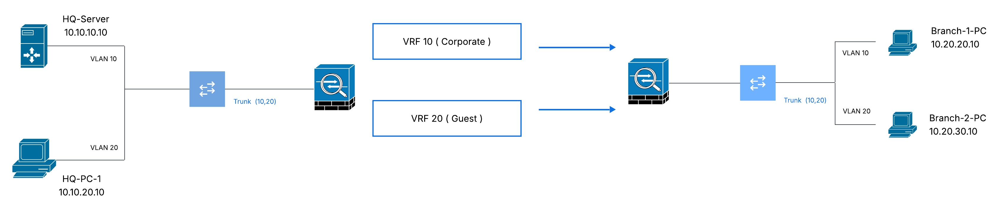

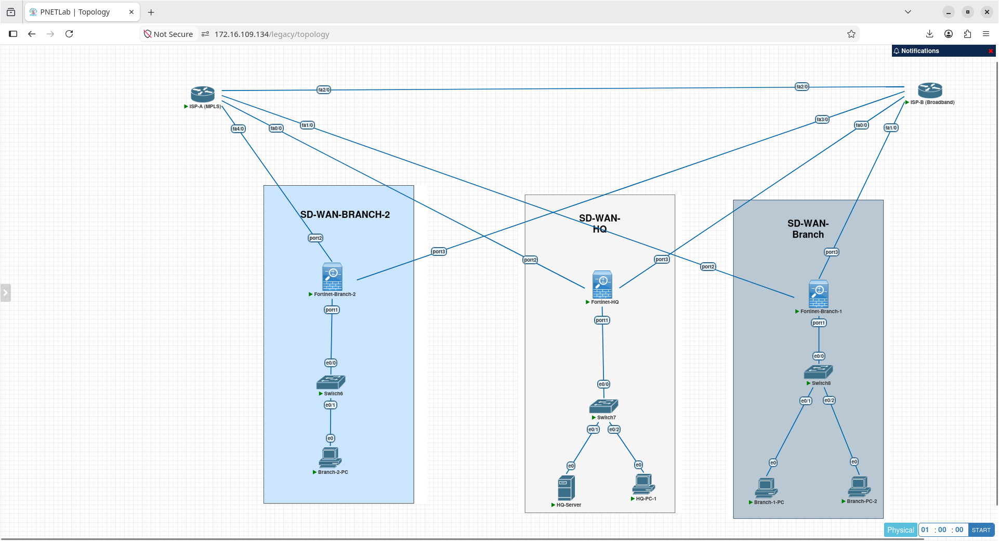

### VRF, Addressing & Route Target Matrix
| Segment Name | VRF ID | Local Interface | Subnet Addressing | Route Distinguisher (RD) | Export / Import RT |
| :--- | :--- | :--- | :--- | :--- | :--- |
| **Transport (PE)** | VRF 0 | port2, port3, MPLS-VPN, BB-VPN | 10.0.1.0/30, 10.0.2.0/30, 10.255.x.x | None (Underlay Core) | None |
| **Corporate LAN** | VRF 10 | port1 | HQ: 10.10.10.0/24<br>Branch-1: 10.20.20.0/24 | HQ: 65000:10<br>Branch-1: 65000:11 | 65000:10 |
| **Guest / IoT** | VRF 20 | port1.20 (VLAN 20) | HQ: 10.10.20.0/24<br>Branch-1: 10.20.30.0/24 | HQ: 65000:20<br>Branch-1: 65000:21 | 65000:20 |

---

## Configuration & Architecture 

### 1. Data Plane Tunnel Encapsulation (`vpn-id-ipip`)
Both Phase 1 IPsec interfaces (`MPLS-VPN` and `BB-VPN`) are configured with `set encapsulation vpn-id-ipip` on HQ and Branch 1. This tells the network processor to embed the VRF tag into the inner IP-in-IP header before encrypting the frame with ESP:

```fortios
config vpn ipsec phase1-interface
    edit "MPLS-VPN"
        set encapsulation vpn-id-ipip
    next
    edit "BB-VPN"
        set encapsulation vpn-id-ipip
    next
end
```
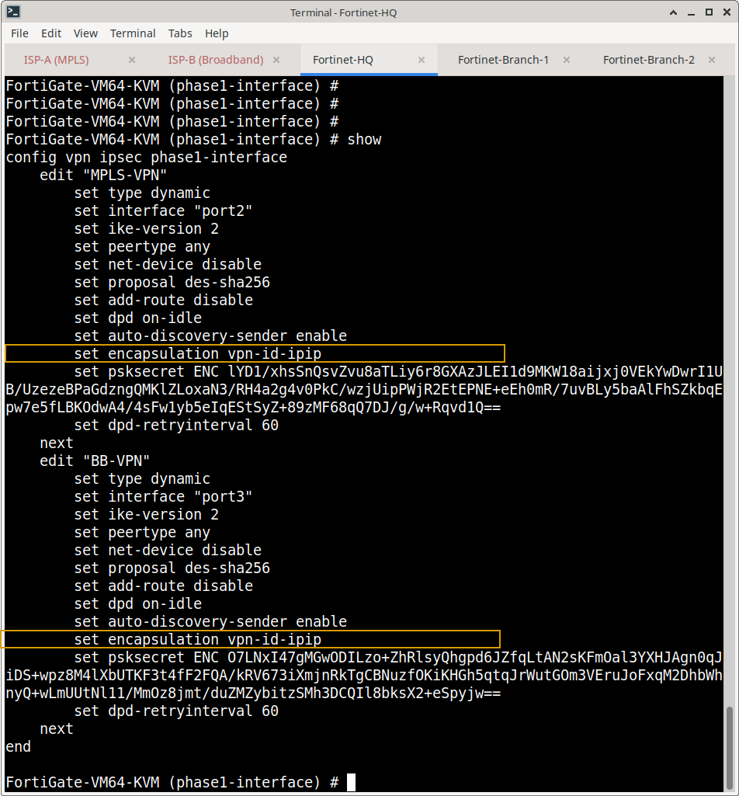

### 2. Segmented LAN Interfaces & Sub-Interfaces
On each FortiGate, the physical `port1` interface is mapped to Corporate (VRF 10), while an 802.1Q sub-interface (`port1.20`) is mapped to Guest (VRF 20):

```fortios
config system interface
     edit "port1.20"
        set vdom "root"
        set vrf 20
        set ip 10.10.20.1 255.255.255.0
        set allowaccess ping
        set src-check  disable
        set device-identification enable
        set role lan
        set snmp-index 11
        set interface "port1"
        set vlanid 20
    next
    edit  "port1-vrf"
        set vdom "root"
        set vrf 10
        set ip 10.10.10.1 255.255.255.0
        set allowaccess ping
         set src-check disable
        set device-identification enable
        set role lan
        set snmp-index 12
        set interface  "port1"
        set vlanid 10
    next
end
```
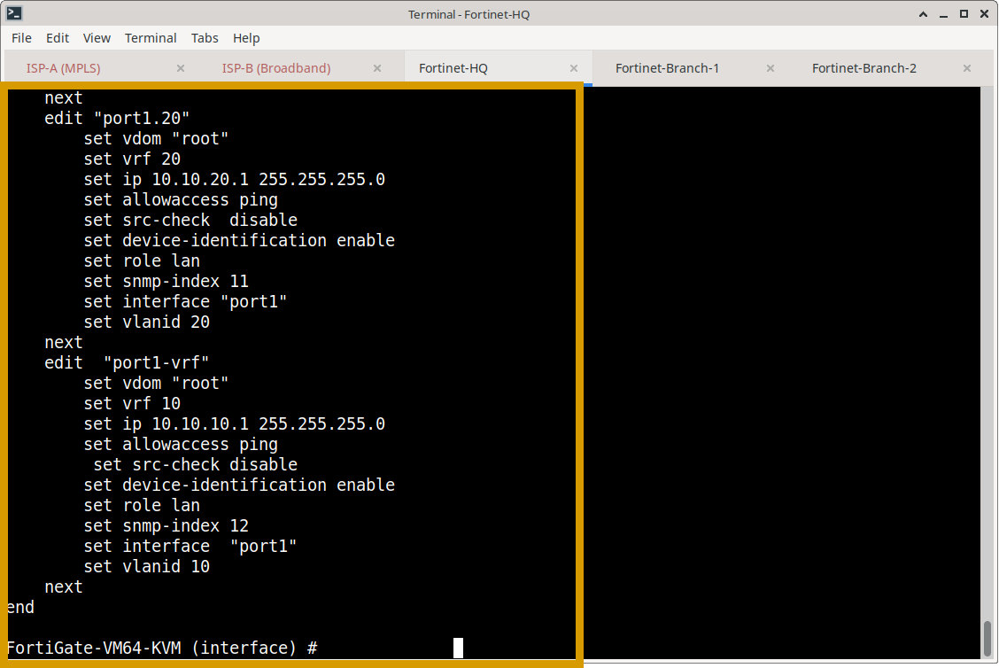

### 3. MP-BGP VPNv4 & Route Reflector Setup
To establish the translation boundary between Customer Edge (CE) VRFs and the Provider Edge (PE) transport:
1. VRF 0 is designated with `set role pe` [1.1.4].
2. Customer VRFs (10 and 20) are assigned `set role ce`, configured with unique Route Distinguishers (RDs) and shared Route Targets (RTs).
3. The Route Reflector on HQ is enabled for VPNv4 reflection across the neighbor groups.

#### Fortinet-HQ Configuration:
```fortios
config router bgp
    config vrf
        edit "10"
            set role ce
            set rd "65000:10"
            set export-rt "65000:10"
            set import-rt "65000:10"
        next
        edit "20"
            set role ce
            set rd "65000:20"
            set export-rt "65000:20"
            set import-rt "65000:20"
        next
        edit "0"
            set role pe
        next
    end
    config neighbor-group
        edit "MPLS-SPOKES"
            set route-reflector-client-vpnv4 enable
            set soft-reconfiguration-vpnv4 enable
        next
        edit "BB-SPOKES"
            set route-reflector-client-vpnv4 enable
            set soft-reconfiguration-vpnv4 enable
        next
    end
    config network
        edit 1
            set prefix 10.10.10.0 255.255.255.0
        next
        edit 2
            set prefix 10.10.20.0 255.255.255.0
        next
    end
end
```
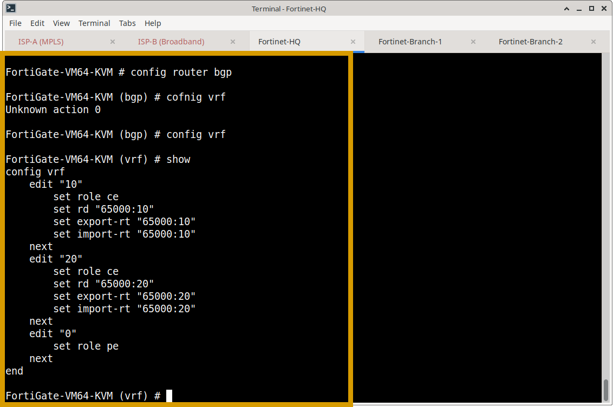

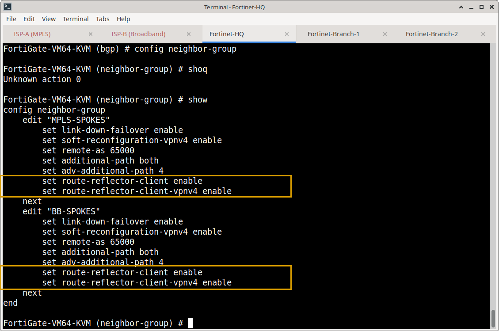

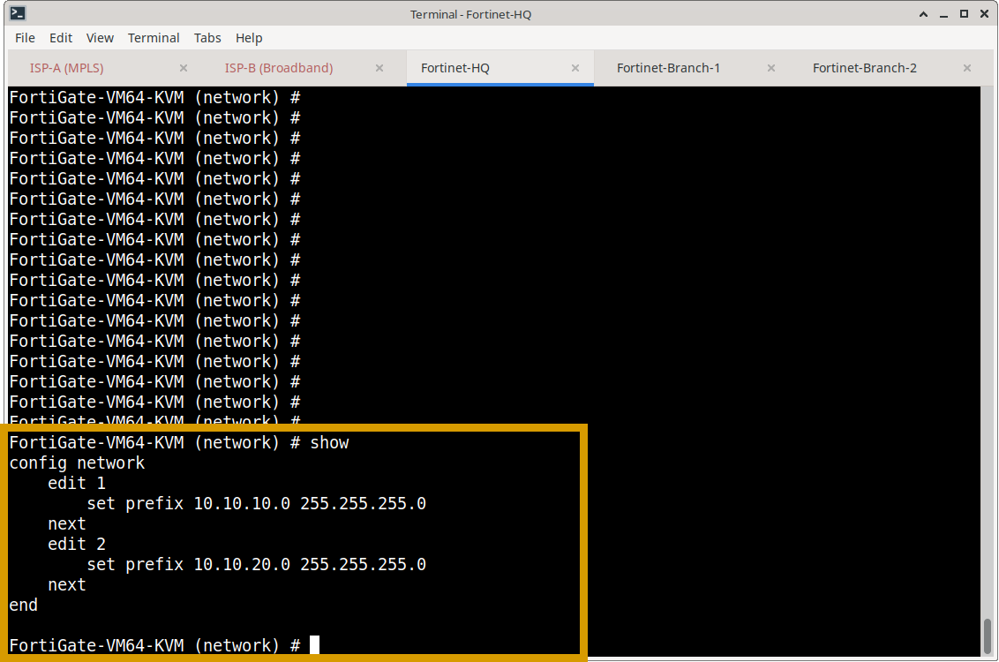

#### Fortinet-Branch-1 Configuration:
```fortios
config router bgp
    config vrf
        edit "10"
            set role ce
            set rd "65000:11"
            set export-rt "65000:10"
            set import-rt "65000:10"
        next
        edit "20"
            set role ce
            set rd "65000:21"
            set export-rt "65000:20"
            set import-rt "65000:20"
        next
        edit "0"
            set role pe
        next
    end
    config network
        edit 1
            set prefix 10.20.20.0 255.255.255.0
        next
        edit 2
            set prefix 10.20.30.0 255.255.255.0
        next
    end
end
```
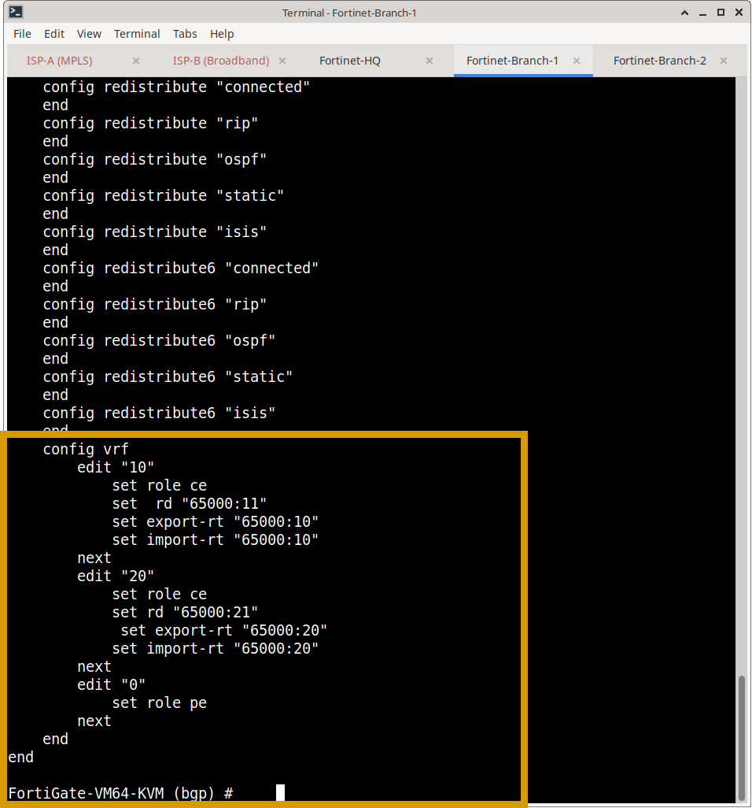

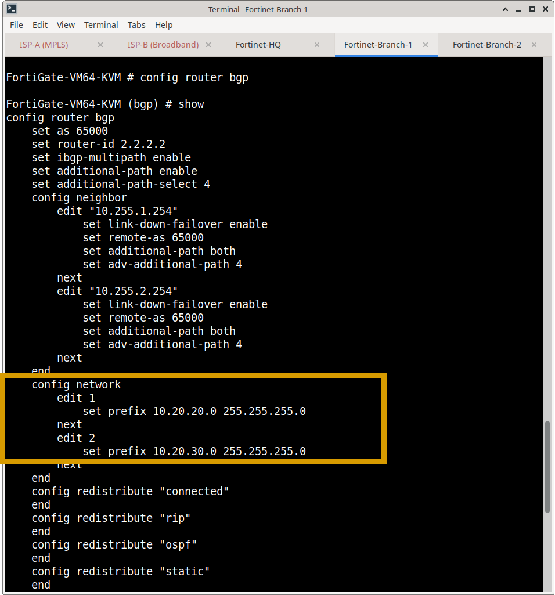

### 4. VRF-Enforced Firewall Security Policies
Security policies enforce boundary isolation by evaluating traffic between the `VPN-ZONE` and the respective VRF-bound LAN interfaces:

```fortios
config firewall policy
    edit 20
        set name "Corp-VRF10-In"
        set srcintf "BB-VPN" "MPLS-VPN"
        set dstintf "port1"
        set srcaddr "all"
        set dstaddr "all"
        set action accept
        set schedule "always"
        set service "ALL"
    next
    edit 21
        set name "Corp-VRF10-Out"
        set srcintf "port1"
        set dstintf "BB-VPN" "MPLS-VPN"
        set srcaddr "all"
        set dstaddr "all"
        set action accept
        set schedule "always"
        set service "ALL"
    next
    edit 22
        set name "Guest-VRF20-In"
        set srcintf "BB-VPN" "MPLS-VPN"
        set dstintf "port1.20"
        set srcaddr "all"
        set dstaddr "all"
        set action accept
        set schedule "always"
        set service "ALL"
    next
    edit 23
        set name "Guest-VRF20-Out"
        set srcintf "port1.20"
        set dstintf "BB-VPN" "MPLS-VPN""
        set srcaddr "all"
        set dstaddr "all"
        set action accept
        set schedule "always"
        set service "ALL"
    next
end
```
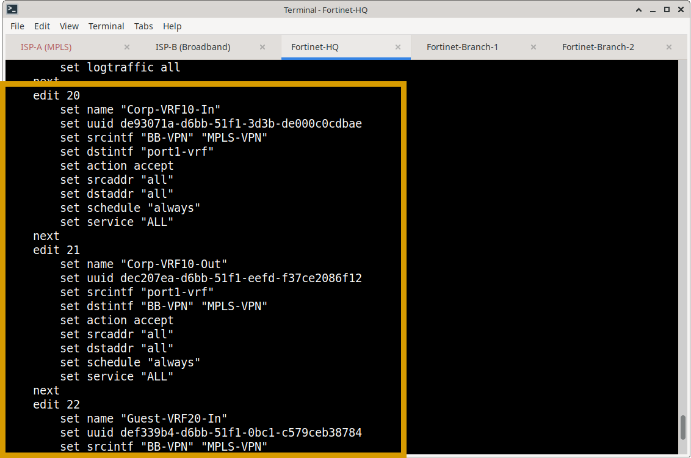

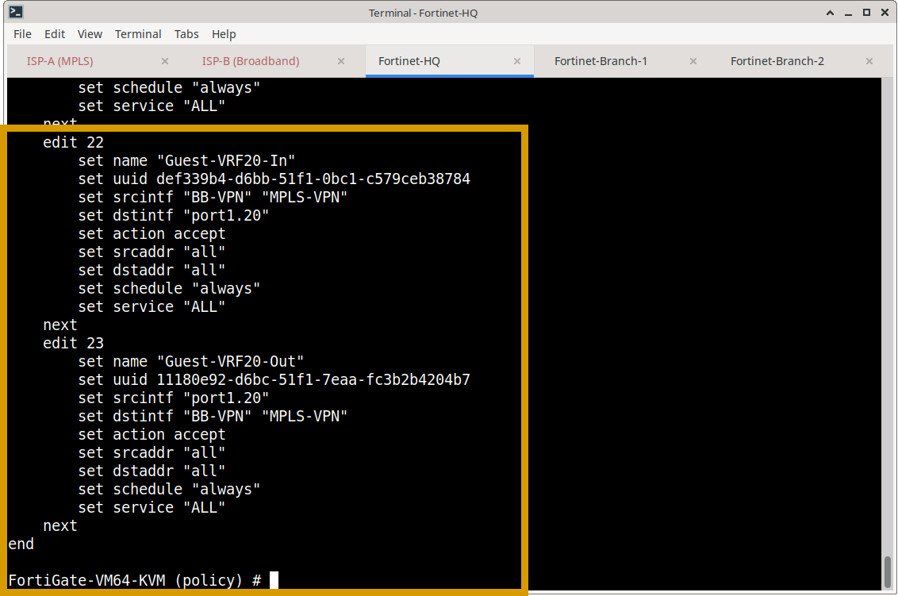

---

## Verification & Execution Lifecycle

### Phase 1: Segregated Routing Table Telemetry
Inspecting the routing tables proves that each VRF maintains an independent Routing Information Base (RIB) with BGP VPNv4 (`B V`) routes recursing through the overlay tunnels in VRF 0:

#### HQ Routing Tables:
```text
FortiGate-VM64-KVM # get router info routing-table all vrf 10
Routing table for VRF=10
C       10.10.10.0/24 is directly connected, port1
B V     10.20.20.0/24 [200/0] via 10.255.1.2 (recursive is directly connected, MPLS-VPN), [1/0]
                              via 10.255.2.2 (recursive is directly connected, BB-VPN), [1/0]

FortiGate-VM64-KVM # get router info routing-table all vrf 20
Routing table for VRF=20
C       10.10.20.0/24 is directly connected, port1.20
B V     10.20.30.0/24 [200/0] via 10.255.1.2 (recursive is directly connected, MPLS-VPN), [1/0]
                              via 10.255.2.2 (recursive is directly connected, BB-VPN), [1/0]
```

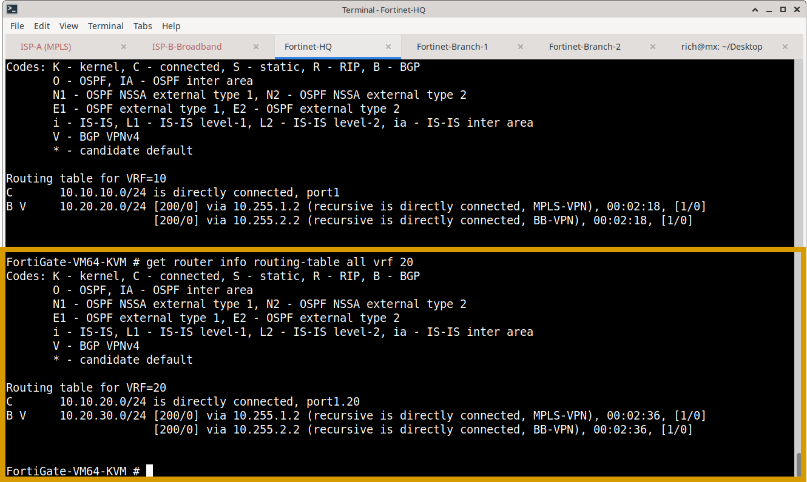

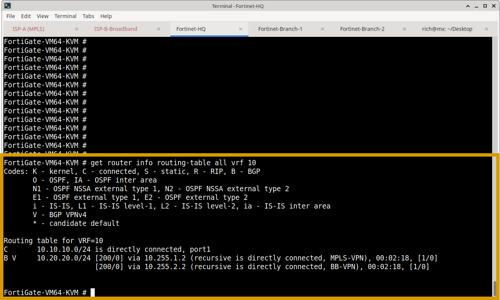

#### Branch-1 Routing Tables:
```text
FortiGate-VM64-KVM # get router info routing-table all vrf 10
Routing table for VRF=10
B V     10.10.10.0/24 [200/0] via 10.255.1.254 (recursive via MPLS-VPN tunnel 10.0.1.2 vrf 0), [1/0]
                              via 10.255.2.254 (recursive via BB-VPN tunnel 10.0.2.2 vrf 0), [1/0]
C       10.20.20.0/24 is directly connected, port1

FortiGate-VM64-KVM # get router info routing-table all vrf 20
Routing table for VRF=20
B V     10.10.20.0/24 [200/0] via 10.255.1.254 (recursive via MPLS-VPN tunnel 10.0.1.2 vrf 0), [1/0]
                              via 10.255.2.254 (recursive via BB-VPN tunnel 10.0.2.2 vrf 0), [1/0]
C       10.20.30.0/24 is directly connected, port1.20
```
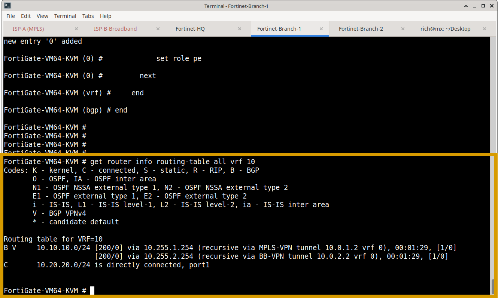

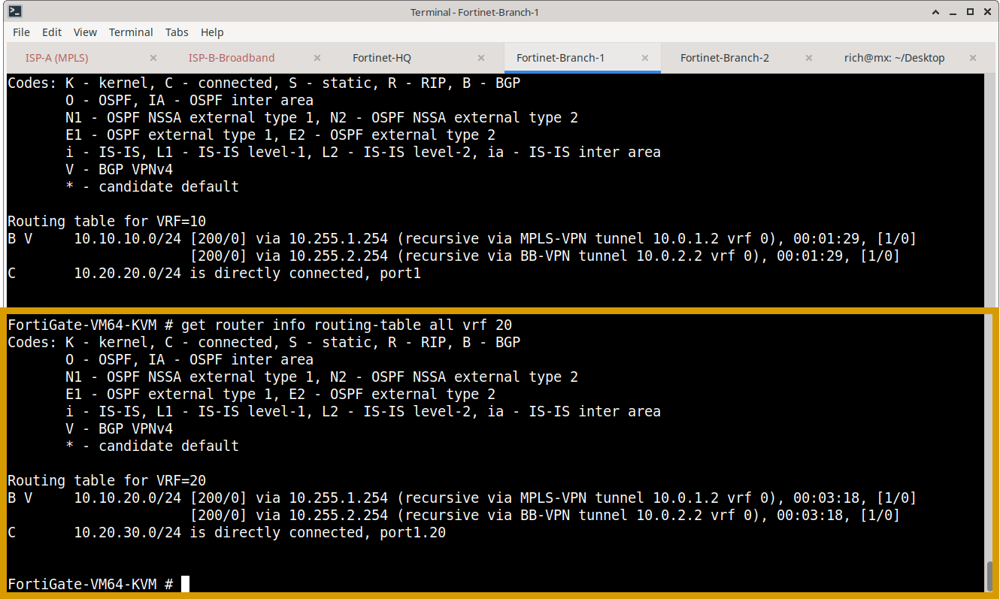

---

Here is the corrected section updated to match your exact terminal commands, prefix ordering, flags, and spacing word-for-word from your screenshots:

---

### MP-BGP VPNv4 Table & Route Distinguisher Verification
Checking the VPNv4 RIB on Fortinet-HQ confirms that prefixes are kept strictly separate using Route Distinguishers (RDs):

```text
FortiGate-VM64-KVM # get router info bgp vpnv4 vrf 10
   Network          Next Hop            Metric LocPrf Weight Path
Route Distinguisher: 65000:10 (Default for VRF 10)
*> 10.10.10.0/24    0.0.0.0                        100  32768 0 i <-/1>
*>i10.20.20.0/24    10.255.2.2               0     100      0 0 i <-/2>
*>i10.20.20.0/24    10.255.1.2               0     100      0 0 i <-/1>

FortiGate-VM64-KVM # get router info bgp vpnv4 vrf 20
   Network          Next Hop            Metric LocPrf Weight Path
Route Distinguisher: 65000:20 (Default for VRF 20)
*> 10.10.20.0/24    0.0.0.0                        100  32768 0 i <-/1>
*>i10.20.30.0/24    10.255.2.2               0     100      0 0 i <-/2>
*>i10.20.30.0/24    10.255.1.2               0     100      0 0 i <-/1>
```

* **Route Distinguisher 65000:10 (Corporate):** HQ originates its local corporate subnet `10.10.10.0/24` locally (`0.0.0.0`, Weight 32768) and learns Branch 1's corporate subnet `10.20.20.0/24` with multipath over both `10.255.1.2` (MPLS) and `10.255.2.2` (Broadband).
* **Route Distinguisher 65000:20 (Guest / IoT):** HQ originates its local guest subnet `10.10.20.0/24` locally (`0.0.0.0`, Weight 32768) and learns Branch 1's guest subnet `10.20.30.0/24` with multipath over both `10.255.1.2` and `10.255.2.2`.
* **Zero Route Leakage:** The guest subnets do not appear under RD 65000:10, and corporate subnets do not appear under RD 65000:20, proving hardware/control-plane tenant isolation across the shared overlay.

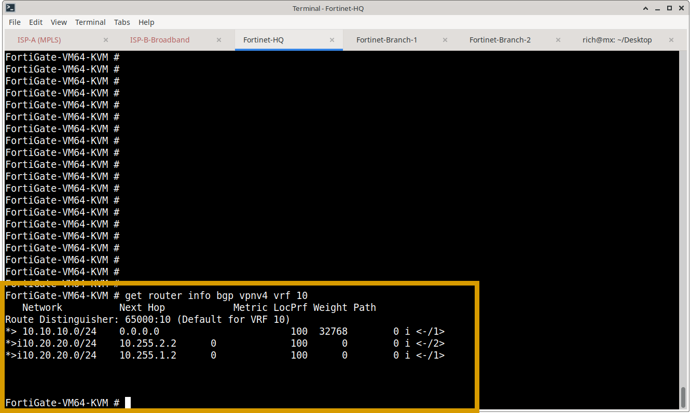

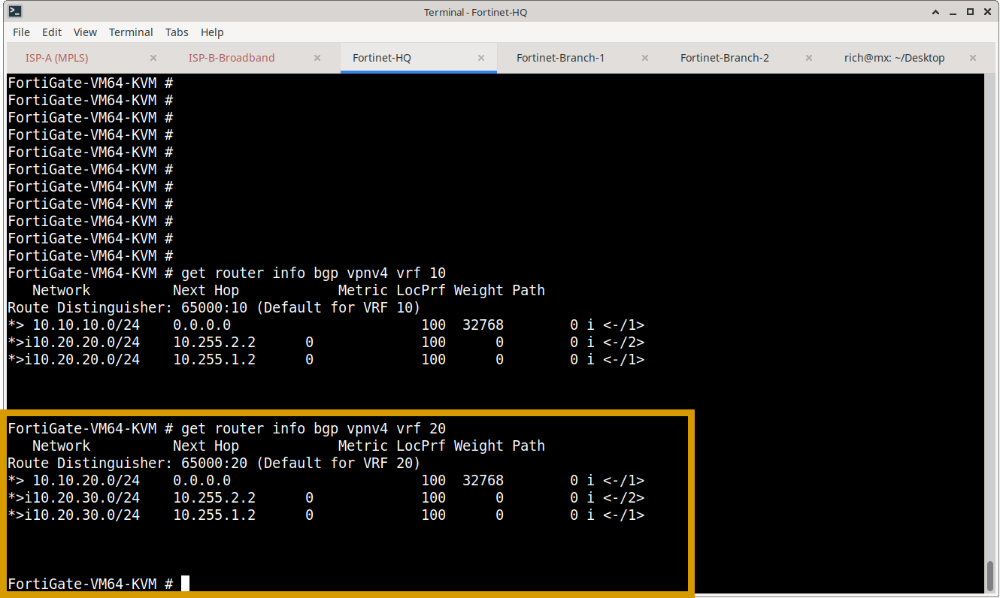

---

### Spoke (Branch 1) 802.1Q VLAN Sub-Interface & MP-BGP VPNv4 Verification

To maintain complete tenant segregation from the local LAN switch down to the WAN overlay, **Fortinet-Branch-1** was configured with 802.1Q VLAN tagging on LAN interface port1, mapping each VLAN into its dedicated Customer Edge VRF:
* **port1 (VLAN 10):** Corporate LAN (10.20.20.1/24) in **VRF 10**.
* **port1.20 (VLAN 20):** Guest / IoT LAN (10.20.30.1/24) in **VRF 20**.

```text
FortiGate-VM64-KVM (interface) # show
...
    edit "port1.20"
        set vdom "root"
        set vrf 20
        set ip 10.20.30.1 255.255.255.0
        set allowaccess ping
        set device-identification enable
        set role lan
        set snmp-index 11
        set interface "port1"
        set vlanid 20
    next
end
```
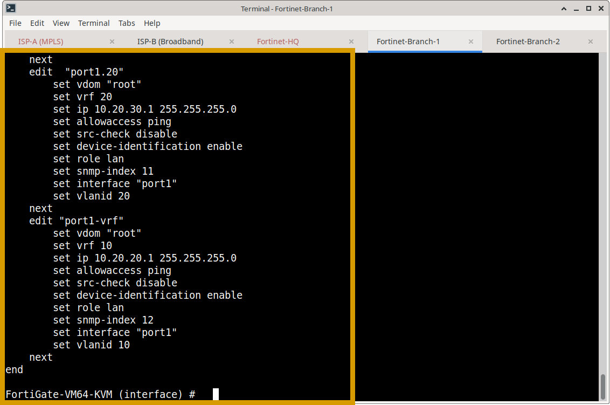

---

#### Branch 1 BGP VPNv4 Table for Corporate (VRF 10)
Querying the BGP VPNv4 routing table for VRF 10 confirms that Branch 1 binds Corporate routes exclusively to **Route Distinguisher 65000:11**:

```text
FortiGate-VM64-KVM # get router info bgp vpnv4 vrf 10
Network          Next Hop          Metric LocPrf Weight Path
Route Distinguisher: 65000:11 (Default for VRF 10)
*>i10.10.10.0/24  10.255.2.254           0    100      0 i <-/2>
*>i10.10.10.0/24  10.255.1.254           0    100      0 i <-/1>
*> 10.20.20.0/24  0.0.0.0                     100  32768 i <-/1>
```

* **Local Route Origination:** Local Corporate subnet 10.20.20.0/24 is originated locally with next-hop 0.0.0.0 and administrative weight 32768.
* **Dual-Path Redundancy:** HQ Corporate subnet 10.10.10.0/24 is learned via both MPLS (10.255.1.254) and Broadband (10.255.2.254) with equal local preference (LocPrf 100), feeding FortiOS SD-WAN with dual candidate overlay paths.
* **Zero Leakage:** Neither 10.10.20.0/24 nor 10.20.30.0/24 (Guest subnets) exist in this table.

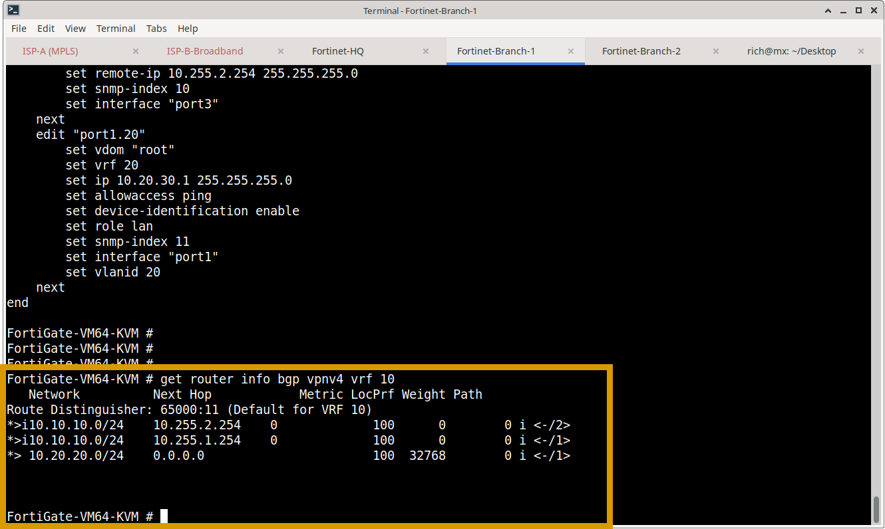

---

#### Branch 1 BGP VPNv4 Table for Guest / IoT (VRF 20)
Querying the BGP VPNv4 routing table for VRF 20 confirms that Branch 1 binds Guest routes exclusively to **Route Distinguisher 65000:21**:

```text
FortiGate-VM64-KVM # get router info bgp vpnv4 vrf 20
Network          Next Hop          Metric LocPrf Weight Path
Route Distinguisher: 65000:21 (Default for VRF 20)
*>i10.10.20.0/24  10.255.2.254           0    100      0 i <-/2>
*>i10.10.20.0/24  10.255.1.254           0    100      0 i <-/1>
*> 10.20.30.0/24  0.0.0.0                     100  32768 i <-/1>
```

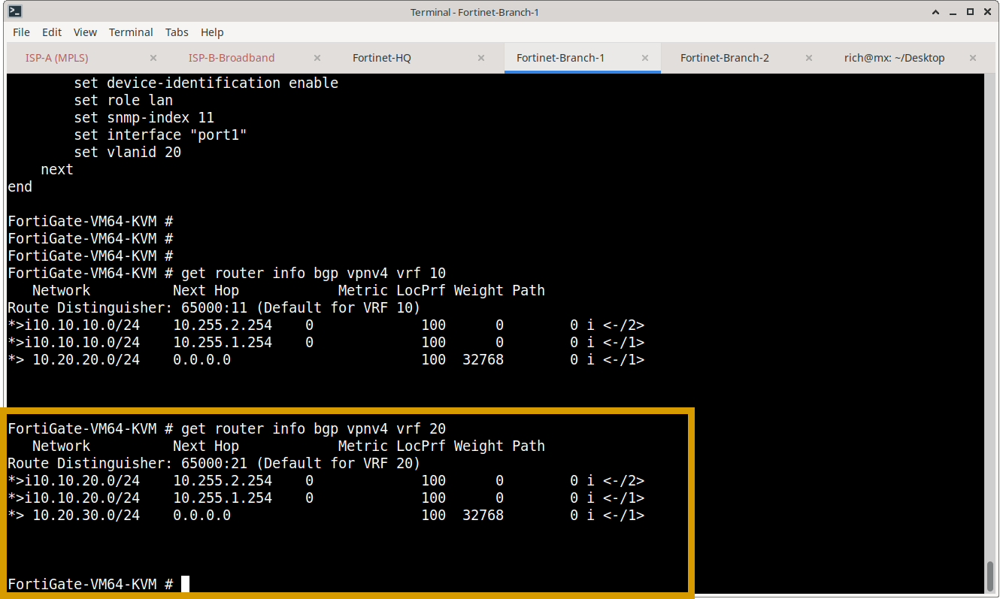

* **Local Route Origination:** Local Guest subnet 10.20.30.0/24 is originated with next-hop 0.0.0.0 and tagged under RD 65000:21.
* **Dual-Path Redundancy:** HQ Guest subnet 10.10.20.0/24 is learned via both MPLS (10.255.1.254) and Broadband (10.255.2.254) over the shared overlay.
* **Strict Tenant Boundary:** Corporate prefixes (10.10.10.0/24 and 10.20.20.0/24) are completely absent from VRF 20, proving that route target import filters prevent cross-tenant route contamination at the control plane.

---

### Phase 3: Data Plane Isolation & Cross-VRF Traffic Drops

1. **Intra-VRF Corporate Traffic (VRF 10 ➔ VRF 10):**
   * Initiated from `HQ-Server` (`10.10.10.10`) targeting `Branch-1-PC` (`10.20.20.10`):
   ```bash
   localhost:~# ping 10.20.20.10 -c 6
   PING 10.20.20.10 (10.20.20.10): 56 data bytes
   64 bytes from 10.20.20.10: seq=0 ttl=62 time=23.213 ms
   64 bytes from 10.20.20.10: seq=1 ttl=62 time=17.166 ms
   64 bytes from 10.20.20.10: seq=2 ttl=62 time=19.517 ms
   64 bytes from 10.20.20.10: seq=3 ttl=62 time=20.988 ms
   64 bytes from 10.20.20.10: seq=4 ttl=62 time=16.566 ms
   64 bytes from 10.20.20.10: seq=5 ttl=62 time=18.934 ms

   --- 10.20.20.10 ping statistics ---
   6 packets transmitted, 6 packets received, 0% packet loss
   round-trip min/avg/max = 16.566/19.397/23.213 ms
   ```
   * **Result:** **0% packet loss**. Corporate traffic flows across the overlay.

**Branch-PC-1 IP**

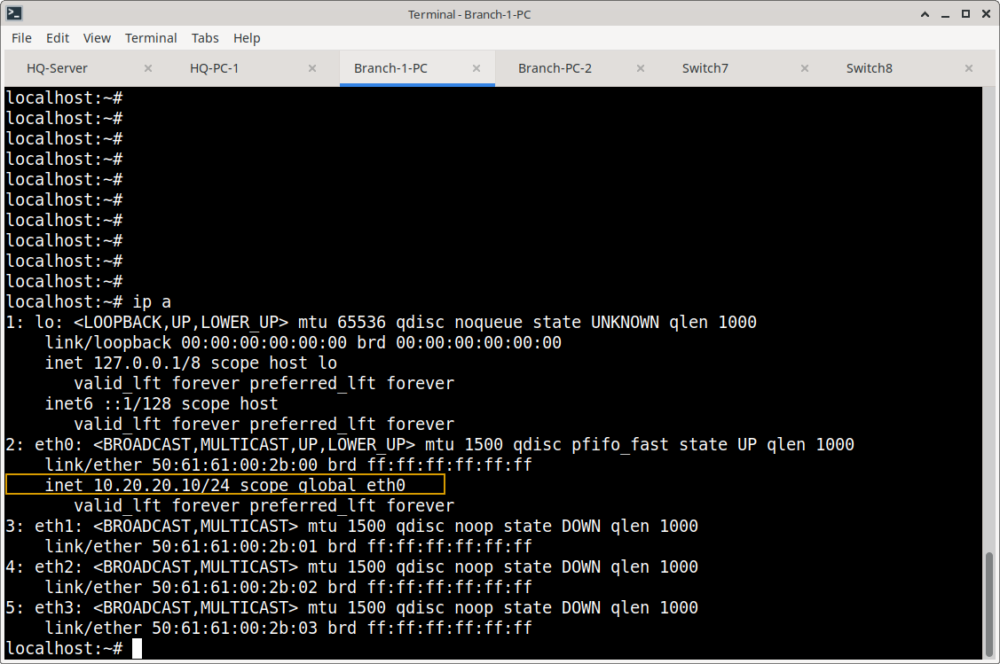

**Successfull Ping: Source (HQ-Server) - Destination (Branch-1-PC)**

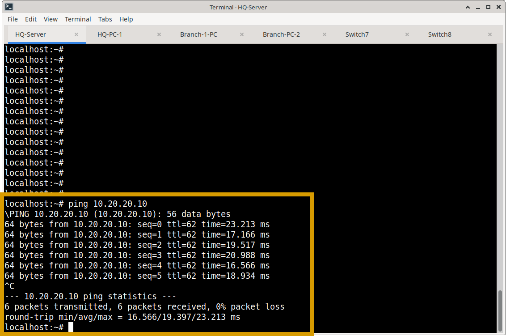


2. **Cross-VRF Boundary Isolation (VRF 10 ➔ VRF 20):**
   * Initiated from `HQ-Server` (`10.10.10.10` in Corporate VRF 10) targeting `Branch-PC-2` (`10.20.30.10` in Guest VRF 20):
   ```bash
   localhost:~# ping 10.20.30.10 -c 17
   PING 10.20.30.10 (10.20.30.10): 56 data bytes

   --- 10.20.30.10 ping statistics ---
   17 packets transmitted, 0 packets received, 100% packet loss
   ```
   * **Result:** **100% packet drop**. The packet cannot be routed or leaked into VRF 20, confirming segmentation over the shared overlay [1.1.3].

**Branch-PC-2- IP**

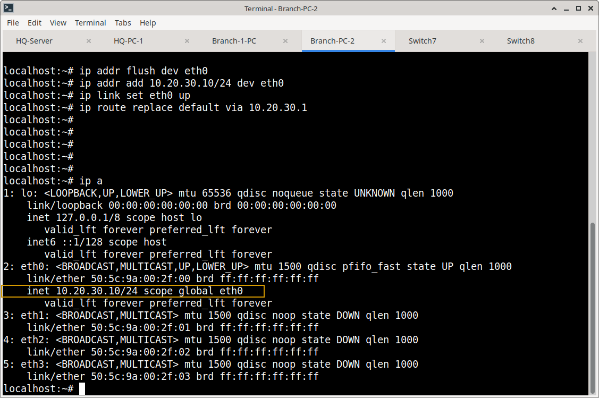

**Failed Ping: Source (HQ-Server) - Destination (Branch-PC-2)**

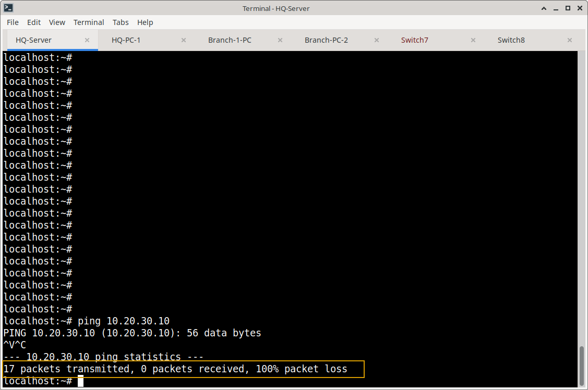

---

## Business Value Delivered
* **Elimination of Tunnel Sprawl:** Reduces overall VPN tunnel configurations by up to 66% by multiplexing Corporate, Guest, and PCI traffic across a single pair of resilient ADVPN underlays.
* **Regulatory & Compliance Assurance:** Meets strict PCI-DSS, HIPAA, and SOC 2 requirements by enforcing tenant isolation at both the routing and firewall policy layers.
* **Simplified WAN Operations:** Provisioning a new segment across 50+ branches requires adding an 802.1Q sub-interface and Route Target entry, without building, monitoring, or troubleshooting new Phase 1 tunnels.

---

### What's Next?

With strict multi-tenant segmentation fully validated over a single overlay, the next step is to optimize outbound internet traffic by allowing trusted SaaS applications to break out locally at the branch, rather than backhauling everything to the HQ.

Continue to the next project to explore intelligent internet breakout:
- **[Project 10: Local Direct Internet Access (DIA) with ISDB Steering](../10-dia-saas-fqdn-steering/)** – Utilizing Fortinet's Internet Service Database (ISDB) and FQDN objects to dynamically steer trusted cloud traffic directly out the local broadband link while securely backhauling corporate traffic.

---

[⬅️ Back to Fortinet SD-WAN Overview](../README.md)
