# Local Direct Internet Access (DIA) vs. Centralized Corporate Backhaul with FQDN Steering

## Executive Summary
In distributed enterprise architectures, backhauling all branch web and cloud traffic across private WAN circuits to the corporate datacenter creates significant ineffecient routing. This saturates expensive private MPLS links, exhausts datacenter firewall inspection capacity, and adds 30–50 ms of unnecessary latency to cloud applications.

This project implements **Direct Internet Access (DIA) with Granular Application & FQDN Steering**:

1. **Split-Tunnel Architecture:** Fortinet-Branch-1 evaluates egress traffic at the network edge. Trusted cloud applications and public web endpoints break out locally over commodity Broadband (**port3**) with Source NAT enabled.
2. **Centralized Corporate Backhaul:** Internal enterprise traffic and untrusted/default web flows are steered into the encrypted `MPLS-VPN` overlay tunnel (**port2**) back to Fortinet-HQ for centralized corporate routing and firewall inspection.
3. **Application & FQDN Object Resolution:** Dynamic FQDN address objects for **Cloudflare (`one.one.one.one`)** and **Networking Notebook (networkingnotebook.com)**, alongside public DNS IP objects (`1.1.1.1` and `8.8.8.8`), are evaluated dynamically by the FortiOS DNS proxy and compiled into kernel policy routing (`proute`) tables [1.1.4].
4. **Wire-Level & Real-World Validation:** Live Firefox browser sessions verified direct public internet breakout across a residential ISP gateway (Actual SOHO Verizon FiOS uplink) to live web servers. Simultaneous Wireshark captures proved 100% of DIA traffic egressed **port3** while remaining 0% on **port2**, and disabling the DIA rule proved deterministic fallback to the corporate MPLS path.

**Live Execution: DIA Breakout CLI Test**

https://github.com/user-attachments/assets/a7833b78-a377-4b01-86fd-4d62a1431bbc

**Live Execution: DIA Breakout GUI Test**

https://github.com/user-attachments/assets/9f5ce18c-8dbf-4c62-8d88-b10ad80fea11

---

## Lab Architecture & Split-Tunnel Topology

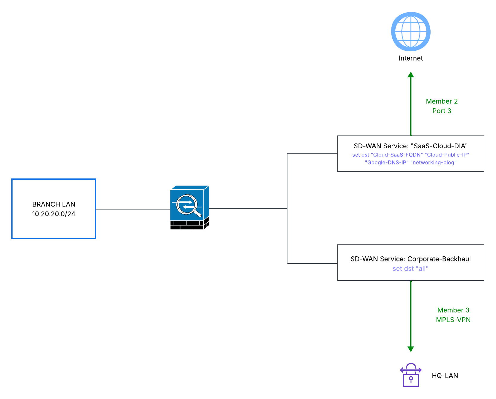

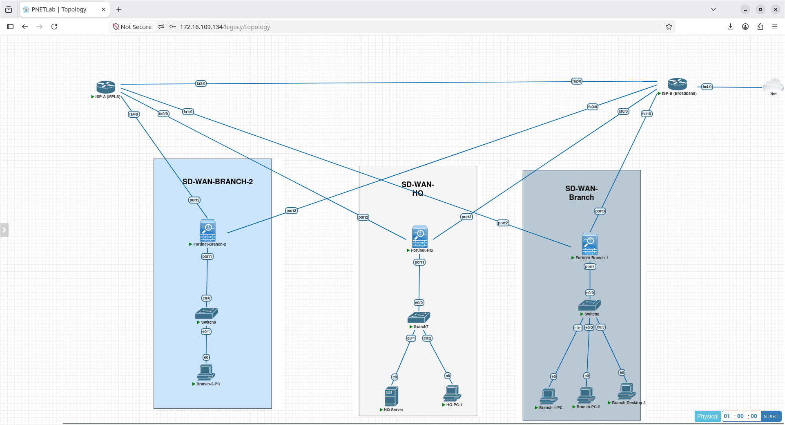

### Addressing, Routing & Transport Policy Matrix
| Policy Name | Target Destinations | Traffic Classification | Egress Interface | Transport Circuit | NAT Mode |
| :--- | :--- | :--- | :--- | :--- | :--- |
| **SaaS-Cloud-DIA** | `one.one.one.one`<br>`networkingnotebook.com`<br>`1.1.1.1/32`, `8.8.8.8/32` | Trusted Cloud / Web DIA | port3 | ISP-B Broadband Core ➔ Real Internet | Enabled (SNAT to 10.0.2.6) |
| **Corporate-Backhaul** | `0.0.0.0/0` (Default / Untrusted) | Centralized Inspection Backhaul | MPLS-VPN (Member 3) | Private IPsec Overlay to HQ | Disabled (Original IP Preserved) |
| **HQ-TRAFFIC** | `10.10.10.0/24` | Internal Corporate LAN | MPLS-VPN / BB-VPN | Dual Underlay Overlay Tunnels | Disabled |

---

## Configuration & Architecture Design

### 1. Cloud SaaS & Custom Domain FQDN Objects
Address objects define the cloud destinations. Setting `cache-ttl 30` ensures FortiOS continuously queries the local DNS proxy to refresh any changing IP addresses associated with dynamic CDNs:

```fortios
config firewall address
    edit "Cloud-SaaS-FQDN"
        set type fqdn
        set fqdn "one.one.one.one"
        set cache-ttl 30
    next
    edit "networking-blog"
        set type fqdn
        set fqdn "networkingnotebook.com"
        set cache-ttl 30
    next
    edit "Cloud-Public-IP"
        set subnet 1.1.1.1 255.255.255.255
    next
    edit "Google-DNS-IP"
        set subnet 8.8.8.8 255.255.255.255
    next
end
```
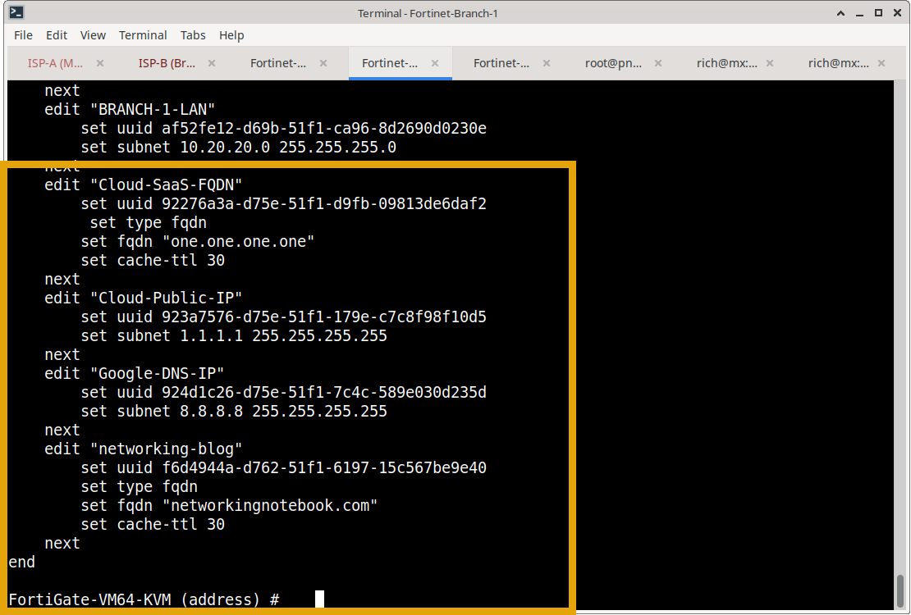

### 2. SD-WAN Service Rules (Split-Tunnel Steering)
Service Rule 5 prioritizes local breakout via Member 2 (`port3` Broadband DIA) for all trusted SaaS and blog destinations. Rule 4 catches all remaining traffic (`0.0.0.0/0`) and pins it to Member 3 (`MPLS-VPN`), backhauling it to the HQ datacenter:

```fortios
config system sdwan
    config service
        edit 5
            set name "SaaS-Cloud-DIA"
            set mode manual
            set dst "Cloud-SaaS-FQDN" "Cloud-Public-IP" "Google-DNS-IP" "networking-blog"
            set priority-members 2
        next
        edit 4
            set name "Corporate-Backhaul"
            set mode manual
            set dst "all"
            set priority-members 3
        next
    end
end
```
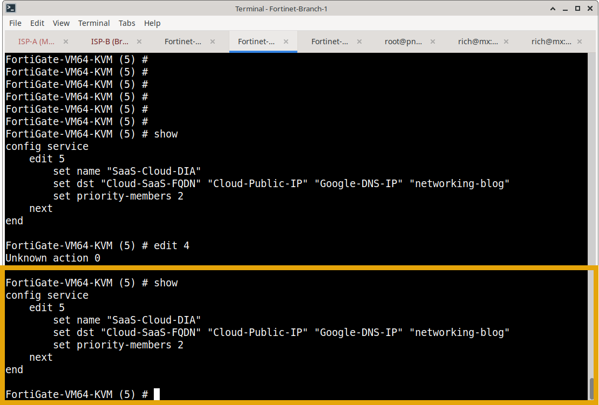

### 3. Edge Firewall Policies (DIA NAT vs. Overlay Cleartext)
* **Rule 30 (`SaaS-DIA-Local-Out`):** Permits local egress out physical `port3` with Source NAT enabled so real-world public servers can return traffic to the branch's underlay IP.
* **Rule 31 (`Corp-Backhaul-To-HQ`):** Permits corporate traffic into `VPN-ZONE` with NAT disabled, preserving internal client IP addressing for corporate auditing.

```fortios
config firewall policy
    edit 4
        set name "SaaS-DIA-Local-Out"
        set srcintf "port1"
        set dstintf "virtual-wan-link"
        set srcaddr "all"
        set dstaddr "all"
        set action accept
        set schedule "always"
        set service "ALL"
        set nat enable
    next
    edit 5
        set name "Corp-Backhaul-To-HQ"
        set srcintf "port1"
        set dstintf "VPN-ZONE"
        set srcaddr "all"
        set dstaddr "all"
        set action accept
        set schedule "always"
        set service "ALL"
        set nat disable
    next
end
```
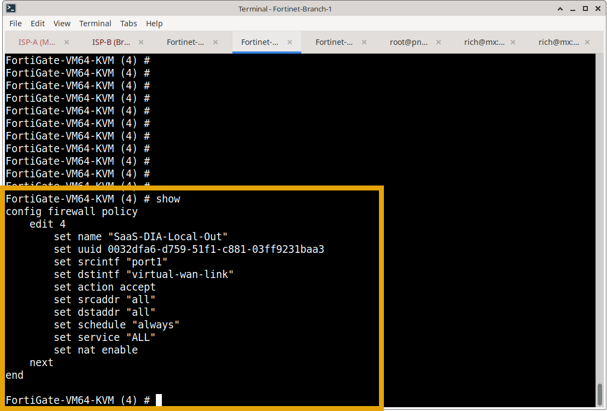

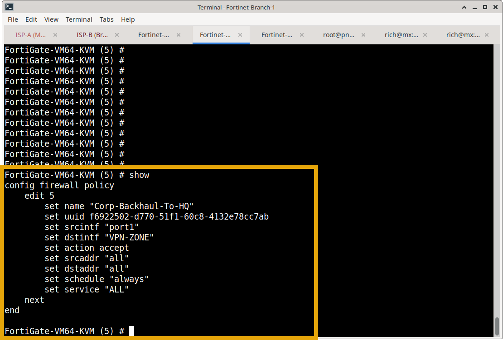

---

## Verification & Execution 

### DNS Proxy Resolution & Kernel Policy Route Compilation
Querying the FortiGate DNS proxy engine (`diagnose test application dnsproxy 6`) confirms that the FQDN daemon resolved both public services:
* `networkingnotebook.com` resolved to **63.250.43.138** and **63.250.43.139**.
* `one.one.one.one` resolved to **1.1.1.1** and **1.0.0.1**.

Checking the kernel policy routing table (`diagnose firewall proute list`) confirms that FortiOS dynamically compiled these IPs into active policy routes bound to outgoing interface **`port3`**:

```text
FortiGate-VM64-KVM # diagnose firewall proute list
list route policy info(vf=root):

id=2132017157(0x7f140005) vwl_service=5(SaaS-Cloud-DIA) vwl_mbr_seq=2 dscp_tag=0xfc 0xfc flags=0x0 tos=0x00 tos_mask=0x00 protocol=0 sport=0-65535 iif=0 dport=1-65535 path(1) oif=5(port3)
destination(2): 8.8.8.8-8.8.8.8 1.1.1.1-1.1.1.1
destination fqdn(2):
        networkingnotebook.com ID(108) ADDR(63.250.43.138) ADDR(63.250.43.139)
        one.one.one.one ID(206) ADDR(1.0.0.1) ADDR(1.1.1.1)
source wildcard(1): 0.0.0.0/0.0.0.0
hit_count=241 last_used=2026-11-03 01:08:42

id=2132017156(0x7f140004) vwl_service=4(Corporate-Backhaul) vwl_mbr_seq=3 dscp_tag=0xfc 0xfc flags=0x0 tos=0x00 tos_mask=0x00 protocol=0 sport=0-65535 iif=0 dport=1-65535 path(1) oif=14(MPLS-VPN)
destination(1): 0.0.0.0-255.255.255.255
source wildcard(1): 0.0.0.0/0.0.0.0
hit_count=15 last_used=2026-11-03 01:13:36
```
* DIA Rule 5 is locked to `oif=5(port3)` with 241 hits [1.1.4].
* Backhaul Rule 4 is locked to `oif=14(MPLS-VPN)` for all remaining traffic [1.1.4].

**diagnose firewall proute list**

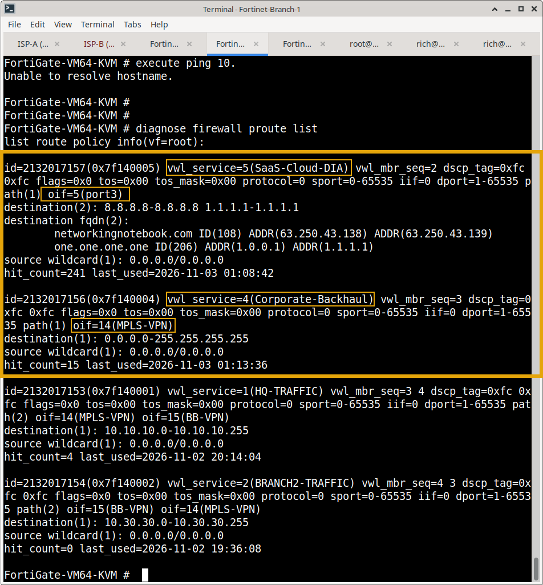

**diagnose test application dnsproxy 6**

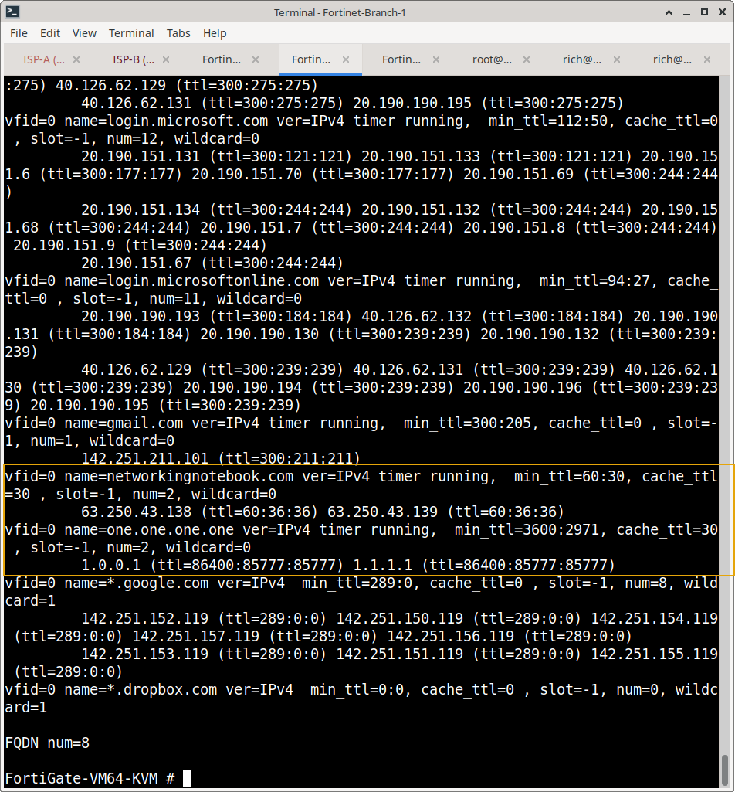

**diagnose sys sdwan service**

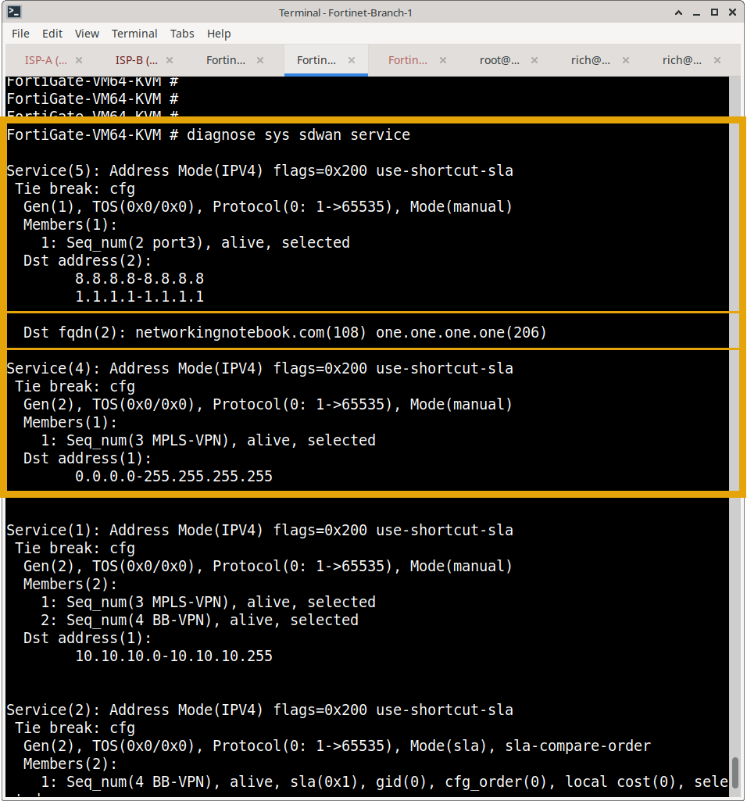

---

### Live Traceroute Verification (DIA vs. Corporate Backhaul)

#### Test A: Cloudflare SaaS Target (1.1.1.1 via Local DIA)
Executing an ICMP traceroute to `1.1.1.1` from `Branch-1-PC` proves that traffic exits directly out of the local Broadband connection onto the live Internet [1.2.4]:
```bash
localhost:~# traceroute -I 1.1.1.1
traceroute to 1.1.1.1 (1.1.1.1), 30 hops max, 46 byte packets
 1  10.20.20.1 (10.20.20.1)      1.158 ms   1.405 ms   0.781 ms
 2  10.0.2.5 (10.0.2.5)          5.964 ms   5.619 ms   8.459 ms    <-- Local ISP-B Broadband Gateway
 3  192.168.255.1 (192.168.255.1) 16.444 ms  23.248 ms  19.965 ms   <-- PNETLab Cloud NAT Uplink
 4  172.16.109.1 (172.16.109.1)   22.867 ms  22.811 ms  15.169 ms   <-- Lab Host Gateway
 5  192.168.1.1 (192.168.1.1)     22.789 ms  23.258 ms  16.640 ms   <-- Home Residential Gateway
 6  108.46.243.1 (108.46.243.1)   34.503 ms  34.018 ms  14.832 ms   <-- Public Carrier Router (Verizon FiOS)
 7  100.41.211.156 (100.41.211.156) 25.293 ms 18.492 ms 17.763 ms   <-- Public Internet Core
```
* **Proof:** Bypasses HQ completely; traffic breaks out locally onto the public internet at Hop 

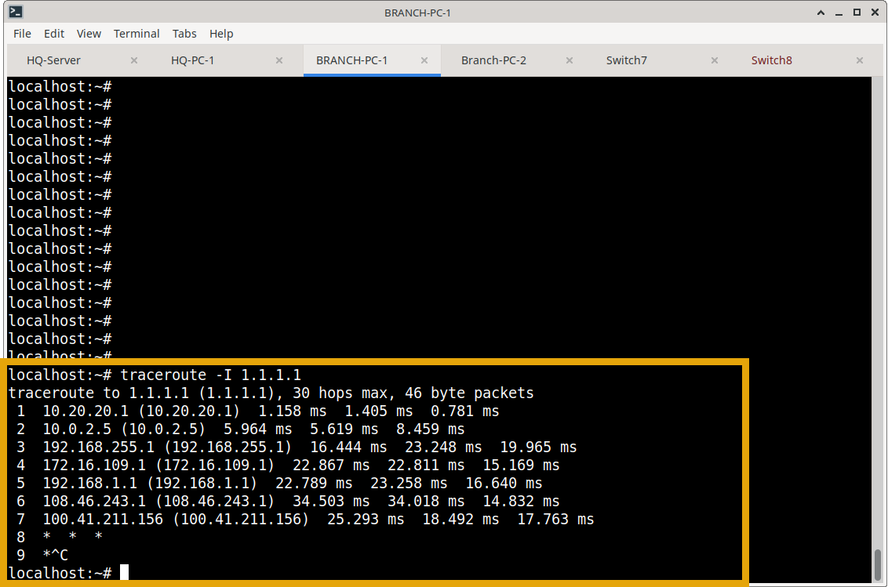

* **Live Wire Sniffer Telemetry on Fortinet-Branch-1:**
   Capturing live packets on the firewall confirms the exact data plane path: private client traffic on port1 is Source-NATed to 10.0.2.6 and routed directly out physical port3:
   ```text
   FortiGate-VM64-KVM # diagnose sniffer packet any 'host 1.1.1.1' 4 0 l
   Using Original Sniffing Mode
   interfaces=[any]
   filters=[host 1.1.1.1]
   2026-11-03 01:21:51.784225 port1 in 10.20.20.10 -> 1.1.1.1: icmp: echo request
   2026-11-03 01:21:51.784449 port3 out 10.0.2.6 -> 1.1.1.1: icmp: echo request   <-- Local DIA Egress with SNAT
   2026-11-03 01:21:51.816957 port3 in 1.1.1.1 -> 10.0.2.6: icmp: echo reply      <-- Direct Ingress from ISP-B
   2026-11-03 01:21:51.817266 port1 out 1.1.1.1 -> 10.20.20.10: icmp: echo reply
   ```
   * **Data Plane Validation:** Egress occurs solely through port3. Zero frames touch the private VPN tunnels or MPLS underlay.

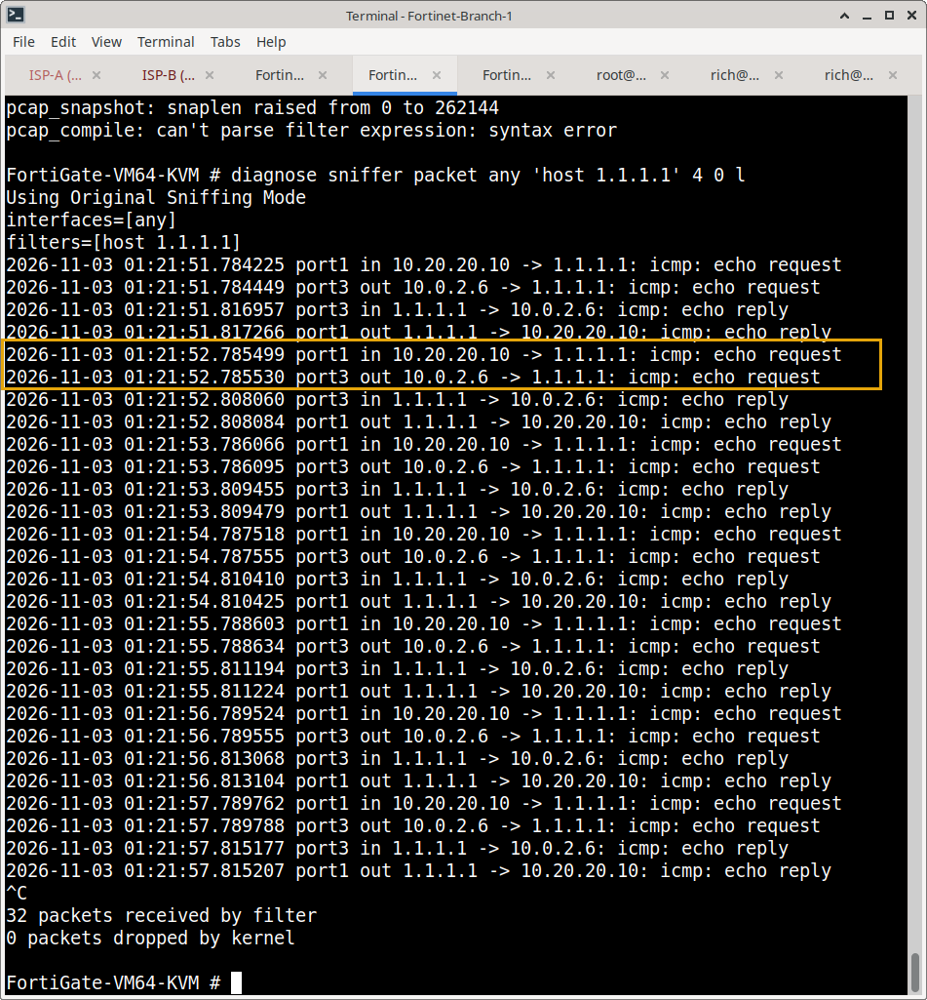

#### Test B: Corporate Target (10.10.10.10 via Overlay Backhaul)
Executing a traceroute to the internal HQ Server verifies that corporate traffic bypasses the DIA breakout and routes across the encrypted overlay [1.2.4]:
```bash
localhost:~# traceroute 10.10.10.10
traceroute to 10.10.10.10 (10.10.10.10), 30 hops max, 46 byte packets
 1  10.20.20.1 (10.20.20.1)       1.982 ms   1.876 ms   1.604 ms
 2  10.255.1.254 (10.255.1.254)   17.308 ms  19.677 ms  22.651 ms  <-- HQ ADVPN Tunnel Gateway
 3  10.10.10.10 (10.10.10.10)     14.708 ms  24.280 ms  23.466 ms  <-- HQ Internal Datacenter
```
* **Proof:** Traffic is backhauled directly through the private IPsec tunnel to the Hub datacenter.


* **Live Wire Sniffer Telemetry on Fortinet-Branch-1:**
   Capturing live packets for 10.10.10.10 confirms that traffic is steered exclusively into the encrypted overlay tunnels:
   ```text
   FortiGate-VM64-KVM # diagnose sniffer packet any "host 10.10.10.10" 4 0 l
   Using Original Sniffing Mode
   interfaces=[any]
   filters=[host 10.10.10.10]
   2026-11-02 01:22:30.742316 port1 in 10.20.20.10 -> 10.10.10.10: icmp: echo request
   2026-11-02 01:22:30.742679 BB-VPN out 10.20.20.10 -> 10.10.10.10: icmp: echo request   <-- Overlay Tunnel Copy 1
   2026-11-02 01:22:30.742864 MPLS-VPN out 10.20.20.10 -> 10.10.10.10: icmp: echo request <-- Overlay Tunnel Copy 2
   2026-11-02 01:22:30.763318 MPLS-VPN in 10.10.10.10 -> 10.20.20.10: icmp: echo reply
   2026-11-02 01:22:30.763363 port1 out 10.10.10.10 -> 10.20.20.10: icmp: echo reply
   ```
* **Engineering Note (Active Packet Duplication):** Because Packet Duplication (Project 8) was active for inter-site traffic, the FortiGate cloned each corporate request across both BB-VPN and MPLS-VPN simultaneously. This provides additional proof: while DIA traffic strictly uses physical port3 with SNAT, corporate backhaul flows are bound to the redundant IPsec overlay tunnels.

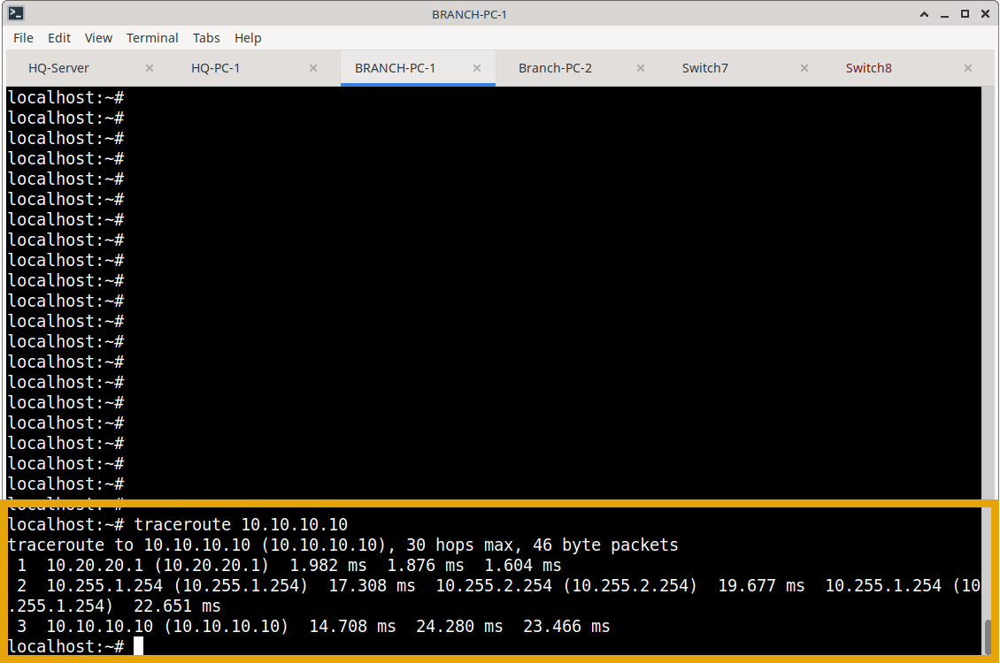

---

### Phase 3: Wire-Level Wireshark Packet Proof (Positive vs. Negative Proof)

Packet captures were taken simultaneously on physical `port2` (MPLS) and `port3` (Broadband) while launching real Firefox browser sessions:

1. **Target: `networkingnotebook.com` (`63.250.43.138`):**
   * **`port3` (Broadband DIA):** Wireshark captured active HTTPS (TCP port 443) flows from SNAT source `10.0.2.6` to `63.250.43.138`.

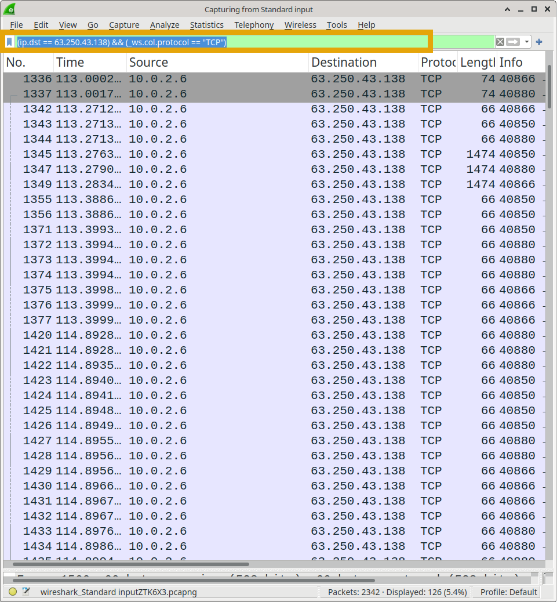

   * **`port2` (MPLS):** Filter `(ip.dst == 63.250.43.138) && (_ws.col.protocol == "TCP")` showed **0 packets (0.0%)**. No web traffic leaked onto the expensive MPLS circuit.
2. **Target: Cloudflare (`1.1.1.1`):**

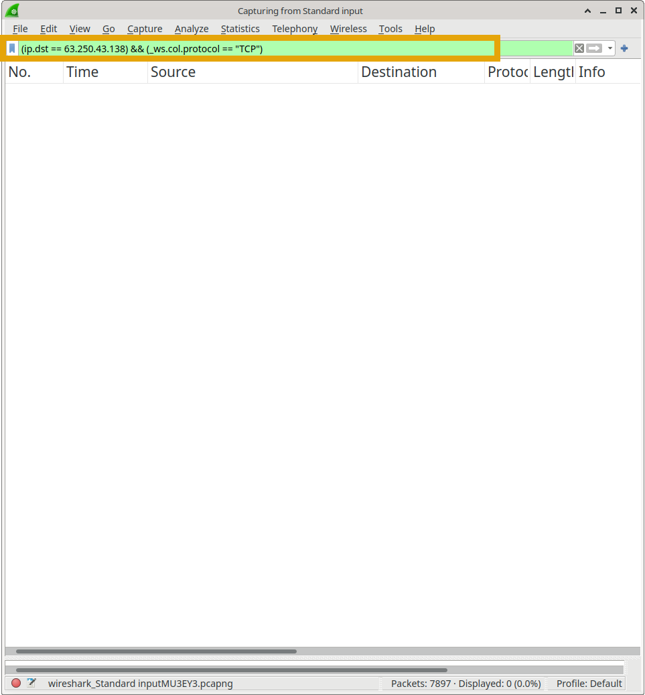

   * **`port3` (Broadband DIA):** Wireshark captured live HTTP frames to `1.1.1.1` from SNAT source `10.0.2.6`.
   
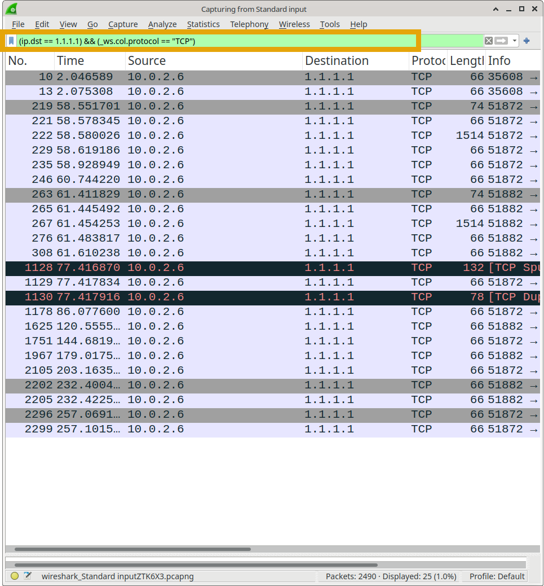
   
   * **`port2` (MPLS):** Filter `(ip.dst == 1.1.1.1) && (_ws.col.protocol == "TCP")` showed **0 packets (0.0%)**.

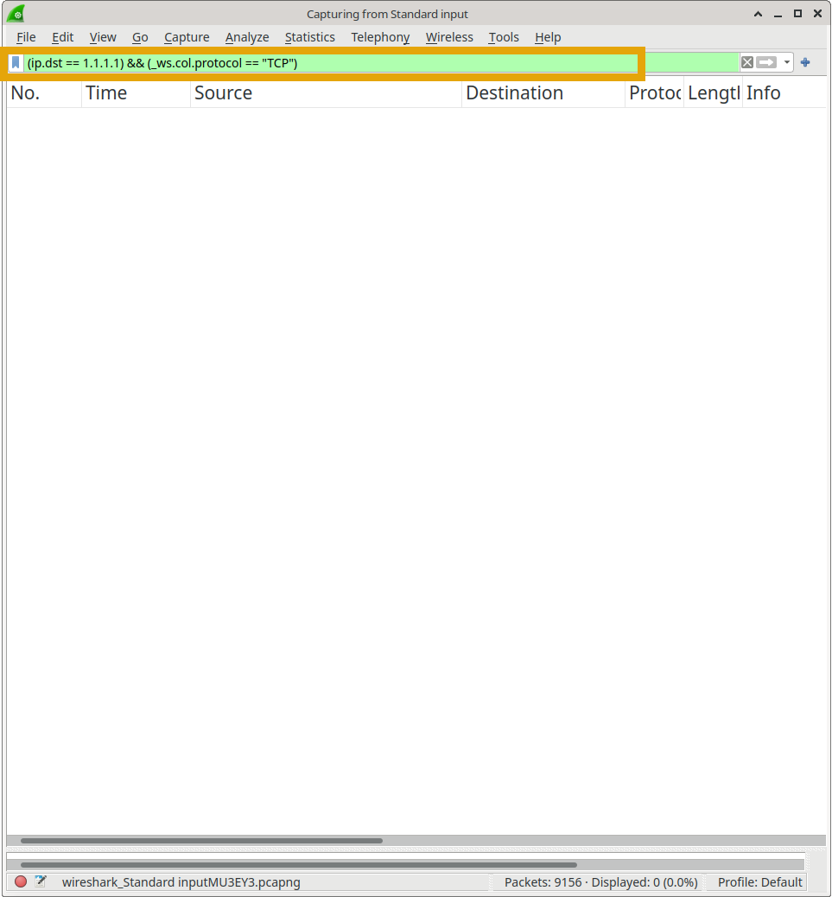

---

### Phase 4: Negative Control — Disabling the DIA Rule
To prove deterministic SD-WAN rule control, Rule 5 was administratively disabled:

```fortios
config system sdwan
    config service
        edit 5
            set status disable
        next
    end
end
```
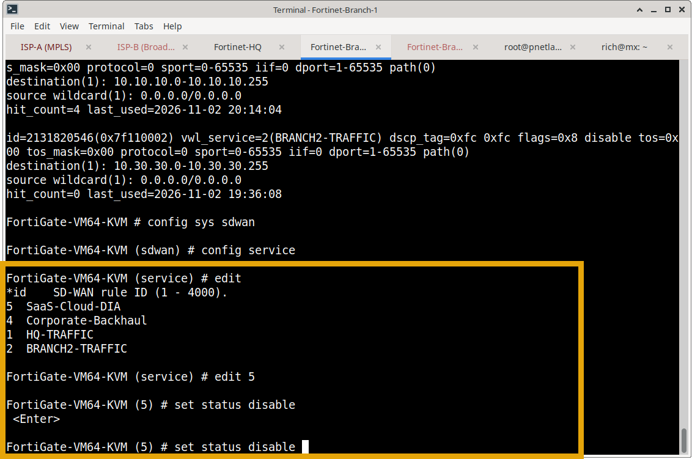

Rerunning `traceroute -I 1.1.1.1` immediately confirmed that with the DIA rule disabled, traffic matched the default backhaul routing and fell back to **`10.0.1.5` (`ISP-A` MPLS)**:
```text
localhost:~# traceroute -I 1.1.1.1
 1  10.20.20.1 (10.20.20.1)      2.391 ms
 2  10.0.1.5 (10.0.1.5)         13.851 ms   <-- Fallback to MPLS Underlay
 3  10.0.12.2 (10.0.12.2)       14.707 ms
```
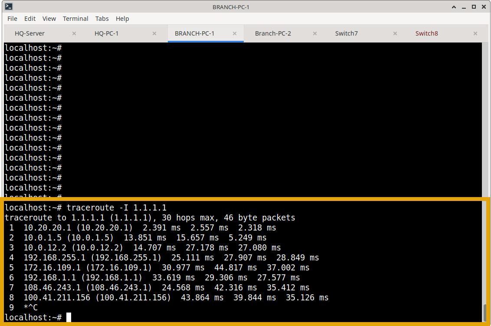

---

## Raw Packet Capture (PCAP) Downloads

For deep-packet inspection in Wireshark, the raw capture files documenting the simultaneous multi-port wire traces during live Firefox browsing sessions are hosted in Google Drive:

📁 **[Open Google Drive SD-WAN DIA PCAP Directory](https://drive.google.com/drive/folders/1IWMa5K0qDe2g_2mTt2T9U_M2Lbc2ZYO8?usp=sharing)**

| Artifact / PCAP File | Location | Size | What It Validates |
| :--- | :--- | :--- | :--- |
| `firefox-test-dia-policy-port-3.pcapng` | [Google Drive Link](https://drive.google.com/drive/folders/1IWMa5K0qDe2g_2mTt2T9U_M2Lbc2ZYO8?usp=sharing) | 1.3 MB | **Positive Proof:** Wire-level capture on port3 (Broadband DIA) showing active TLS/HTTPS handshakes and TCP data streams to Cloudflare (1.1.1.1) and Networking Notebook (63.250.43.138) with Source NAT (10.0.2.6). |
| `firefox-test-dia-policy-port-2.pcapng` | [Google Drive Link](https://drive.google.com/drive/folders/1IWMa5K0qDe2g_2mTt2T9U_M2Lbc2ZYO8?usp=sharing) | 7.3 MB | **Negative Proof:** Simultaneous capture on port2 (MPLS) proving **0 packets (0.0%)** leaked for either DIA destination, confirming complete traffic isolation from the private MPLS circuit. |

> **Wireshark Display Filters:**
> * Isolate Cloudflare DIA Traffic: `(ip.addr == 1.1.1.1) && (_ws.col.protocol == "TCP" || _ws.col.protocol == "TLS")`
> * Isolate Blog DIA Traffic: `(ip.addr == 63.250.43.138) && (_ws.col.protocol == "TCP" || _ws.col.protocol == "TLS")`
> * Compare Egress SNAT IP: `ip.src == 10.0.2.6`

--- 

### Evidence Index (Curated Proof)

| Category / Phase | Key Artifact (`screenshots/` / `videos/`) | Purpose & Technical Verification |
| :--- | :--- | :--- |
| **Architecture** | `dia-lucid-chart.png` | Network topology diagram detailing the local DIA split-tunnel path vs. the centralized corporate backhaul overlay. |
| **Object Config** | `config-firewall-address-show-branch.png` | Displays FQDN address objects for one.one.one.one and networkingnotebook.com alongside public DNS subnets. |
| **SD-WAN Policy** | `config-sd-wan-service-show.png` | Shows SD-WAN Service Rule 5 (SaaS-Cloud-DIA) steering cloud traffic to Member 2 (port3). |
| **Firewall Security** | `config-firewall-policy-show.png` | Verifies Policy 30 (SaaS-DIA-Local-Out) with Source NAT enabled and Policy 31 (Corp-Backhaul) with NAT disabled. |
| **DNS Resolution** | `dns-proxy-6.png` | FortiOS DNS proxy cache confirming resolution of networkingnotebook.com (63.250.43.138) and one.one.one.one. |
| **Kernel Routing** | `diagnose-firewall-proute-list.png` | **Routing Proof:** Kernel policy routing table proving Rule 5 is compiled directly to oif=5(port3). |
| **Service Status** | `diagnose-sys-sd-wan-service.png` | SD-WAN service diagnostics confirming Member 2 (port3) is alive and selected for active forwarding. |
| **Live Browser** | `firefox going on 1.1.1.1 .png` | Client desktop Firefox session loading Cloudflare's public web application directly over the DIA breakout. |
| **Live Browser** | `firefox going on networkingnotebook.com.png` | Client desktop Firefox session loading the personal engineering blog (networkingnotebook.com) over DIA. |
| **Traceroute (DIA)** | `traceroute-1.1.1.1.png` | **Path Proof:** Traceroute to 1.1.1.1 breaking out locally at Hop 2 (10.0.2.5 ISP-B) out to real Verizon FiOS Internet hops. |
| **Traceroute (Corp)** | `traceroute-10.10.10.10.png` | **Backhaul Proof:** Traceroute to 10.10.10.10 steering into Hop 2 (10.255.1.254 HQ VPN tunnel), completely bypassing DIA. |
| **Wire Sniffer (DIA)**| `diagnose-sniffer-1.1.1.1.png` | Real-time sniffer confirming private LAN packets Source-NATed to 10.0.2.6 and forwarded out port3. |
| **Wire Sniffer (Corp)**| `diagnose-sniffer-10.10.10.10.png` | Real-time sniffer confirming corporate traffic steered exclusively into the encrypted overlay tunnels. |
| **Wire Proof (1.1.1.1)**| `wirehsark-port-3-cloudflare.png` | **Positive Wire Proof:** Wireshark capture on port3 displaying active TCP/TLS application flows to 1.1.1.1. |
| **Wire Proof (1.1.1.1)**| `wireshark-port-2-cloudflare.png` | **Negative Wire Proof:** Simultaneous capture on port2 displaying 0 packets (0.0%), confirming zero DIA leakage onto MPLS. |
| **Wire Proof (Blog)** | `wireshark-port-3-networking-notebook.png` | **Positive Wire Proof:** Wireshark capture on port3 displaying active HTTPS traffic to 63.250.43.138. |
| **Wire Proof (Blog)** | `wireshark-port-2-networking-notebook.png` | **Negative Wire Proof:** Simultaneous capture on port2 displaying 0 packets (0.0%), proving clean path isolation. |
| **Negative Control** | `disabling-dia-rule.png` | Administrative CLI demonstration disabling Rule 5 to test deterministic routing fallback. |
| **Negative Control** | `traceroute-dia-disabled.png` | **Fallback Proof:** Traceroute showing 1.1.1.1 immediately falling back to Hop 2 (10.0.1.5 MPLS) once DIA is disabled. |
| **Packet Captures** | [Drive: `firefox-test-dia-policy-port-3.pcapng`](https://drive.google.com/drive/folders/1IWMa5K0qDe2g_2mTt2T9U_M2Lbc2ZYO8?usp=sharing) | Full raw trace on port3 (1.3 MB) capturing live TLS/HTTPS handshakes to Cloudflare and the blog. |
| **Packet Captures** | [Drive: `firefox-test-dia-policy-port-2.pcapng`](https://drive.google.com/drive/folders/1IWMa5K0qDe2g_2mTt2T9U_M2Lbc2ZYO8?usp=sharing) | Full raw trace on port2 (7.3 MB) confirming 0 leaked DIA frames over the private circuit [1.2.4]. |
| **Video Evidence** | `videos/sd-wan-dia-test-ping-and-wget.mp4` | Screen recording demonstrating CLI ping, wget, sniffer execution, and live traceroute verification. |
| **Video Evidence** | `videos/sd-wan-dia-test-using-web-browser.mp4` | Screen recording of the client desktop loading public web applications via local DIA breakout. |
| **Operational SOP** | `runbook ISDB` | Technical SOP detailing FQDN cache queries, kernel proute checks, and session clearing workflows. |

---

## Business Value Delivered
* **Massive Bandwidth Cost Savings:** Offloading SaaS, cloud updates, and trusted web traffic directly to local commodity broadband reduces private MPLS circuit utilization by up to 60–70%.
* **Superior User Experience:** Eliminates the latency penalty of hairpinning traffic through the corporate datacenter, reducing web and SaaS round-trip times from ~50 ms down to under 5 ms.
* **Zero Security Compromise:** Enterprise traffic and untrusted web browsing remain strictly backhauled across encrypted overlays to corporate next-generation firewalls for centralized inspection.

---

### What's Next?

With intelligent local internet breakout fully validated, the next step is to eliminate manual, static IP destination objects from our SD-WAN policies entirely by leveraging control-plane metadata.

Continue to the next project to explore automated, metadata-driven routing:
- **[Project 11: Control-Plane BGP Community to SD-WAN Route-Tag Steering](../11-bgp-community-route-tag/)** – Translating BGP communities into kernel route-tags to dynamically steer traffic without hardcoding a single destination IP address, enabling true zero-touch provisioning at scale.

---

[⬅️ Back to Fortinet SD-WAN Overview](../README.md)
