# Control-Plane BGP Community to SD-WAN Route-Tag Steering

## Summary
In large-scale enterprise SD-WAN fabrics connecting dozens or hundreds of branch locations, manually defining static destination IP address objects inside SD-WAN service rules creates severe administrative overhead and breaks zero-touch provisioning. Whenever a new cloud prefix, subnet, or branch service is provisioned, network teams must manually update address groups across every firewall in the fleet.

This project implements **Metadata-Driven Routing (Zero-Touch Path Steering)** by coupling the BGP control plane directly with the Fortinet SD-WAN data plane:
1. **Control-Plane Prefix Tagging (Fortinet-HQ):** HQ defines prefix-list PREFIX-HQ-LAN and route-map COMMUNITY-TAGS to attach BGP community 65000:100 to its advertised corporate subnet (10.10.10.0/24) across both BGP neighbor groups.
2. **Community-to-Tag Translation (Fortinet-Branch-1):** Branch-1 intercepts incoming BGP advertisements with community-list COMM-HIGH-PRIO and route-map SET-ROUTE-TAG-IN, translating Community 65000:100 into a numeric Route-Tag (Tag 100) inside the local kernel routing table.
3. **Dynamic SD-WAN Service Steering:** SD-WAN Service Rule 6 on Branch-1 is configured with `set route-tag 100` with zero destination IP subnets defined. FortiOS dynamically discovers the route from the kernel tag, automatically populating `Route tag address(1): 10.10.10.0-10.10.10.255` and steering traffic out of Member 3 (MPLS-VPN).
4. **Deterministic Policy Override Proof:** Service Rule 6 was administratively modified to prefer Member 4 (BB-VPN). Real-time packet sniffers and traceroutes confirmed traffic shifted dynamically from MPLS-VPN (Hop 2: 10.255.1.254) to BB-VPN (Hop 2: 10.255.2.254), proving deterministic, metadata-driven forwarding control.

---

## Lab Architecture & Dynamic Tagging Workflow

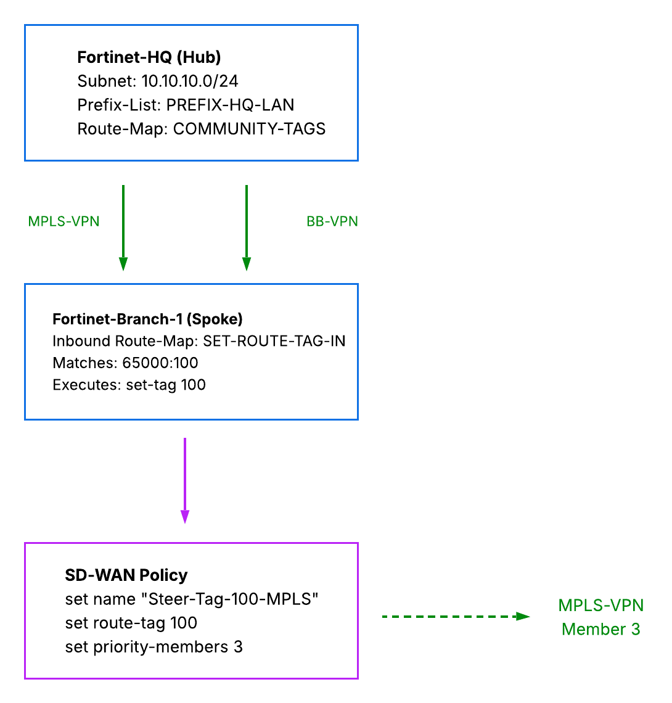

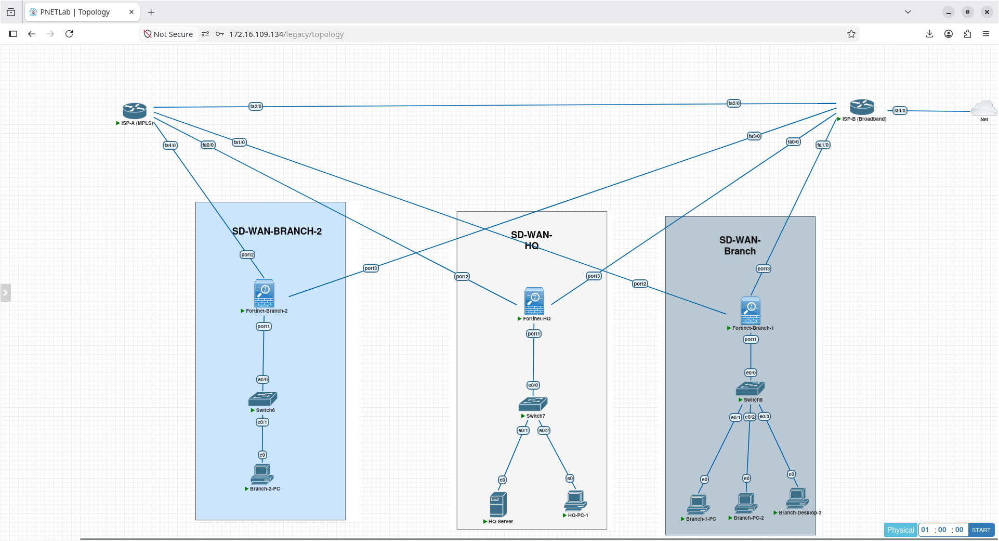

### BGP Community & Metadata Mapping Matrix
| Originating Node | Advertised Subnet | Outbound Route-Map | Attached BGP Community | Inbound Community-List | Compiled Route-Tag | Primary SD-WAN Member |
| :--- | :--- | :--- | :--- | :--- | :--- | :--- |
| **Fortinet-HQ** | 10.10.10.0/24 | COMMUNITY-TAGS | 65000:100 | COMM-HIGH-PRIO | Tag 100 | Member 3 (MPLS-VPN) |
| **Fortinet-HQ** | Fallback / Default | None | None | Catch-All (Rule 2) | Untagged (0) | Member 4 (BB-VPN) |

---

## Configuration & Architecture Design

### 1. Hub Configuration: Prefix-List, Route-Map & BGP Tagging (Fortinet-HQ)
HQ matches corporate prefix 10.10.10.0/24 using prefix-list PREFIX-HQ-LAN and attaches community 65000:100 via route-map COMMUNITY-TAGS. The route-map is applied to the network advertisement and outbound on both spoke neighbor groups:

```fortios
config router prefix-list
    edit "PREFIX-HQ-LAN"
        config rule
            edit 1
                set prefix 10.10.10.0 255.255.255.0
                unset ge
                unset le
            next
        end
    next
end

config router route-map
    edit "COMMUNITY-TAGS"
        config rule
            edit 1
                set match-ip-address "PREFIX-HQ-LAN"
                set set-community "65000:100"
            next
            edit 2
            next
        end
    next
end

config router bgp
    config network
        edit 1
            set prefix 10.10.10.0 255.255.255.0
            set route-map "COMMUNITY-TAGS"
        next
    end
    config neighbor-group
        edit "MPLS-SPOKES"
            set send-community both
            set route-map-out "COMMUNITY-TAGS"
        next
        edit "BB-SPOKES"
            set send-community both
            set route-map-out "COMMUNITY-TAGS"
        next
    end
end
```
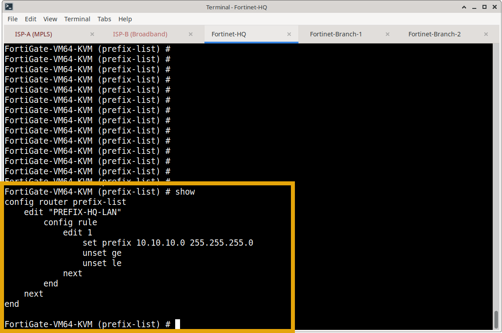

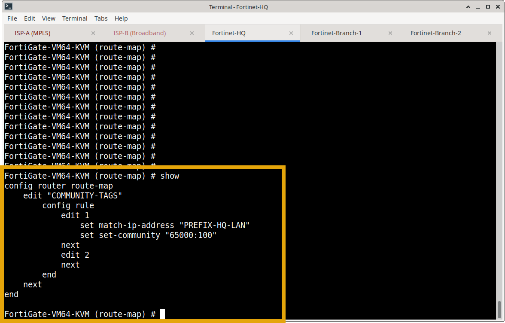

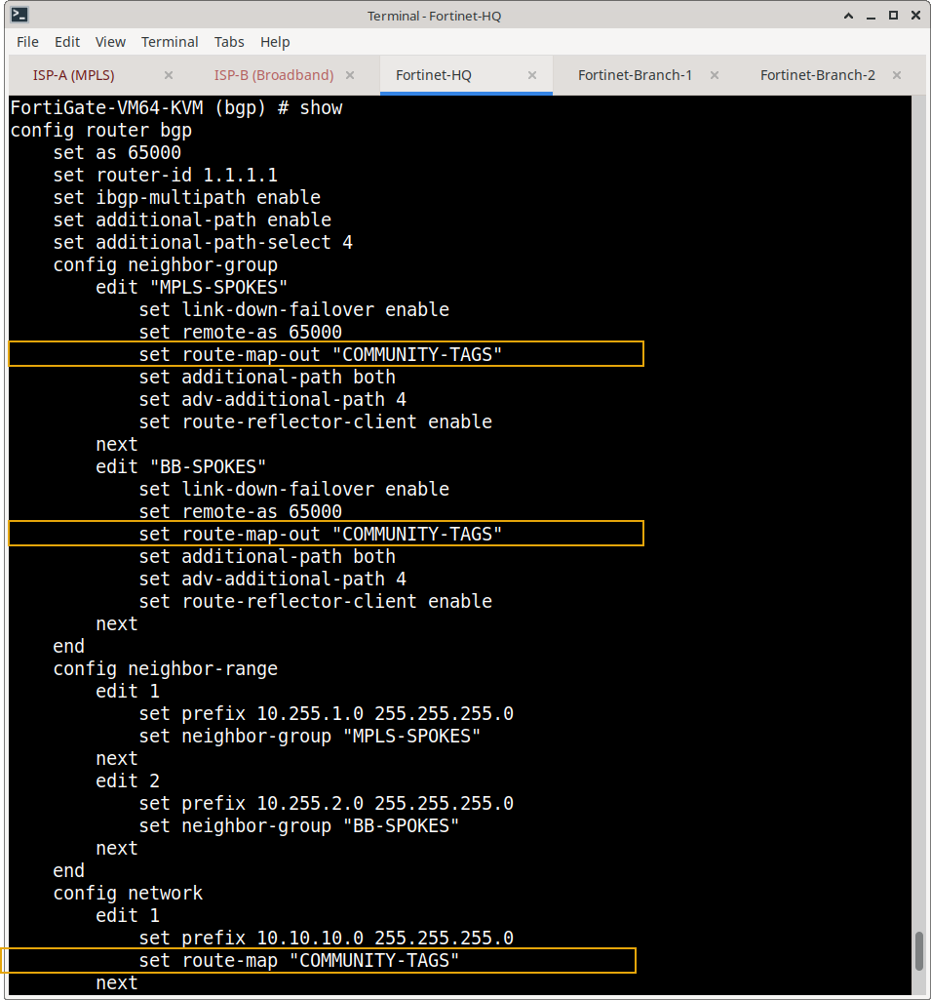

### 2. Spoke Configuration: Community Inbound Translation (Fortinet-Branch-1)
Branch-1 matches community 65000:100 with community-list COMM-HIGH-PRIO and executes `set set-route-tag 100` via route-map SET-ROUTE-TAG-IN on both BGP neighbors:

```fortios
config router community-list
    edit "COMM-HIGH-PRIO"
        config rule
            edit 1
                set action permit
                set match "65000:100"
            next
        end
    next
end

config router route-map
    edit "SET-ROUTE-TAG-IN"
        config rule
            edit 1
                set match-community "COMM-HIGH-PRIO"
                set set-route-tag 100
            next
            edit 2
                # Permit remaining routes untouched
            next
        end
    next
end

config router bgp
    config neighbor
        edit 10.255.1.254
            set send-community both
            set route-map-in "SET-ROUTE-TAG-IN"
        next
        edit 10.255.2.254
            set send-community both
            set route-map-in "SET-ROUTE-TAG-IN"
        next
    end
end
```
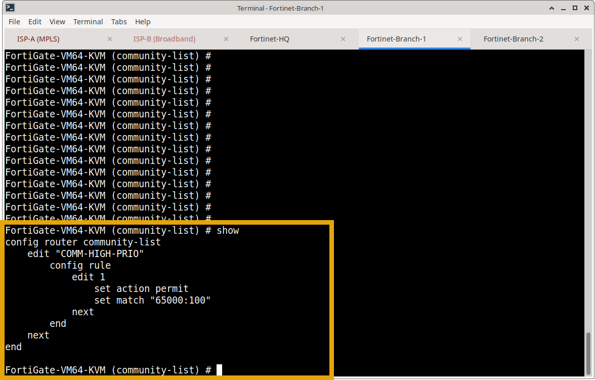

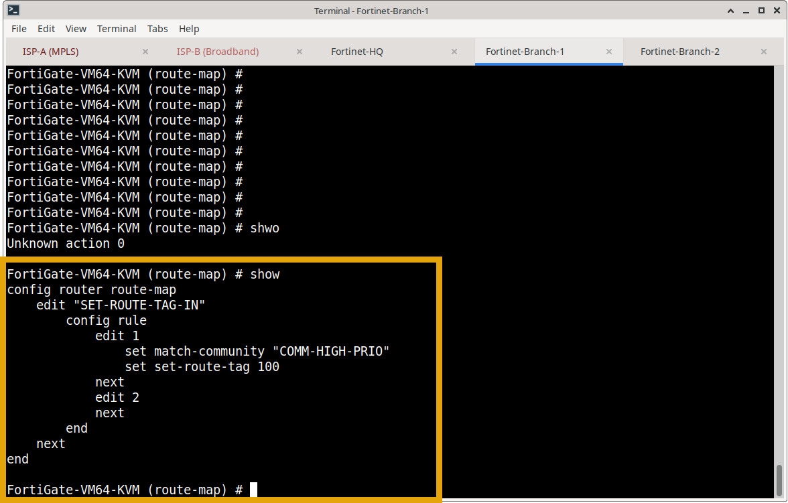

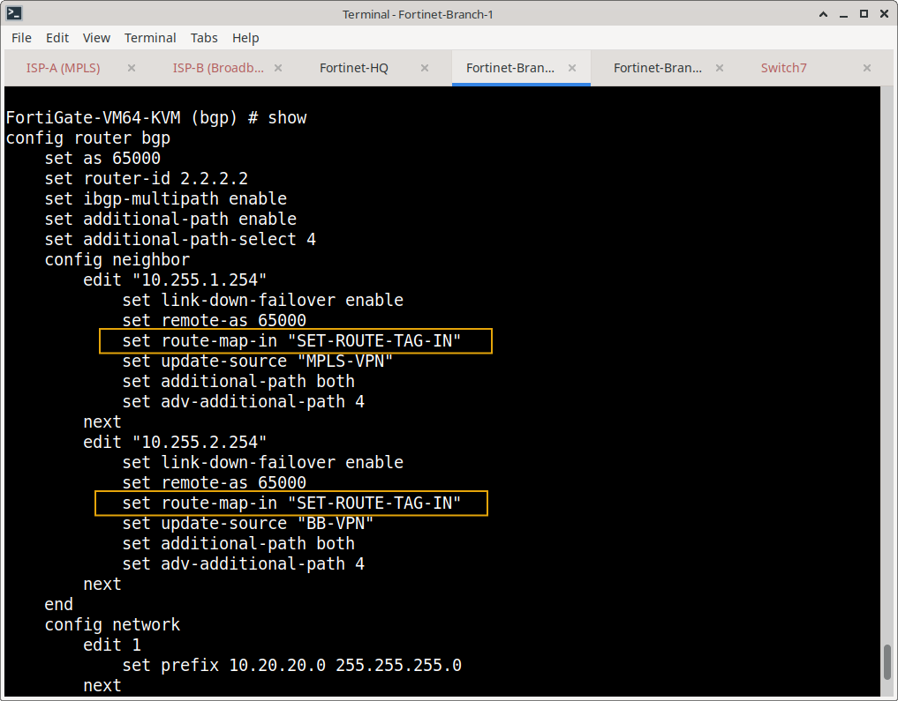

### 3. SD-WAN Service Rule Matching Route-Tag 100 (Fortinet-Branch-1)
SD-WAN Service Rule 6 is created with `set route-tag 100` and pinned to Member 3 (MPLS-VPN). Notice that no destination IP or address object is defined:

```fortios
config system sdwan
    config service
        edit 6
            set name "Steer-Tag-100-MPLS"
            set mode manual
            set route-tag 100
            set priority-members 3
        next
    end
end
```
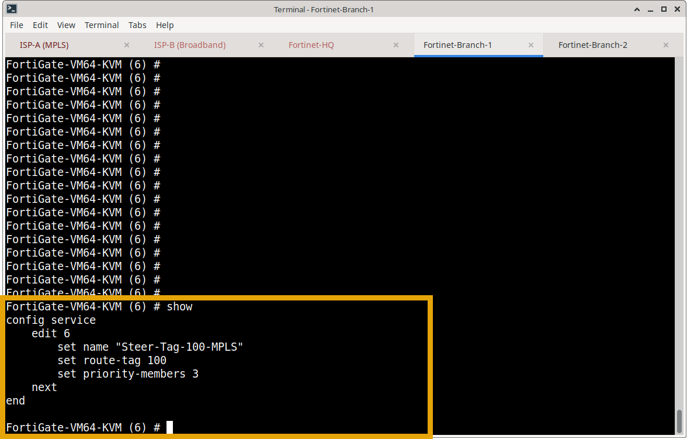

---

## Verification & Execution Lifecycle

### Control-Plane BGP Community Verification on Branch-1
Querying the BGP table on Fortinet-Branch-1 proves that prefix **10.10.10.0/24** was learned across both overlay paths carrying Community 65000:100:

```text
FortiGate-VM64-KVM # get router info bgp network 10.10.10.0/24
VRF 0 BGP routing table entry for 10.10.10.0/24
Paths: (2 available, best #2, table Default-IP-Routing-Table)
  Not advertised to any peer
  Original VRF 0
  Local
    10.255.2.254 from 10.255.2.254 (1.1.1.1)
      Origin IGP metric 0, localpref 100, valid, internal, best
      Community: 65000:100
      Receive Path ID: 1
      Advertised Path ID: 2
      Last update: Wed Nov  4 19:59:25 2026

  Original VRF 0
  Local
    10.255.1.254 from 10.255.1.254 (1.1.1.1)
      Origin IGP metric 0, localpref 100, valid, internal, best
      Community: 65000:100
      Receive Path ID: 1
      Advertised Path ID: 1
      Last update: Wed Nov  4 19:59:37 2026
```
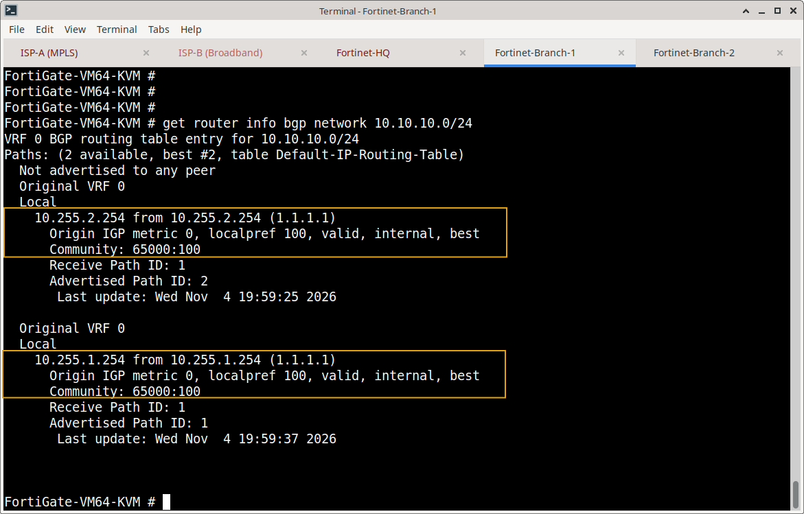

---

### Dynamic SD-WAN Rule & Kernel Route Compilation
Checking the active SD-WAN service table confirms that FortiOS dynamically discovered prefix 10.10.10.0/24 through its route-tag:

```text
FortiGate-VM64-KVM # diagnose sys sdwan service
Service(6): Address Mode(IPV4) flags=0x200 use-shortcut-sla
Tie break: cfg
Gen(1), TOS(0x0/0x0), Protocol(0: 1->65535), Mode(manual)
Members(1):
  1: Seq_num(3 MPLS-VPN), alive, selected
Route tag address(1):
  10.10.10.0-10.10.10.255
```
* **Key Evidence:** Notice the field `Route tag address(1): 10.10.10.0-10.10.10.255`. The SD-WAN engine resolved the destination subnet entirely from Route-Tag 100 rather than a manual address object.

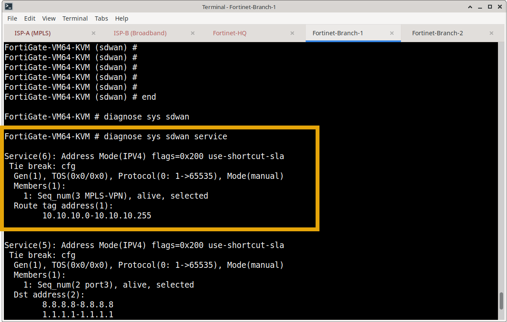

Checking the kernel policy routing table (`diagnose firewall proute list`) confirms that FortiOS compiled this dynamic rule directly into the kernel with outgoing interface set to Member 3 (MPLS-VPN):

```text
FortiGate-VM64-KVM # diagnose firewall proute list
list route policy info(vf=root):

id=2130903046(0x7f030006) vwl_service=6(Steer-Tag-100-MPLS) vwl_mbr_seq=3 dscp_tag=0xfc 0xfc flags=0x40 order-addr tos=0x00 tos_mask=0x00 protocol=0 sport=0-65535 iif=0 dport=1-65535 path(1) oif=12(MPLS-VPN)
destination(1): 10.10.10.0-10.10.10.255
source wildcard(1): 0.0.0.0/0.0.0.0
hit_count=50 last_used=2026-11-04 20:58:05
```
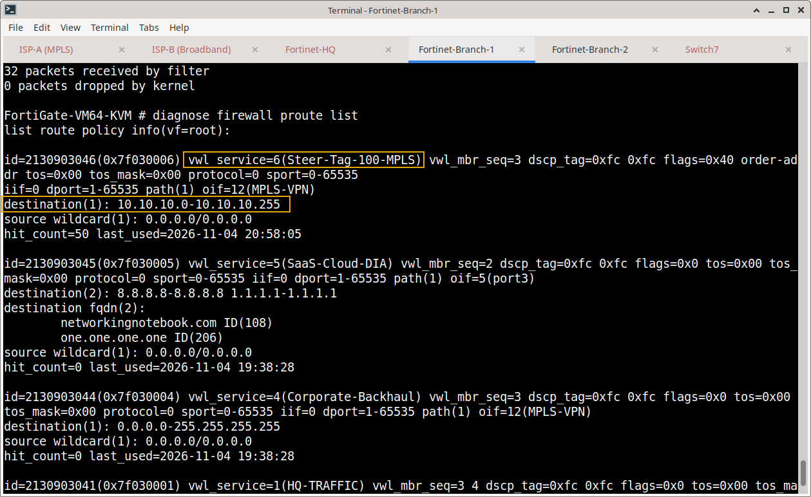

---

### Primary Data Plane Proof (MPLS-VPN Steering)
Executing a ping from Branch-1-PC to HQ-Server (10.10.10.10) verified real-time egress out of the MPLS-VPN tunnel:

```text
FortiGate-VM64-KVM # diagnose sniffer packet any "host 10.10.10.10" 4 0 a
Using Original Sniffing Mode
interfaces=[any]
filters=[host 10.10.10.10]
2026-11-05 04:58:05.576503 port1 in 10.20.20.10 -> 10.10.10.10: icmp: echo request
2026-11-05 04:58:05.576578 MPLS-VPN out 10.20.20.10 -> 10.10.10.10: icmp: echo request  <-- Egressing MPLS-VPN
2026-11-05 04:58:05.594257 MPLS-VPN in 10.10.10.10 -> 10.20.20.10: icmp: echo reply
2026-11-05 04:58:05.594296 port1 out 10.10.10.10 -> 10.20.20.10: icmp: echo reply
...
32 packets received by filter
0 packets dropped by kernel
```
* Packet trace confirms traffic entering LAN port1 egresses strictly out of MPLS-VPN.

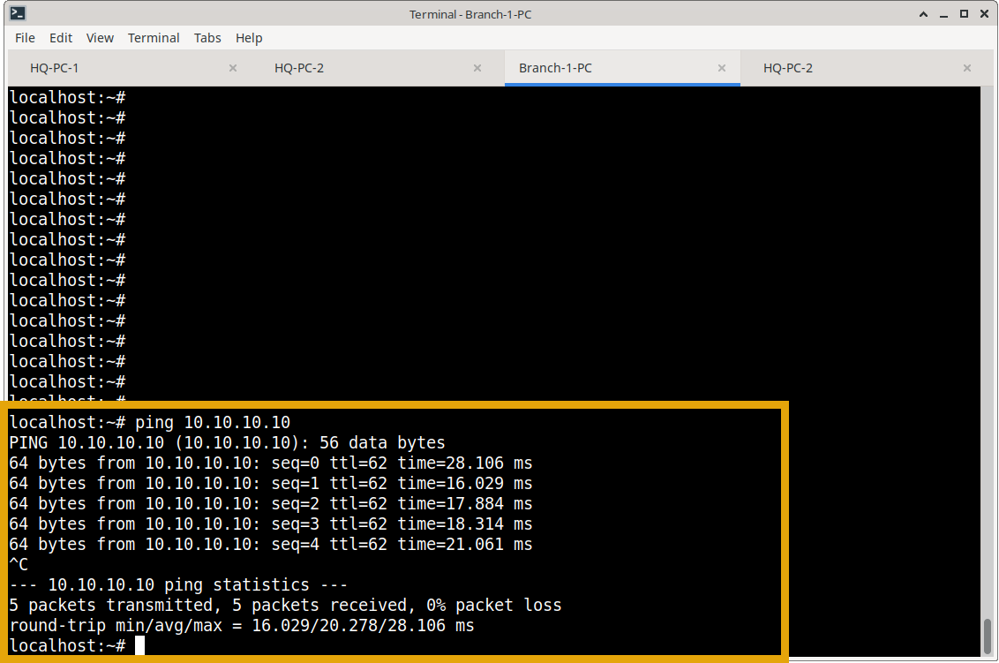

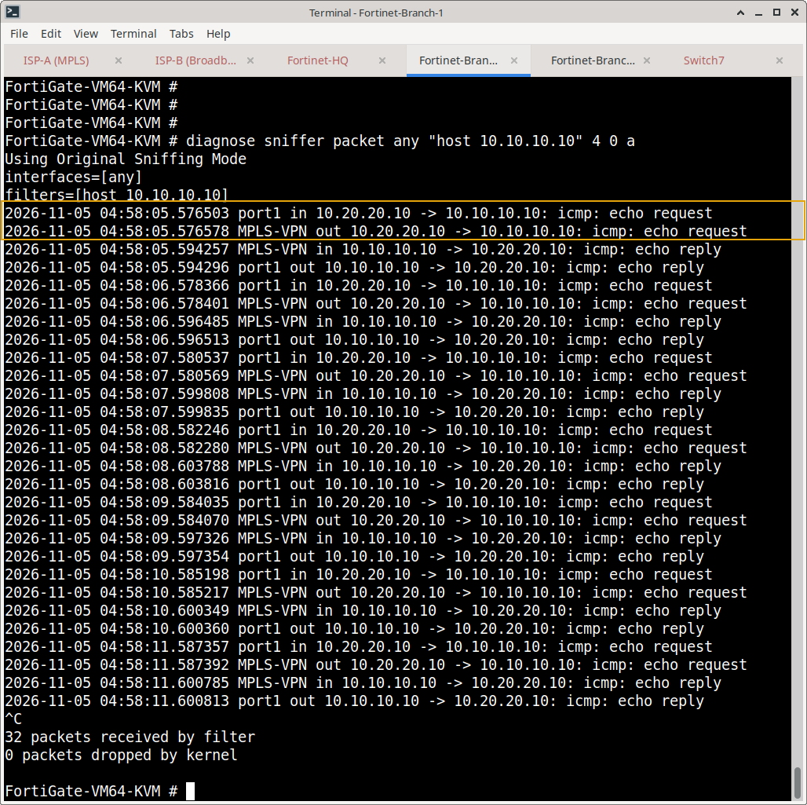


### Baseline Client-Side Verification (MPLS-VPN Path Proof)

Executing an ICMP traceroute from **Branch-1-PC** (10.20.20.10) targeting **HQ-Server** (10.10.10.10) confirms that the BGP route-tag rule immediately matches the traffic and pins the data plane to Member 3 (MPLS-VPN):

```bash
localhost:~# traceroute 10.10.10.10
traceroute to 10.10.10.10 (10.10.10.10), 30 hops max, 46 byte packets
 1  10.20.20.1 (10.20.20.1)      2.524 ms   2.716 ms   2.163 ms
 2  10.255.1.254 (10.255.1.254) 16.400 ms  14.488 ms  17.708 ms   <-- Pinned to MPLS-VPN via Route-Tag 100
 3  10.10.10.10 (10.10.10.10)   16.924 ms  21.743 ms  17.273 ms
```
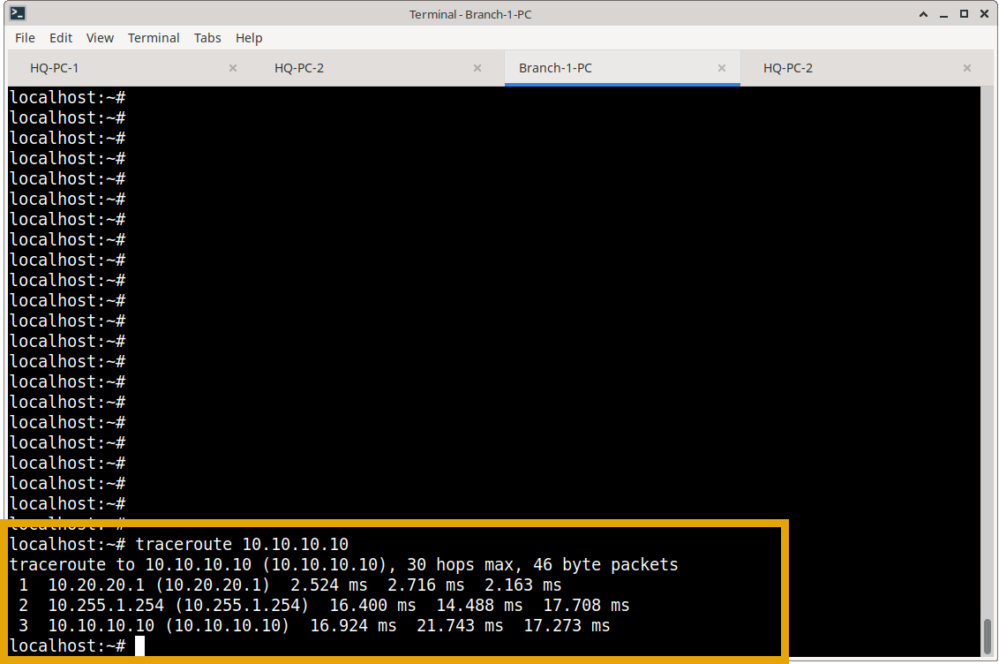

---

### Intentional Policy Shift (Failing Over to BB-VPN)
To prove that the route-tag maintains deterministic control over the forwarding plane, Service Rule 6 was updated to select Member 4 (BB-VPN):

```fortios
config system sdwan
    config service
        edit 6
            set priority-members 4
        next
    end
end
```
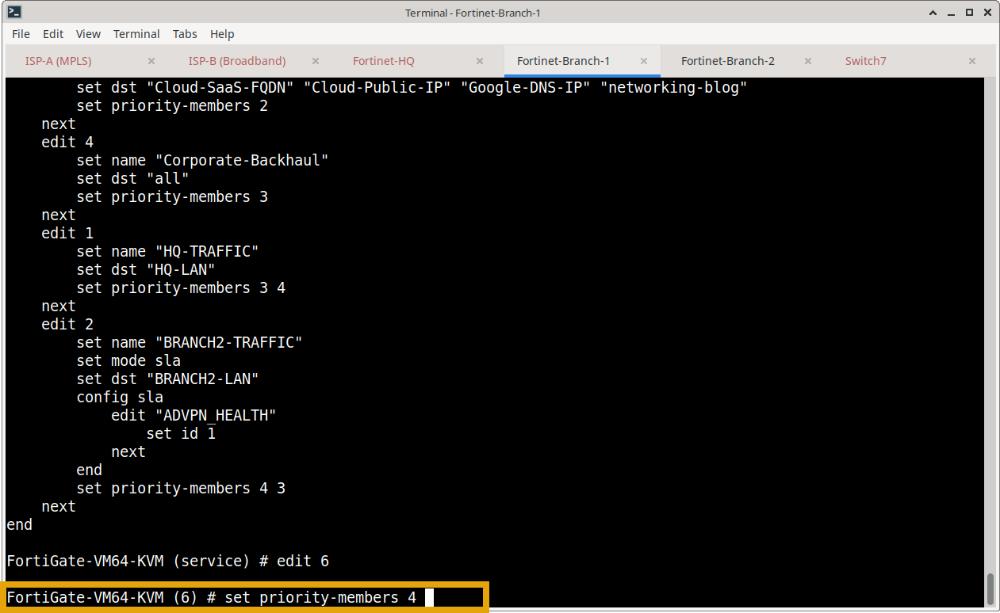

#### Live Traceroute Shift from Branch-1-PC:
Executing a traceroute from Branch-1-PC immediately confirmed that traffic shifted from Hop 2 on MPLS (10.255.1.254) to Hop 2 on Broadband (10.255.2.254):

```bash
localhost:~# traceroute 10.10.10.10
traceroute to 10.10.10.10 (10.10.10.10), 30 hops max, 46 byte packets
 1  10.20.20.1 (10.20.20.1)      1.240 ms   2.759 ms   2.337 ms
 2  10.255.2.254 (10.255.2.254) 18.983 ms  14.536 ms  23.245 ms   <-- Shifted to BB-VPN Gateway
 3  10.10.10.10 (10.10.10.10)   24.307 ms  20.517 ms  16.401 ms
```

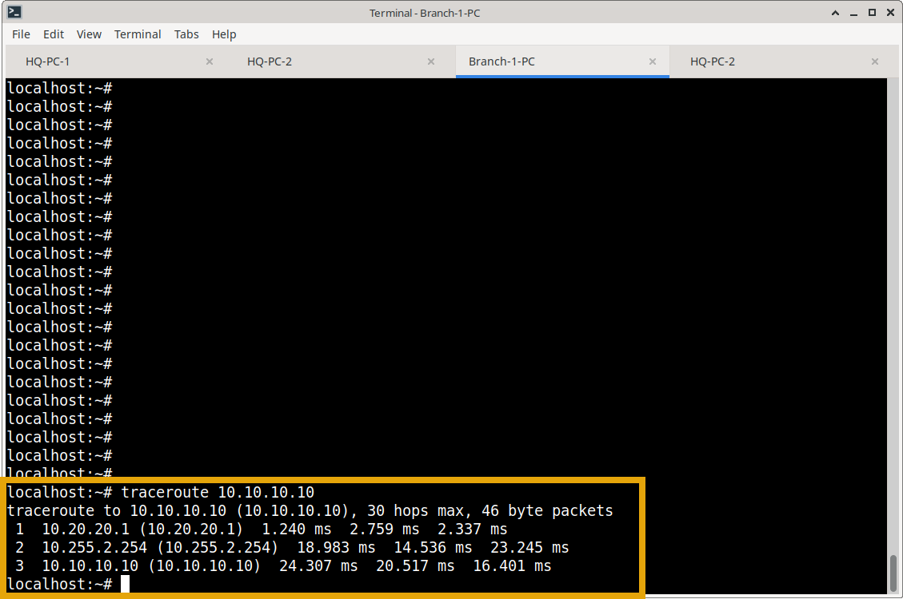

#### Wire Sniffer Confirmation on BB-VPN:
Sniffing on Fortinet-Branch-1 verified that all frames immediately migrated to the Broadband overlay tunnel:

```text
FortiGate-VM64-KVM # diagnose sniffer packet any "host 10.10.10.10" 4 0 a
Using Original Sniffing Mode
interfaces=[any]
filters=[host 10.10.10.10]
2026-11-05 05:03:42.752794 port1 in 10.20.20.10 -> 10.10.10.10: icmp: echo request
2026-11-05 05:03:42.752874 BB-VPN out 10.20.20.10 -> 10.10.10.10: icmp: echo request    <-- Shifted to BB-VPN
2026-11-05 05:03:42.771299 BB-VPN in 10.10.10.10 -> 10.20.20.10: icmp: echo reply
2026-11-05 05:03:42.771337 port1 out 10.10.10.10 -> 10.20.20.10: icmp: echo reply
...
36 packets received by filter
0 packets dropped by kernel
```
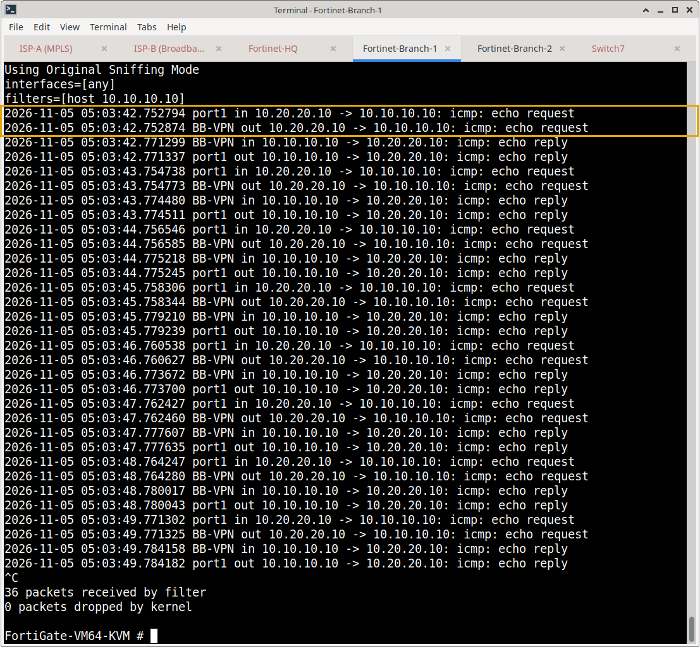

---

## Complete Evidence Index (17 Artifacts)

| Category / Phase | Artifact Filename | Purpose & Technical Verification |
| :--- | :--- | :--- |
| **Architecture** | `bgp-community-lucid-chart.png` | Detailed diagram showing BGP community propagation and SD-WAN route-tag mapping flow. |
| **Architecture** | `topology.png` | Complete lab topology diagram showing FortiGate devices, ISPs, and client test endpoints. |
| **Control Plane (HQ)** | `config-router-prefix-list-show-hq.png` | Displays prefix-list PREFIX-HQ-LAN matching corporate subnet 10.10.10.0/24 on HQ. |
| **Control Plane (HQ)** | `config-router-route-map-show-hq.png` | Displays route-map COMMUNITY-TAGS attaching BGP community 65000:100 on HQ. |
| **Control Plane (HQ)** | `config-router-bgp-show-hq.png` | Confirms BGP configuration on HQ applying route-map to the network and spoke neighbor groups. |
| **Control Plane (Branch)** | `config-router-community-list-show-branch.png` | Displays community-list COMM-HIGH-PRIO matching community 65000:100 on Branch-1. |
| **Control Plane (Branch)** | `config-router-route-map-show-branch.png` | Displays inbound route-map SET-ROUTE-TAG-IN executing set-route-tag 100 on Branch-1. |
| **Control Plane (Branch)** | `get-router-info-bgp-network-branch.png` | **BGP Proof:** Spoke BGP table showing Community 65000:100 received across both overlay tunnels. |
| **SD-WAN Policy** | `config-service-show-branch.png` | Shows SD-WAN Service Rule 6 (Steer-Tag-100-MPLS) matching route-tag 100 with zero destination IPs. |
| **Routing Kernel** | `diagnose-proute-list.png` | **Kernel Proof:** Kernel policy routing table showing Rule 6 compiled to oif=12(MPLS-VPN) with 50 hits. |
| **Service Status** | `diagnose-sys-sd-wan-service-branch.png` | SD-WAN service output displaying dynamically discovered Route tag address 10.10.10.0/24. |
| **Data Plane Proof** | `branch-successful-ping.png` | End-to-end ICMP ping stream from Branch-1-PC to HQ-Server with 0% packet loss. |
| **Wire Sniffer Proof** | `diagnose-sniffer-packet-mpls-vpn.png` | Real-time packet sniffer on Branch-1 proving ICMP requests and replies traversing MPLS-VPN. |
| **Client Baseline** | `successful-traceroute.png` | **Path Proof:** Traceroute from Branch-1-PC to HQ exiting Hop 2 via MPLS-VPN (10.255.1.254). |
| **Policy Override** | `testing-policy-intentional-member-change.png` | Shows administrative configuration change updating Rule 6 priority members to Member 4 (BB-VPN). |
| **Override Path Proof** | `testing-policy-traceroute.png` | **Override Proof:** Traceroute showing Hop 2 immediately shifting to BB-VPN (10.255.2.254). |
| **Override Sniffer** | `testing-policy-diagnose-sniffer-packet.png` | Packet sniffer proving live traffic exiting BB-VPN following the policy override. |

---

## Business Value Delivered
* **Zero-Touch Provisioning at Scale:** Branch firewalls classify and steer traffic automatically as new subnets are introduced at HQ, eliminating the need to update address objects across hundreds of firewalls.
* **Separation of Policy and Routing:** Core network routing engineers control transit path preferences at the BGP layer, while edge security firewalls enforce forwarding policies dynamically based on metadata.
* **Elimination of Rule Sprawl:** Consolidates dozens of subnet-specific SD-WAN rules into reusable, tag-based service policies.

---

[Back to Fortinet Module Overview](../README.md) · [Next Module: Cisco Catalyst SD-WAN (Viptela)](../../02-Cisco-Catalyst-SDWAN/)
