# Enterprise Dual-Hub Dual-Region ADVPN (Disaster Recovery & Control-Plane Redundancy)

## Summary
In mission-critical enterprise architectures, deploying a single SD-WAN Hub introduces an unacceptable single point of failure. If the primary datacenter suffers a catastrophic outage (power loss, carrier fiber cut, or hardware failure), inter-site transit routing halts, and all new dynamic spoke-to-spoke shortcut discovery terminates across the entire enterprise.

This project implements the pinnacle of enterprise WAN engineering: **Active/Standby Dual-Hub Dual-Region ADVPN with a dedicated Datacenter Interconnect (DCI)**:
1. **4-Overlay Spoke Architecture:** Every branch office (Branch-1 and Branch-2) maintains four persistent IKEv2 route-based IPsec tunnels—two to Primary Hub 1 (Fortinet-HQ) over MPLS and Broadband, and two to Secondary Disaster Recovery Hub 2 (Fortinet-Hub-2) over MPLS and Broadband.
2. **Deterministic BGP Route Reflection & Metric Steering:** Both Hubs operate as independent BGP Route Reflectors in AS 65000. Hub 1 advertises routes with **Local-Preference 200 (Primary)**, while Hub 2 advertises routes with **Local-Preference 100 (Standby)**, ensuring deterministic traffic patterns during healthy states.
3. **Inter-Hub Datacenter Interconnect (DCI):** A dedicated point-to-point IPsec tunnel and non-client iBGP peering interconnect Hub 1 and Hub 2 directly across the MPLS backbone, providing cross-datacenter database synchronization and split-hub transit protection.
4. **Autonomous Disaster Recovery Proof:** A complete datacenter blackout was simulated on Hub 1 by administratively shutting down both physical WAN circuits (`port2` and `port3`). Branch firewalls autonomously detected the failure, preserved the BGP control plane via Hub 2, and dynamically spawned spoke-to-spoke shortcuts directly across the surviving overlay without human intervention.

---

## Lab Architecture & Multi-Hub Mesh Topology

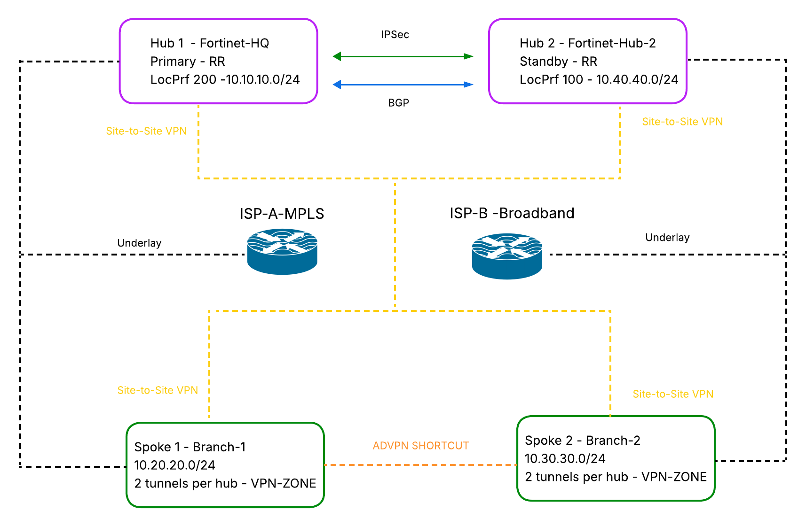

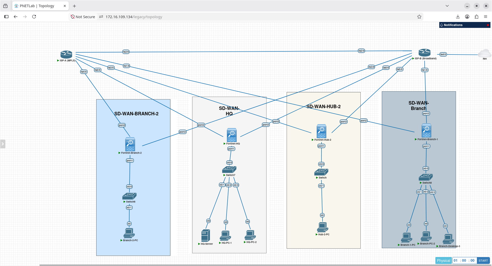

### Complete Addressing, Overlay & BGP Peering Matrix
| Device | Role | Physical Interfaces | Overlay IP Addressing | BGP Router ID | Advertised Prefix | Advertised Local Preference |
| :--- | :--- | :--- | :--- | :--- | :--- | :--- |
| **Fortinet-HQ** | Hub 1 (Primary DC) | port2: 10.0.1.2/30<br>port3: 10.0.2.2/30<br>port1: 10.10.10.1/24 | MPLS-VPN: 10.255.1.254/32<br>BB-VPN: 10.255.2.254/32<br>DCI: 10.255.255.1/30 | 1.1.1.1 | 10.10.10.0/24 | LocPrf 200 (Primary) |
| **Fortinet-Hub-2** | Hub 2 (DR DC) | port2: 10.0.1.14/30<br>port3: 10.0.2.14/30<br>port1: 10.40.40.1/24 | H2-ADVPN-MPLS: 10.255.3.254/32<br>H2-ADVPN-BB: 10.255.4.254/32<br>DCI: 10.255.255.2/30 | 4.4.4.4 | 10.40.40.0/24 | LocPrf 100 (Standby) |
| **Fortinet-Branch-1** | Spoke 1 | port2: 10.0.1.6/30<br>port3: 10.0.2.6/30<br>port1: 10.20.20.1/24 | MPLS-VPN: 10.255.1.2/32<br>BB-VPN: 10.255.2.2/32<br>H2-MPLS: 10.255.3.2/32<br>H2-BB: 10.255.4.2/32 | 2.2.2.2 | 10.20.20.0/24 | Default (100) |
| **Fortinet-Branch-2** | Spoke 2 | port2: 10.0.1.10/30<br>port3: 10.0.2.10/30<br>port1: 10.30.30.1/24 | MPLS-VPN: 10.255.1.3/32<br>BB-VPN: 10.255.2.3/32<br>H2-MPLS: 10.255.3.3/32<br>H2-BB: 10.255.4.3/32 | 3.3.3.3 | 10.30.30.0/24 | Default (100) |

---

## Configuration & Architecture Design

### Hub 2 Dynamic Dialup Templates & BGP Route Reflector
Hub 2 operates as an autonomous ADVPN sender, listening for incoming spoke tunnels on both circuits and advertising routes with standby priority (LocPrf 100):

```fortios
config vpn ipsec phase1-interface
    edit "H2-ADVPN-MPLS"
        set type dynamic
        set interface "port2"
        set ike-version 2
        set peertype any
        set net-device disable
        set proposal des-sha256
        set add-route disable
        set dpd on-idle
        set auto-discovery-sender enable
        set psksecret Pateau1!
    next
    edit "H2-ADVPN-BB"
        set type dynamic
        set interface "port3"
        set ike-version 2
        set peertype any
        set net-device disable
        set proposal des-sha256
        set add-route disable
        set dpd on-idle
        set auto-discovery-sender enable
        set psksecret Pateau1!
    next
end
```

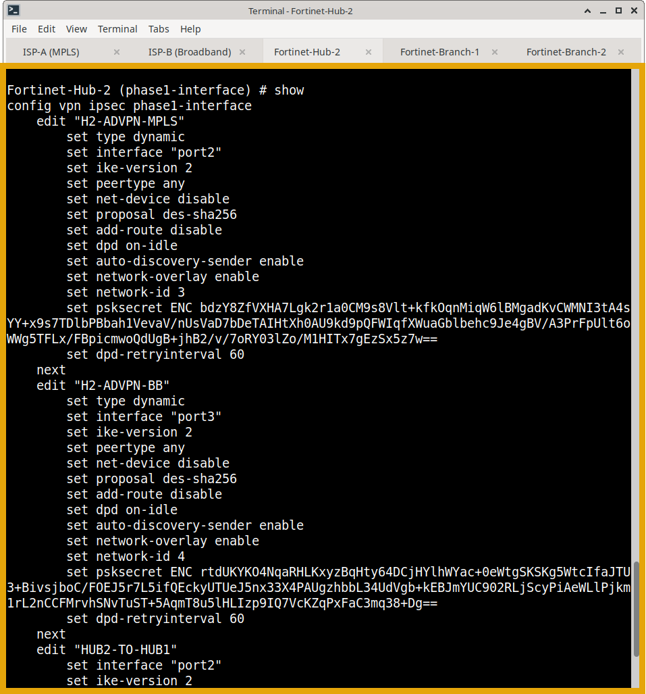

```
config system interface
    edit "H2-ADVPN-MPLS"
        set ip 10.255.3.254 255.255.255.255
        set remote-ip 10.255.3.253 255.255.255.0
        set allowaccess ping
    next
    edit "H2-ADVPN-BB"
        set ip 10.255.4.254 255.255.255.255
        set remote-ip 10.255.4.253 255.255.255.0
        set allowaccess ping
    next
end
```

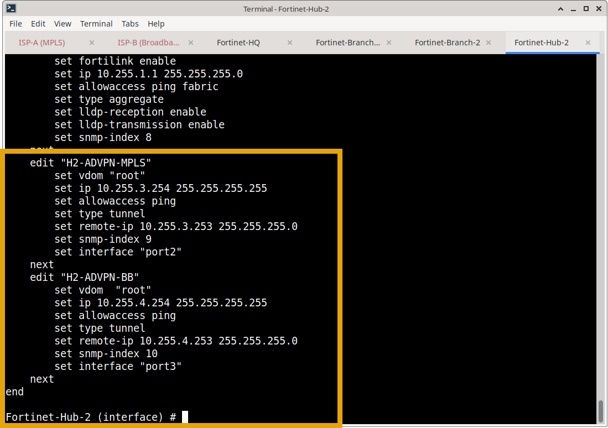

```
config router route-map
    edit "SET-STANDBY-PREF"
        config rule
            edit 1
                set set-local-preference 100
            next
        end
    next
end
```

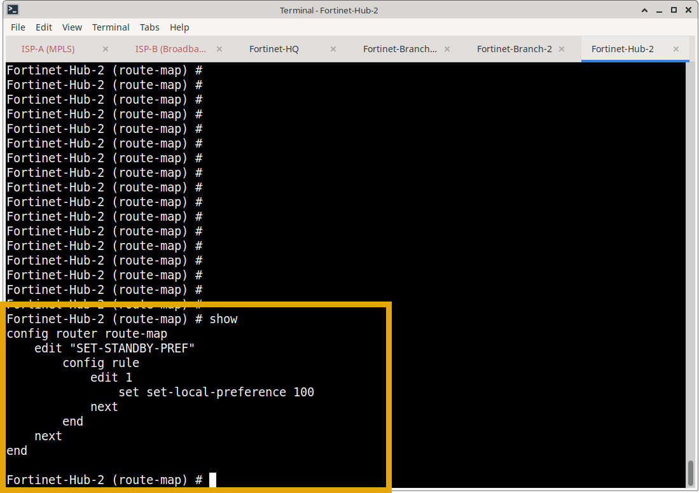

```
config router bgp
    set as 65000
    set router-id 4.4.4.4
    set ibgp-multipath enable
    set additional-path enable
    set additional-path-select 4

    config neighbor-group
        edit "H2-MPLS-SPOKES"
            set remote-as 65000
            set route-reflector-client enable
            set route-map-out "SET-STANDBY-PREF"
            set additional-path both
            set adv-additional-path 4
        next
        edit "H2-BB-SPOKES"
            set remote-as 65000
            set route-reflector-client enable
            set route-map-out "SET-STANDBY-PREF"
            set additional-path both
            set adv-additional-path 4
        next
    end
    config neighbor-range
        edit 1
            set prefix 10.255.3.0 255.255.255.0
            set neighbor-group "H2-MPLS-SPOKES"
        next
        edit 2
            set prefix 10.255.4.0 255.255.255.0
            set neighbor-group "H2-BB-SPOKES"
        next
    end
    config network
        edit 1
            set prefix 10.40.40.0 255.255.255.0
        next
    end
end
```
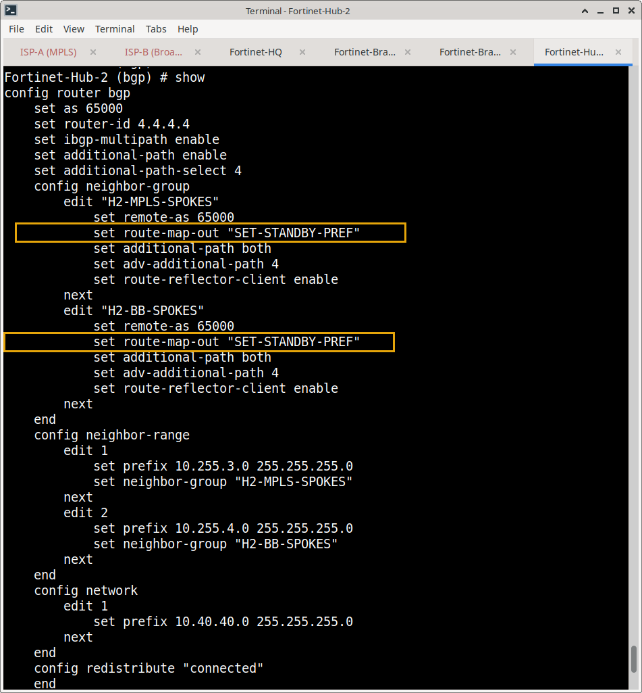

### Hub 1 (HQ) Primary BGP Route Reflector Preference
On Fortinet-HQ, outbound advertisements to spokes are tagged with Local-Preference 200, guaranteeing that Hub 1 is chosen as the primary transit path during normal operations:

```fortios
config router route-map
    edit "SET-PRIMARY-PREF"
        config rule
            edit 1
                set set-local-preference 200
            next
        end
    next
end

config router bgp
    config neighbor-group
        edit "MPLS-SPOKES"
            set route-map-out "SET-PRIMARY-PREF"
        next
        edit "BB-SPOKES"
            set route-map-out "SET-PRIMARY-PREF"
        next
    end
end
```

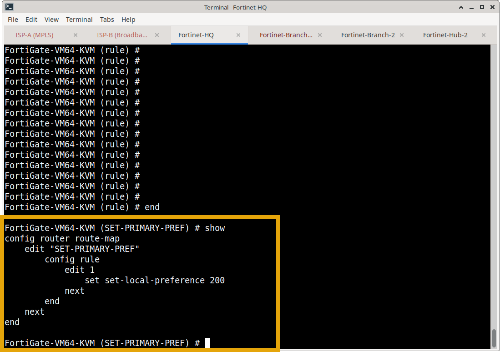

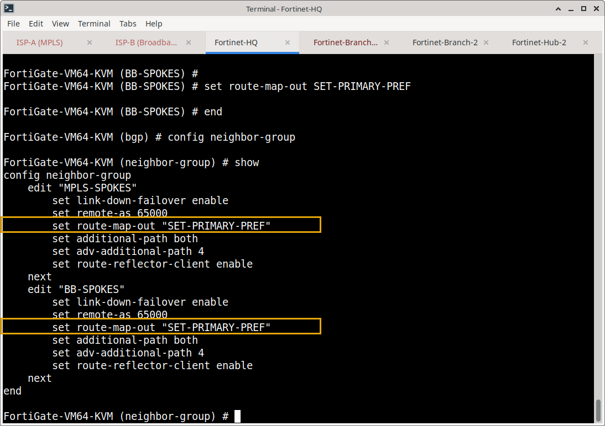

### 3. Inter-Hub Datacenter Interconnect (DCI) Tunnel
A dedicated point-to-point IPsec tunnel interconnects HQ and Hub 2 over MPLS port2, peered with standard iBGP:

```fortios
# On Fortinet-HQ:
config vpn ipsec phase1-interface
    edit "HUB1-TO-HUB2"
        set interface "port2"
        set ike-version 2
        set proposal des-sha256
        set remote-gw 10.0.1.14
        set psksecret Pateau1!
        set auto-negotiate enable
        set dpd on-idle
    next
end

config system interface
    edit "HUB1-TO-HUB2"
        set ip 10.255.255.1 255.255.255.252
        set remote-ip 10.255.255.2 255.255.255.252
        set allowaccess ping
    next
end

config router bgp
    config neighbor
        edit 10.255.255.2
            set remote-as 65000
            set link-down-failover enable
            set update-source "HUB1-TO-HUB2"
        next
    end
end
```
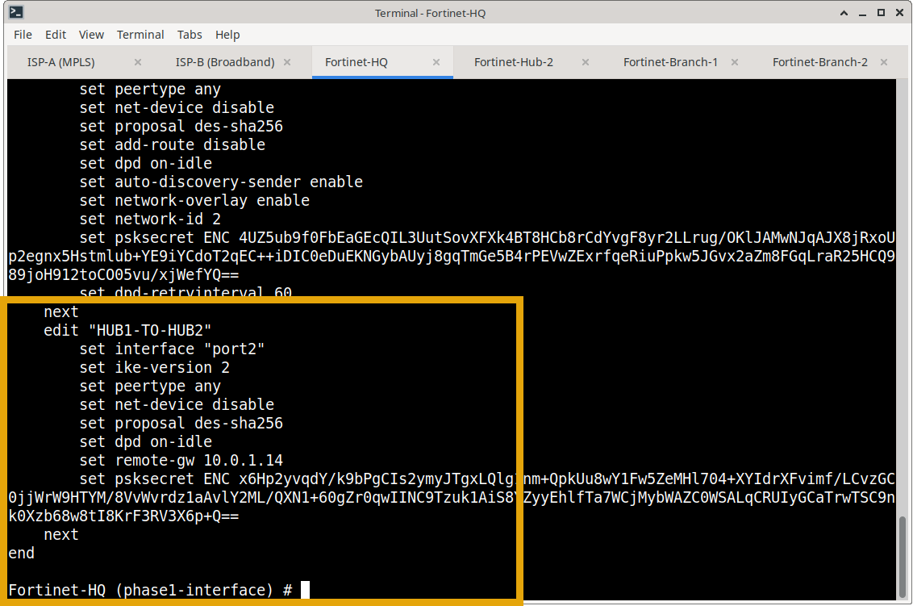

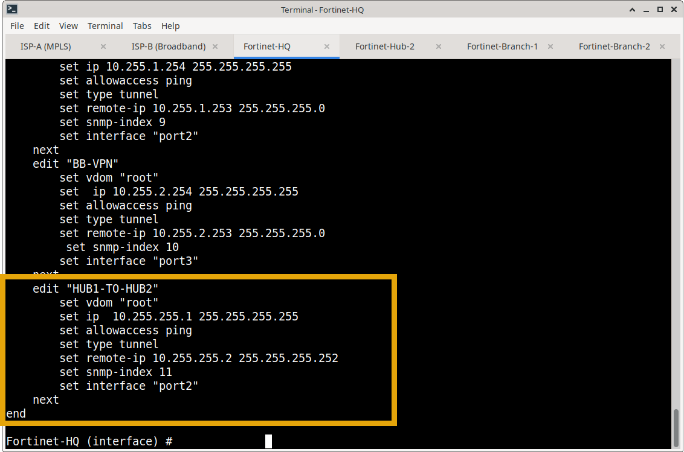

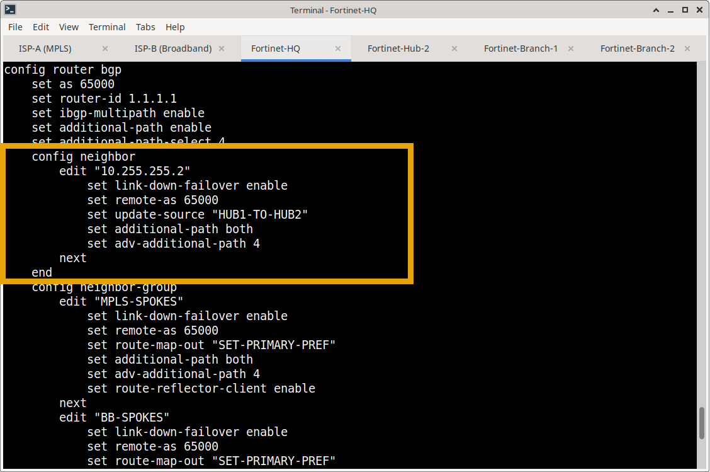

### 4. Spoke 4-Tunnel Architecture (Fortinet-Branch-1 & Branch-2)
Each spoke provisions static tunnels to both Hub 1 and Hub 2, bundling all four overlays into the unified SD-WAN zone `VPN-ZONE`:

```fortios
config vpn ipsec phase1-interface
    edit "H2-MPLS"
        set interface "port2"
        set ike-version 2
        set peertype any
        set net-device disable
        set proposal des-sha256
        set dpd on-idle
        set auto-discovery-receiver enable
        set remote-gw 10.0.1.14
        set psksecret Pateau1!
        set add-route disable
    next
    edit "H2-BB"
        set interface "port3"
        set ike-version 2
        set peertype any
        set net-device disable
        set proposal des-sha256
        set dpd on-idle
        set auto-discovery-receiver enable
        set remote-gw 10.0.2.14
        set psksecret Pateau1!
        set add-route disable
    next
end
```

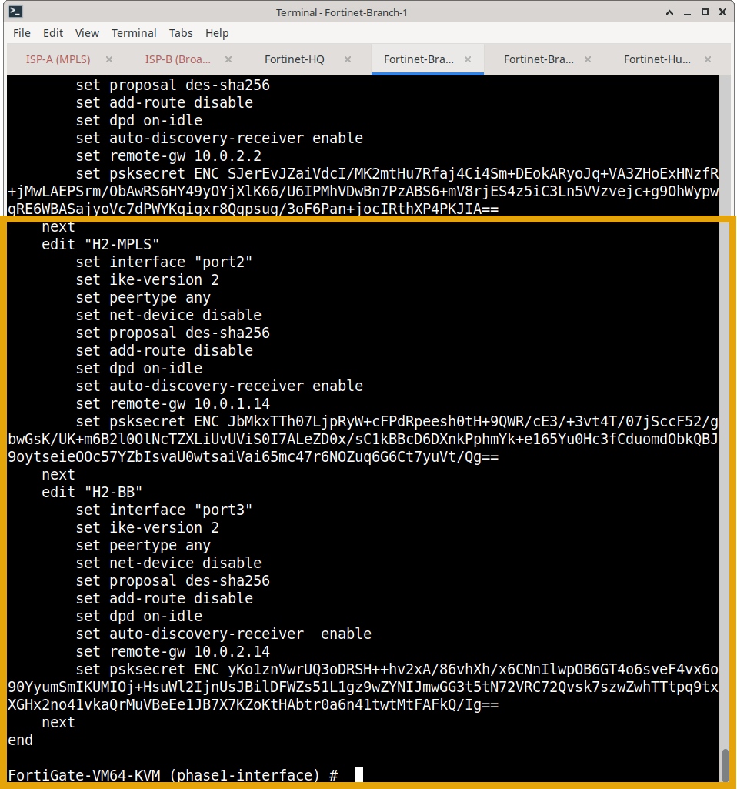

```fortinet
config system interface
    edit "H2-MPLS"
        set ip 10.255.3.2 255.255.255.255
        set remote-ip 10.255.3.254 255.255.255.0
        set allowaccess ping
    next
    edit "H2-BB"
        set ip 10.255.4.2 255.255.255.255
        set remote-ip 10.255.4.254 255.255.255.0
        set allowaccess ping
    next
end
```

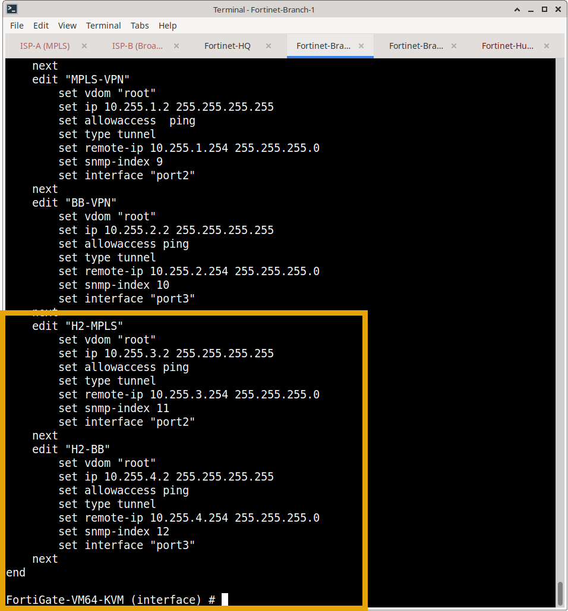

```fortinet
config system sdwan
    config members
        edit 3
            set interface "MPLS-VPN"
            set zone "VPN-ZONE"
        next
        edit 4
            set interface "BB-VPN"
            set zone "VPN-ZONE"
        next
        edit 5
            set interface "H2-MPLS"
            set zone "VPN-ZONE"
        next
        edit 6
            set interface "H2-BB"
            set zone "VPN-ZONE"
        next
    end
end
```
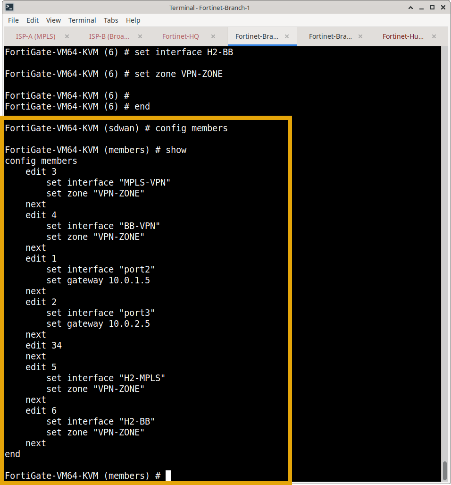

```fortinet
config router bgp
    config neighbor
        edit 10.255.3.254
            set remote-as 65000
            set link-down-failover enable
            set additional-path both
            set adv-additional-path 4
            set update-source "H2-MPLS"
        next
        edit 10.255.4.254
            set remote-as 65000
            set link-down-failover enable
            set additional-path both
            set adv-additional-path 4
            set update-source "H2-BB"
        next
    end
end
```
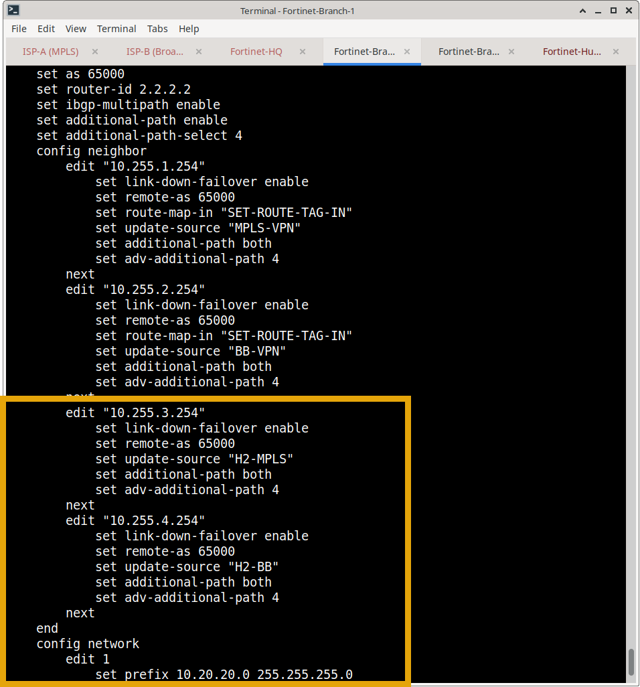

---

## Verification & Execution Lifecycle

### Secondary Hub (Hub 2) Dynamic Spoke Overlay

**Hub-2 <----> HQ**

To establish a private backbone between HQ and Hub-2 and synchronize BGP route reflection across regions, a dedicated point-to-point IPsec tunnel (**HUB2-TO-HUB1**) was provisioned between **Fortinet-Hub-2** (10.0.1.14) and **Fortinet-HQ** (10.0.1.2) across MPLS port2.

```text
Fortinet-Hub-2 # diagnose vpn ike gateway

vd: root/0
name: HUB2-TO-HUB1
version: 2
interface: port2 4
addr: 10.0.1.14:500 -> 10.0.1.2:500
tun_id: 10.0.0.3/::10.0.0.8
remote_location: 0.0.0.0
virtual-interface-addr: 10.255.255.2 -> 0.0.0.0
created: 95s ago
PPK: no
IKE SA: created 1/1  established 1/1  time 40/40/40 ms
IPsec SA: created 1/1  established 1/1  time 40/40/40 ms

  id/spi: 237 eb923d4063853a99/b30237bc2e4d9b24
  direction: initiator
  status: established 96-96s ago = 40ms
  proposal: des-sha256
  child: no
  SK_ei: e08cec4f92299b74
  SK_er: f8957d1b6c4d35f1
  SK_ai: c902e0a7c78e7dab-00172da7cdb1cc79-9df921805d5f978e-4a75b278157b24d4
  SK_ar: 68dcc6f6a278f231-e8fd8291aeb0bf88-745c6d680a7be9b2-afdb653da5ba3c75
  PPK: no
  message-id sent/recv: 2/1
  lifetime/rekey: 86400/86003
  DPD sent/recv: 00000000/00000000

Fortinet-Hub-2 # 
```
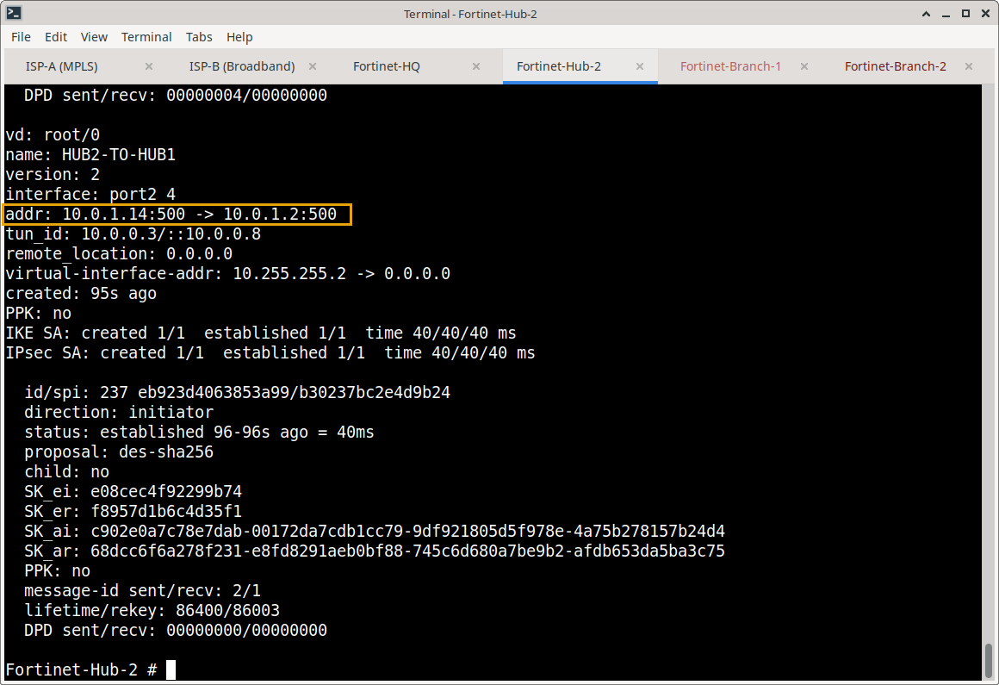

**Hub-2 <----> Branch-1**

```text
Fortinet-Hub-2 # diagnose vpn ike gateway

vd: root connections from all remote branches, the IKE gateway table was inspected via `diagnose vpn ike gateway`. 

The/0
name: H2-ADVPN-MPLS_0
version: 2
interface: port2 4
addr: 10.0.1.14:500 -> 10.0.1.6:500
tun_id: 10.255.3.2/::10.0.0.3
remote_location: 0.0.0. output confirms that the two parent dialup templates (`H2-ADVPN-MPLS` on port2 and `H2-AD0
virtual-interface-addr: 10.255.3.254 -> 1VPN-BB` on port3) dynamically spawned **four independent child tunnel instances**, fully establishing the secondary multi-path overlay mesh.
```
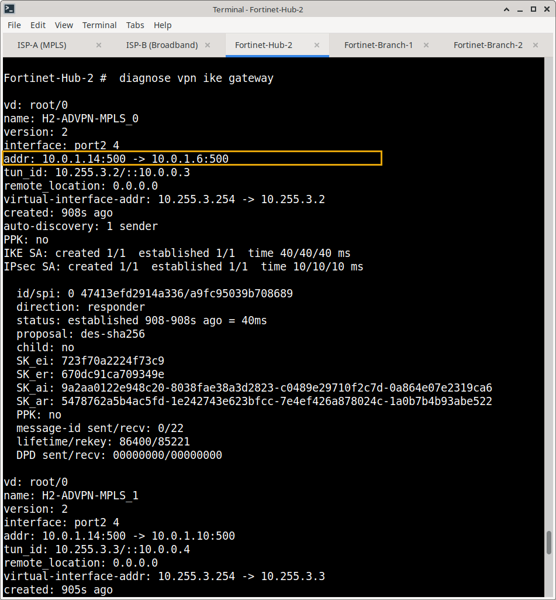

**Hub-2 <----> Branch-2**

```
vd: root/0
name: H2-ADVPN-MPLS_1
version:0.0.3
remote_location: 0.0.0.0
virtual-interface-addr: 10.255.3.254 -> 10.255.3 2
interface: port2 4
addr: 10.0.1.14:500 -> 10.0.1.10:500
tun_id: 1.2
created: 908s ago
auto-discovery: 1 sender
PPK: no
IKE SA0.255.3.3/::10.0.0.4
remote_location: 0.0.0.0
virtual-interface-addr: 10.255.3: created 1/1  established 1/1  time 40/40/40 ms
IPsec SA: created 1/1  established 1/1  time 10/10.254 -> 10.255.3.3
created: 905s ago
auto-discovery: 1 sender
PPK: no
IKE SA: created 1/1  established 1/1  time 20/20/20 ms
IPsec SA: created/10 ms
  id/spi: 0 47413efd2914a336/a9fc95039b708689
  direction: responder
  status: established 908-908s ago = 40ms
  proposal: 1/1  established 1/1  time 0/0/0 ms
  direction: responder
  status: established 905-905s ago = 20ms
  proposal: des-sha256
```
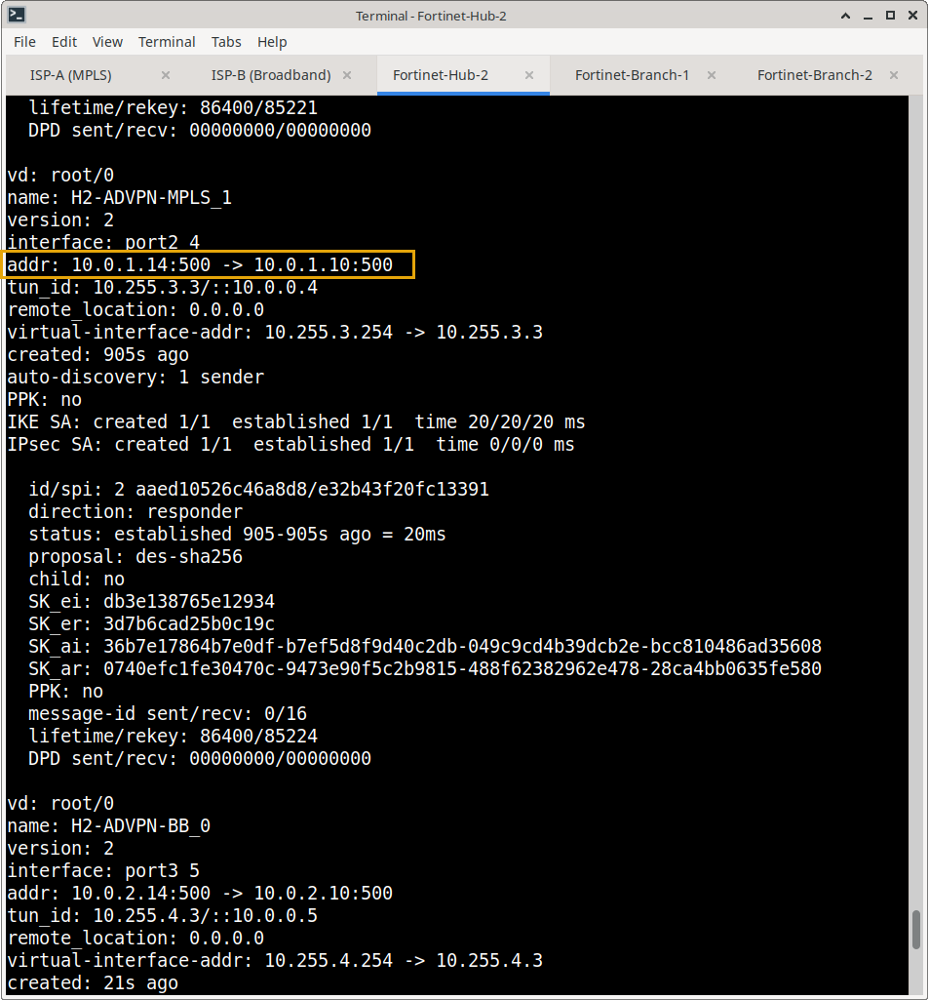

**Hub-2 <----> Branch-2 (Second Tunnel)**

```
vd: root/0
name: H2-ADVPN-MPLS_ des-sha256

vd: root/0
name: H2-ADVPN-BB_0
version: 2
interface: port3 5
addr: 10.0.2.11
version: 2
interface: port2 4
addr: 10.0.1.4:500 -> 10.0.2.10:500
tun_id14:500 -> 10.0.1.10:500
tun_id: 10.255.3.3/::10.0.0.4
: 10.255.4.3/::10.0.0.5
remote_location: 0.0.0.0
virtual-interface-addr: 10.25remote_location: 0.0.0.0
virtual-interface-addr: 10.25.4.254 -> 10.255.4.3
created: 255.3.254 -> 10.255.3.3
created: 901s ago
auto-discovery: 1 sender
PPK: no
IKE SA: created 15s ago
auto-discovery: 1 sender
PPK: no
IKE SA: created 1/1  established 1/1  time 20/20/20 ms
IPsec SA/1  established 1/1  time 20/20/20 ms
IPsec SA: created 1/1  established 1/1  time 0/0/0 ms
  direction: created 1/1  established 1/1  time 0/0/0 ms
  id: responder
  status: established 21-21s ago = 20ms
  proposal: des-sha256

vd: root/0
name: H2-ADVPN-BB_1/spi: 2 aaed10526c46a8d8/e32b43f20fc13391
  direction: responder
  status: established 90
version: 2
interface: port3 5
addr: 10.0.2.15-905s ago = 20ms
  proposal: des-sha256
```
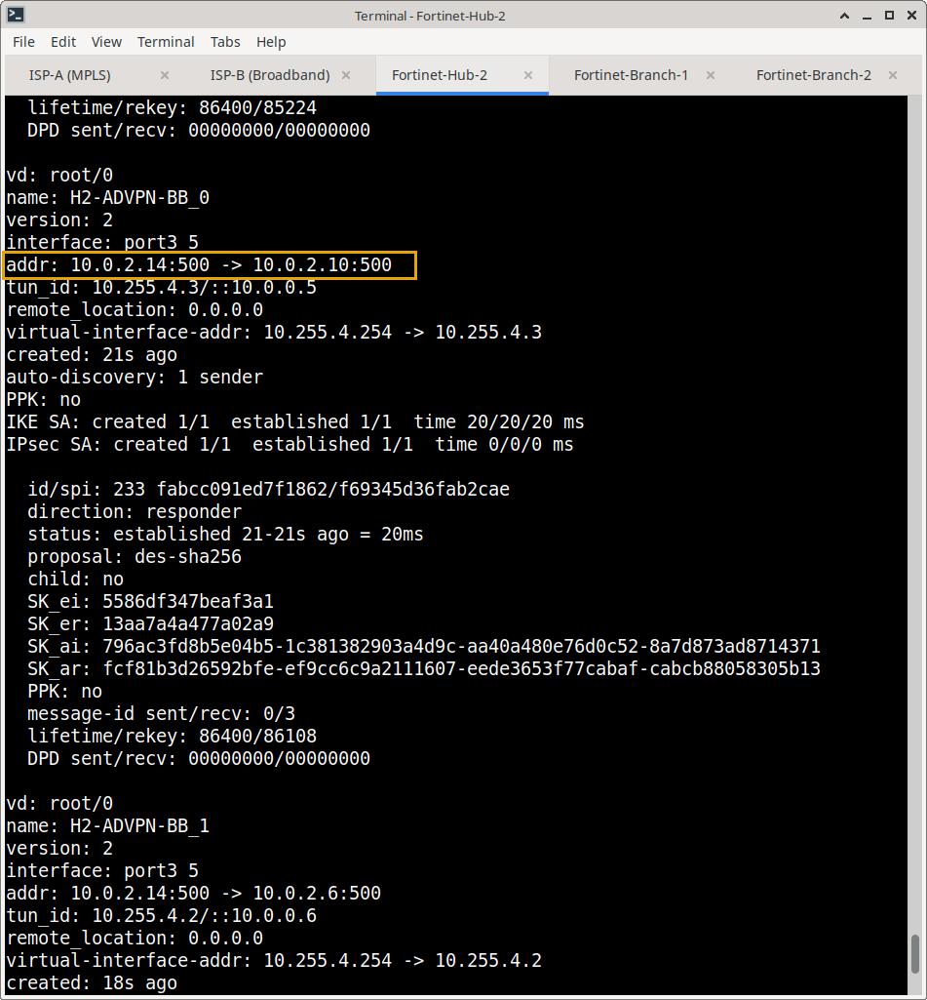

**Hub-2 <----> Branch-1 (Second Tunnel)**

```
vd: root/0
name: H2-ADVPN-BB_1
version: 2
interface: port3 5
addr: 10.0.2.14:500 -> 10.0.2.6:500
tun_id: 10.255.4.2/::10.0.0.6
remote_location: 0.0.0.0
virtual-interface-addr: 10.255.4.254 -> 10.255.4.2
created: 18s ago
auto-discovery: 1 sender
PPK: no
IKE SA: created 1/1  established 1/1  time 20/20/20 ms
IPsec SA: created 1/1  established 1/1  time 0/0/0 ms

  id/spi: 234 b8b31099d5b445a8/a5bf6ee137a7c4c0
  direction: responder
  status: established 18-18s ago = 20ms
  proposal: des-sha256
  child: no
  SK_ei: 3f45b0d6bafcec3a
  SK_er: 25695847836bb555
  SK_ai: fdf2cbea3c8a110b-51196a63958dc983-d4a72c0416097443-d6266f60301fe2fe
  SK_ar: ca5dc9aef916375d-3a3a0b66ca971fd9-86e3bbb76d67aade-99126a239d034450
  PPK: no
  message-id sent/recv: 0/2
  lifetime/rekey: 86400/86111
  DPD sent/recv: 00000000/00000000

Fortinet-Hub-2 #
```
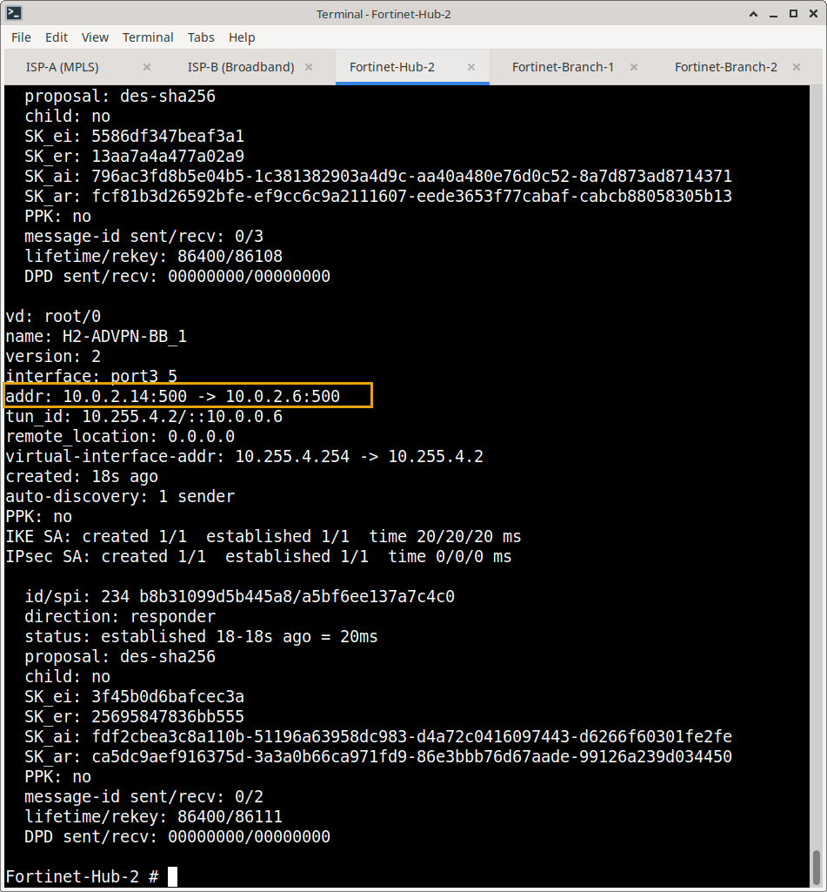

### Dual-Hub Control Plane & BGP Mesh Verification
1. **Hub 1 BGP Summary (5 Established Neighbors):**
   HQ confirms established BGP sessions to Spoke 1, Spoke 2, and the Inter-Hub peer Hub 2 (`10.255.255.2`):
   ```text
   FortiGate-VM64-KVM # get router info bgp summary
   VRF 0 BGP router identifier 1.1.1.1, local AS number 65000
   Neighbor        V    AS MsgRcvd MsgSent   TblVer  InQ OutQ Up/Down  State/PfxRcd
   10.255.1.2      4 65000     443     455        14    0    0 05:35:05        1
   10.255.1.3      4 65000     437     452        14    0    0 06:19:28        1
   10.255.2.2      4 65000     434     446        14    0    0 05:35:08        1
   10.255.2.3      4 65000      68      77        14    0    0 00:57:58        1
   10.255.255.2    4 65000      10      14        14    0    0 00:05:08        3
   Total number of neighbors 5
   ```
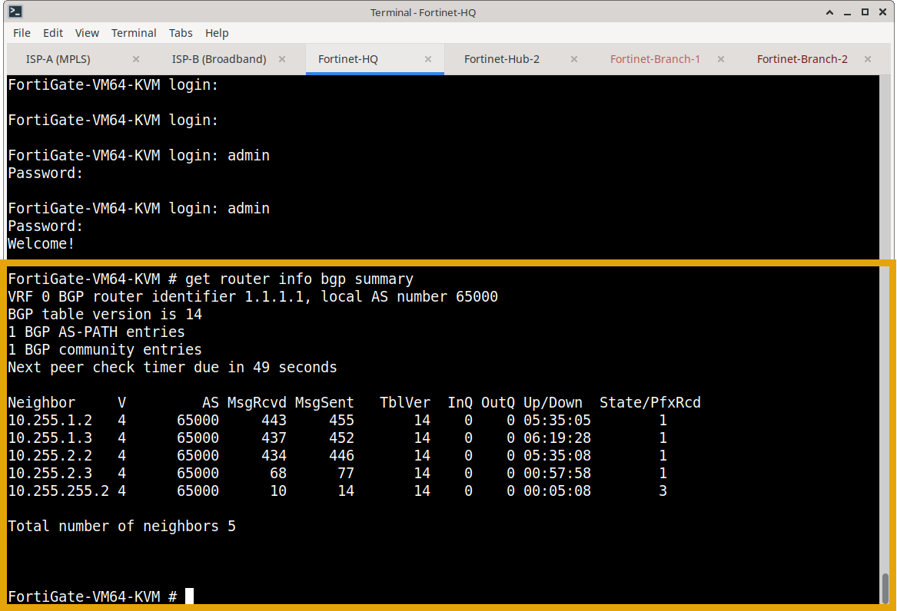

2. **Hub 2 BGP Summary (5 Established Neighbors):**
   Hub 2 confirms established BGP sessions across its dynamic ranges plus the Inter-Hub peer HQ (`10.255.255.1`):
   ```text
   Fortinet-Hub-2 # get router info bgp summary
   VRF 0 BGP router identifier 4.4.4.4, local AS number 65000
   Neighbor        V    AS MsgRcvd MsgSent   TblVer  InQ OutQ Up/Down  State/PfxRcd
   10.255.3.2      4 65000      39      48         6    0    0 00:31:47        1
   10.255.3.3      4 65000      40      50         6    0    0 00:32:58        1
   10.255.4.2      4 65000      22      32         6    0    0 00:16:51        1
   10.255.4.3      4 65000      21      30         6    0    0 00:16:01        1
   10.255.255.1    4 65000      12      10         6    0    0 00:04:28        3
   Total number of neighbors 5
   ```
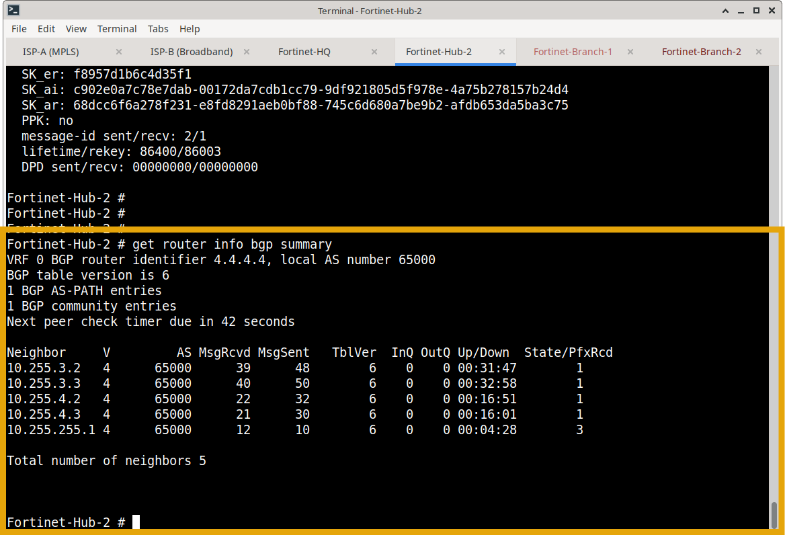

3. **Spoke 1 BGP Summary (4 Overlays Active):**
   Branch-1 confirms active BGP peering to both Hubs concurrently:
   ```text
   FortiGate-VM64-KVM # get router info bgp summary
   VRF 0 BGP router identifier 2.2.2.2, local AS number 65000
   Neighbor        V    AS MsgRcvd MsgSent   TblVer  InQ OutQ Up/Down  State/PfxRcd
   10.255.1.254    4 65000     455     444         7    0    0 05:35:40        5
   10.255.2.254    4 65000     446     435         6    0    0 05:35:43        5
   10.255.3.254    4 65000      49      40         8    0    0 00:33:01        5
   10.255.4.254    4 65000      33      23         9    0    0 00:18:05        5
   Total number of neighbors 4
   ```
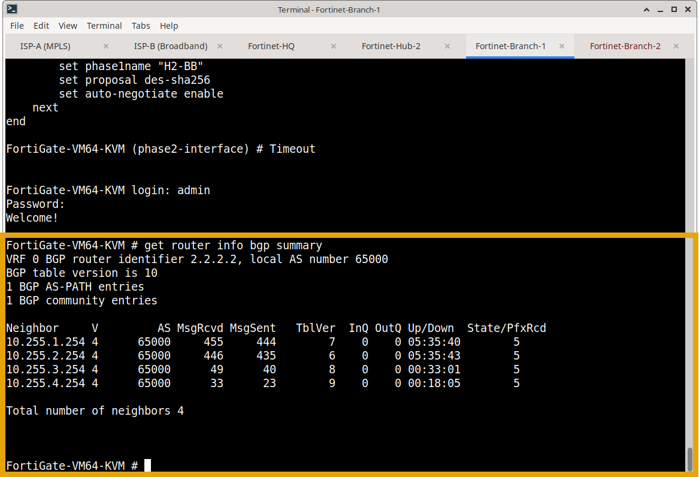

---

### Inter-Hub Datacenter Interconnect (DCI) Verification
Executing a ping across the private Inter-Hub DCI tunnel confirms direct communication between primary and secondary datacenters:

```text
FortiGate-VM64-KVM # execute ping 10.40.40.1
PING 10.40.40.1 (10.40.40.1): 56 data bytes
64 bytes from 10.40.40.1: icmp_seq=0 ttl=255 time=13.7 ms
64 bytes from 10.40.40.1: icmp_seq=1 ttl=255 time=15.3 ms
64 bytes from 10.40.40.1: icmp_seq=2 ttl=255 time=19.0 ms
64 bytes from 10.40.40.1: icmp_seq=3 ttl=255 time=11.9 ms

--- 10.40.40.1 ping statistics ---
4 packets transmitted, 4 packets received, 0% packet loss
round-trip min/avg/max = 11.9/14.9/19.0 ms
```
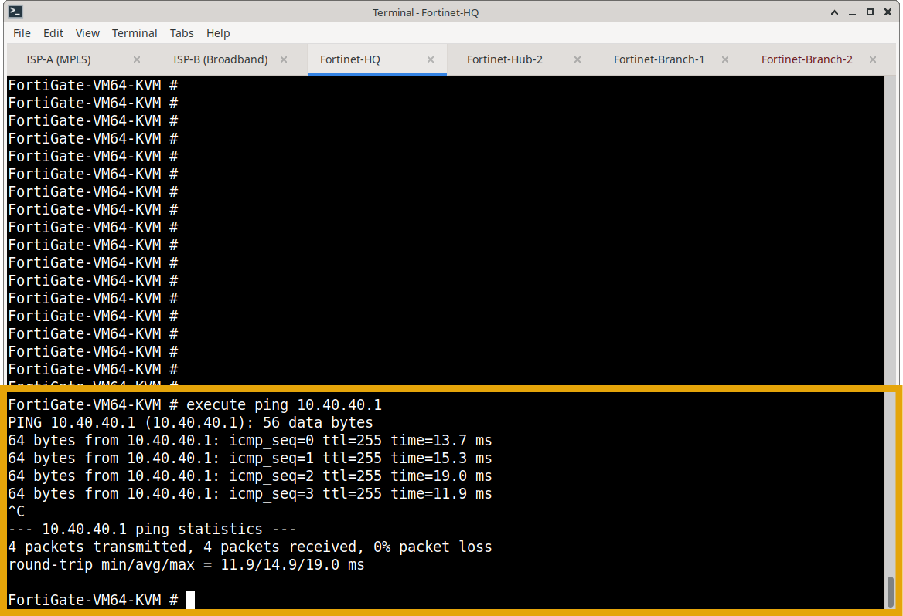

---

### BGP Local-Preference Traffic Steering Proof
Querying the BGP table on Branch-1 proves that traffic engineering functions dynamically via Local-Preference:

1. **Prefix 10.10.10.0/24 (HQ LAN):**
   Advertised by Hub 1 with **`localpref 200`** (selected as best path):
  
  ```text
   FortiGate-VM64-KVM # get router info bgp network 10.10.10.0/24
   Paths: (4 available, best #4)
     Local
       10.255.1.254 from 10.255.1.254 (1.1.1.1)
         Origin IGP metric 0, localpref 200, valid, internal, best
   ```
   
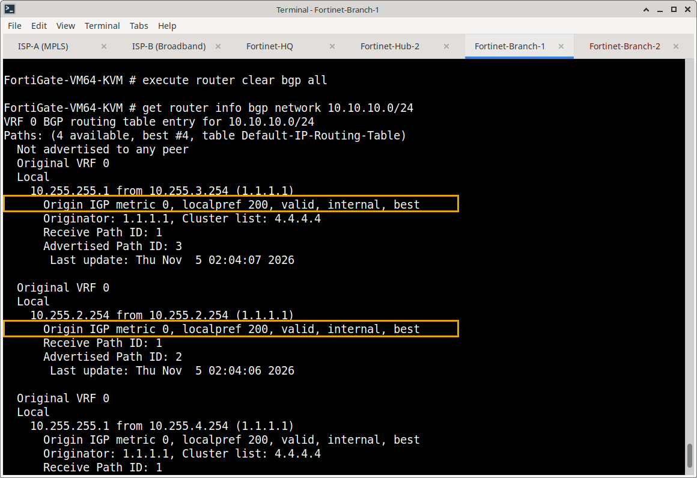
   
2. **Prefix 10.40.40.0/24 (DC-2 LAN):**
   Advertised by Hub 2 with **`localpref 100`** (standby path):
   
   ```text
   FortiGate-VM64-KVM # get router info bgp network 10.40.40.0/24
   Paths: (3 available, best #3)
     Local
       10.255.3.254 from 10.255.3.254 (4.4.4.4)
         Origin IGP metric 0, localpref 100, valid, internal, best
   ```
   
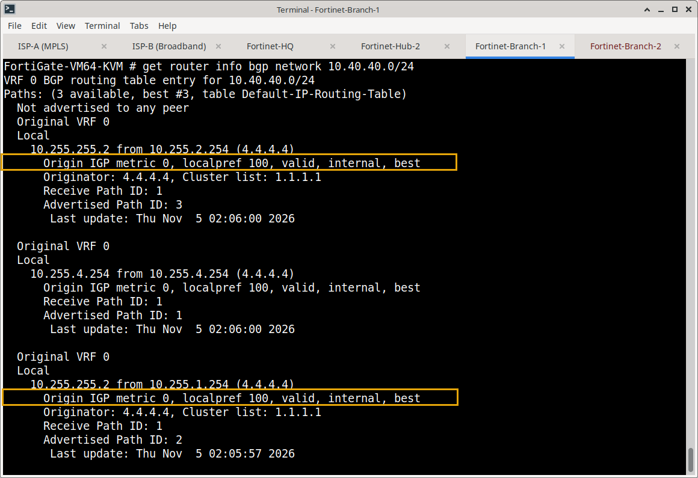

---

### Dynamic Spoke-to-Spoke Shortcut Spawning (Before vs. After)

Initiating traffic between Branch-1 (`10.20.20.10`) and Branch-2 (`10.30.30.10`) triggered the NHRP resolution sequence, spawning a direct shortcut tunnel instance on Branch-1:

```text
name: H2-MPLS_0
version: 2
interface: port2 4
addr: 10.0.1.6:500 -> 10.0.1.10:500
tun_id: 10.0.1.10/::10.0.1.10
virtual-interface-addr: 10.255.3.2 -> 10.255.3.3
auto-discovery: 2 receiver
IKE SA: created 1/1  established 1/1  time 50/50/50 ms
IPsec SA: created 1/1  established 1/1  time 50/50/50 ms
```
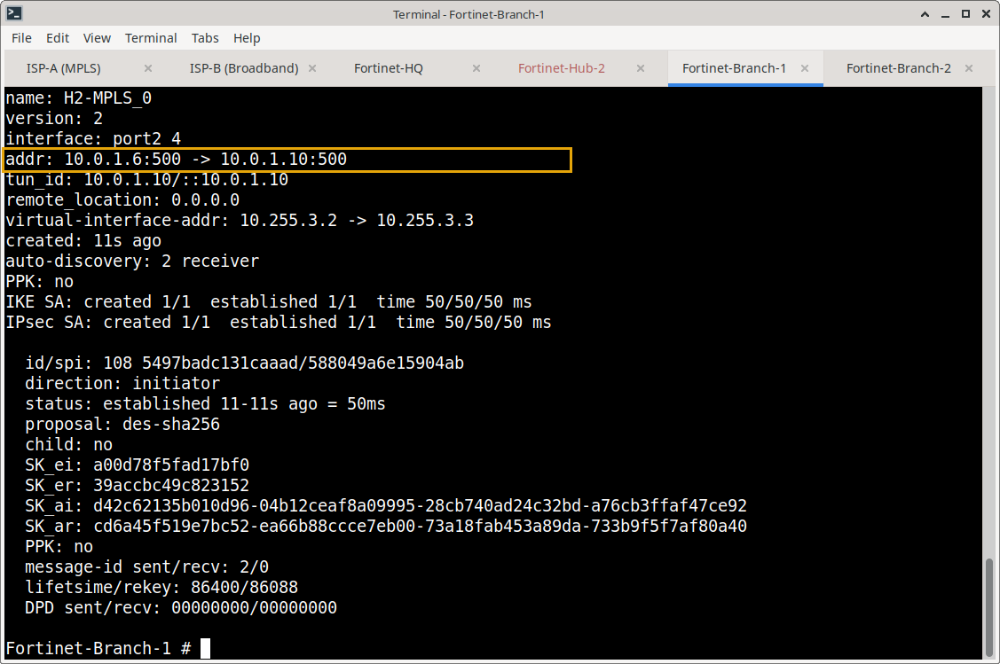

---

#### 1. Initial Path: Transiting Primary Hub 1 (Before Shortcut)
When Branch-1-PC (`10.20.20.10`) initiates its first flow to Branch-2-PC (`10.30.30.10`), no direct tunnel exists between the spokes yet. The initial packets transit through **Primary Hub 1 (`10.255.1.254`)**:

```bash
localhost:~# traceroute 10.30.30.10
traceroute to 10.30.30.10 (10.30.30.10), 30 hops max, 46 byte packets
 1  10.20.20.1 (10.20.20.1)      2.210 ms   2.657 ms   2.181 ms
 2  10.255.1.254 (10.255.1.254) 19.917 ms  16.997 ms  24.569 ms   <-- Transiting Primary Hub 1 (HQ)
 3  10.255.1.3 (10.255.1.3)     40.476 ms  42.091 ms  36.591 ms   <-- Branch-2 MPLS-VPN Gateway
 4  10.30.30.10 (10.30.30.10)   35.103 ms  36.320 ms  37.719 ms
```
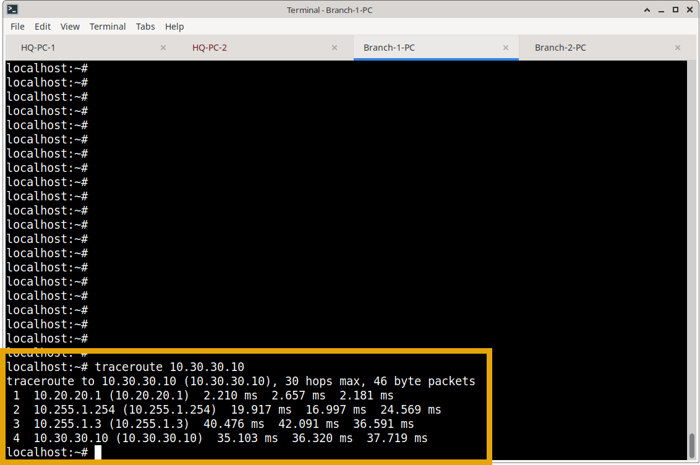

* **Hop Count:** 4 hops total.
* **Path Breakdown:** Traffic routes through Hop 2 at 10.255.1.254 (HQ Hub 1) before reaching Branch-2 at 10.255.1.3.
* **Mechanism:** This transit flow triggers Primary Hub 1 to issue an NHRP Redirect to Branch-1.

---

#### Direct Path: On-Demand Dynamic Shortcut (After Shortcut Established)
Upon receiving the redirect, Branch-1 and Branch-2 dynamically negotiate a direct shortcut tunnel. Subsequent packets bypass Hub 1 entirely, routing straight to Branch-2's MPLS overlay gateway (**10.255.1.3**):

```bash
localhost:~# traceroute 10.30.30.10
traceroute to 10.30.30.10 (10.30.30.10), 30 hops max, 46 byte packets
 1  10.20.20.1 (10.20.20.1)    2.107 ms   2.395 ms   2.508 ms
 2  10.255.1.3 (10.255.1.3)   15.636 ms  15.022 ms  16.575 ms   <-- Direct Spoke Shortcut (HQ Bypassed!)
 3  10.30.30.10 (10.30.30.10) 24.771 ms  21.530 ms  17.489 ms
```

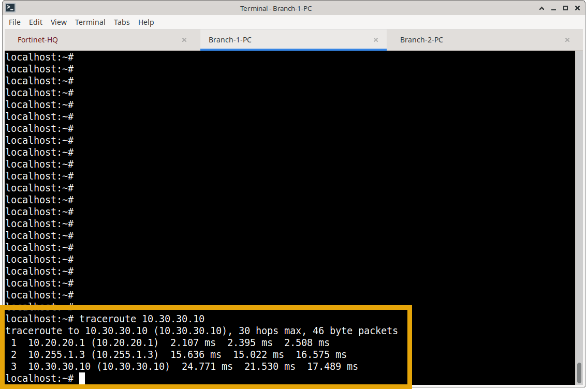

**10.255.1.3 = BRANCH-2 (MPLS-VPN)**

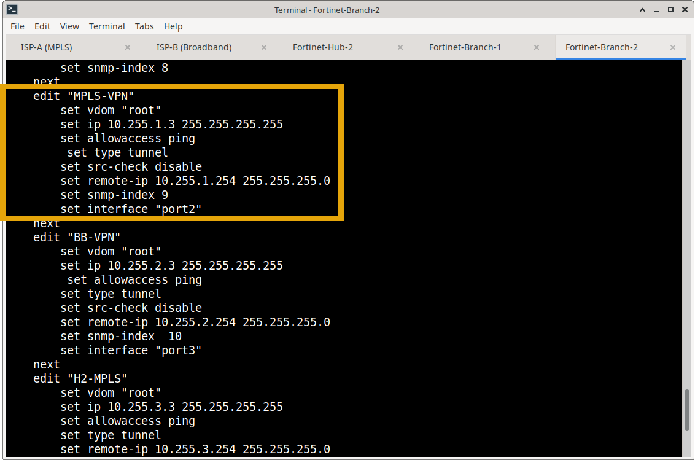

* **Hop Count:** Reduced from 4 hops down to **3 hops total**.
* **Round-Trip Time:** Slashed from ~37 ms down to **~15–16 ms (over 50% latency reduction)**.
* **Direct Overlay Binding:** Notice Hop 2 is **10.255.1.3 directly** (Branch-2 MPLS-VPN). Hop 2 at 10.255.1.254 (HQ) is eliminated from the data path.

---

### The Disaster Recovery Test (Total Hub 1 Datacenter Blackout)

#### Blackout Failure Injection on Primary Hub 1
On Fortinet-HQ, both physical WAN ports were administratively disabled to simulate a total datacenter loss:

```fortios
config system interface
    edit "port2"
        set status down
    next
    edit "port3"
        set status down
    next
end
```
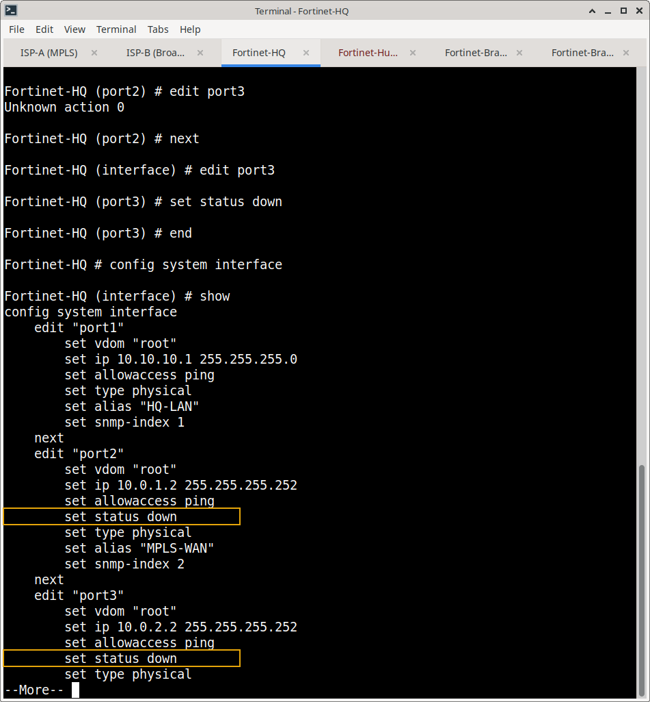

#### Primary Overlay Teardown & Tunnel Detection on Branch-1
Following the shutdown of Hub 1's underlay circuits, Dead Peer Detection (DPD) on Branch-1 expired. Querying the IKE gateway status via `diagnose vpn ike gateway` confirms that both primary overlay tunnels transitioned out of the established state into a connecting status:

```text
Fortinet-Branch-1 # diagnose vpn ike gateway

vd: root/0
name: MPLS-VPN
version: 2
interface: port2 4
addr: 10.0.1.6:500 -> 10.0.1.2:500
tun_id: 10.0.1.2/::10.0.1.2
remote_location: 0.0.0.0
virtual-interface-addr: 10.255.1.2 -> 0.0.0.0
created: 13s ago
PPK: no
IKE SA: created 1/1  established 0/0
IPsec SA: created 1/1  established 0/0

  id/spi: 109 9d1fa86be0981c90/0000000000000000
  direction: initiator
  status: connecting, state 3, started 13s ago

vd: root/0
name: BB-VPN
version: 2
interface: port3 5
addr: 10.0.2.6:500 -> 10.0.2.2:500
tun_id: 10.0.2.2/::10.0.2.2
remote_location: 0.0.0.0
virtual-interface-addr: 10.255.2.2 -> 0.0.0.0
created: 2s ago
PPK: no
IKE SA: created 1/1  established 0/0
IPsec SA: created 1/1  established 0/0

  id/spi: 110 909a5e8e87698855/0000000000000000
  direction: initiator
  status: connecting, state 3, started 2s ago
```

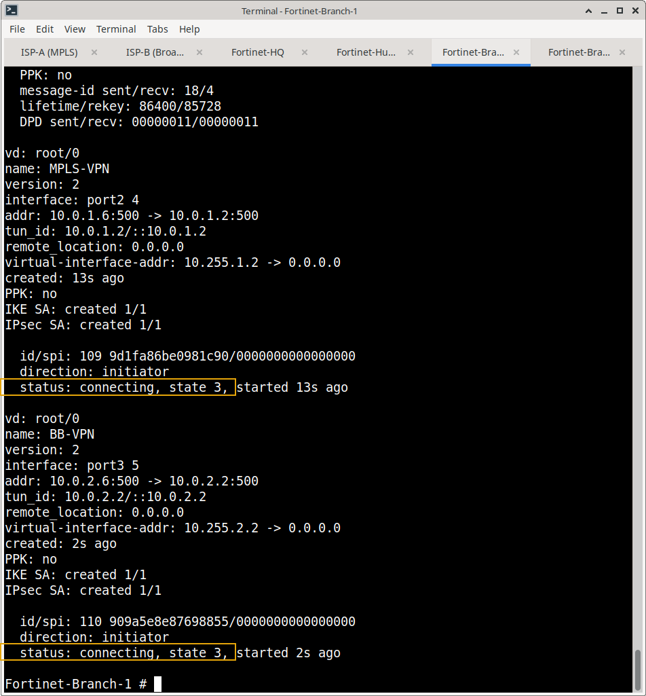


* **Telemetry Analysis:** Both MPLS-VPN and BB-VPN display `status: connecting, state 3`. This confirms the local IKE daemon identified the loss of Primary Hub 1, tore down the active Security Associations, and entered re-negotiation mode without blackholing traffic.

#### Spoke Autonomous BGP Control-Plane Failover
Branch-1 immediately detected the loss of Hub 1. BGP neighbor sessions to Hub 1 dropped to `Active`, while Hub 2 neighbors remained established:

```text
Fortinet-Branch-1 # get router info bgp summary
Neighbor        V    AS MsgRcvd MsgSent   TblVer  InQ OutQ Up/Down  State/PfxRcd
10.255.1.254    4 65000      11      11        0    0    0 never    Active
10.255.2.254    4 65000      11      11        0    0    0 never    Active
10.255.3.254    4 65000      46      44        1    0    0 00:35:54        3
10.255.4.254    4 65000      47      43        1    0    0 00:35:54        3
Total number of neighbors 4
```
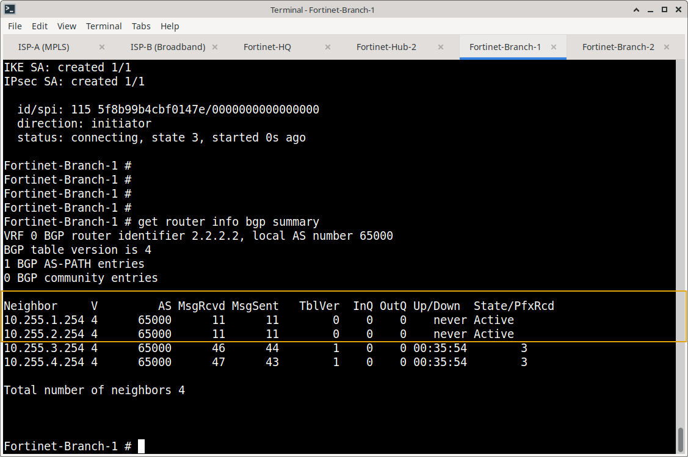

#### BGP Route Promotion to Standby Hub 2
Branch-1's BGP table automatically promoted Hub 2's paths (`10.255.3.254` and `10.255.4.254`) to active best paths:

```text
Fortinet-Branch-1 # get router info bgp network
   Network          Next Hop            Metric LocPrf Weight RouteTag Path
*>i10.30.30.0/24    10.255.4.3               0    100      0        0 i <2/2>
*>i                 10.255.3.3               0    100      0        0 i <1/1>
*>i10.40.40.0/24    10.255.3.254             0    100      0        0 i <1/1>
```

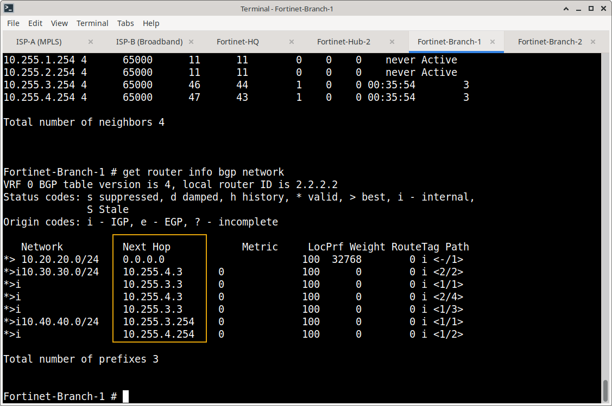

#### Data Plane Continuity During Disaster Recovery
Running an ICMP stream from Branch-1-PC to Branch-2-PC confirmed traffic continued flowing with stable round-trip times (~14–27 ms), and new path traceroutes routed directly over the surviving Hub 2 overlay (`10.255.3.3`):

```bash
localhost:~# traceroute 10.30.30.10
traceroute to 10.30.30.10 (10.30.30.10), 30 hops max, 46 byte packets
 1  10.20.20.1 (10.20.20.1)    2.464 ms   2.657 ms   0.018 ms
 2  10.255.3.3 (10.255.3.3)   19.632 ms  24.598 ms  15.844 ms   <-- Active Routing via Hub 2 Overlay
 3  10.30.30.10 (10.30.30.10) 16.050 ms  22.460 ms  16.990 ms
```
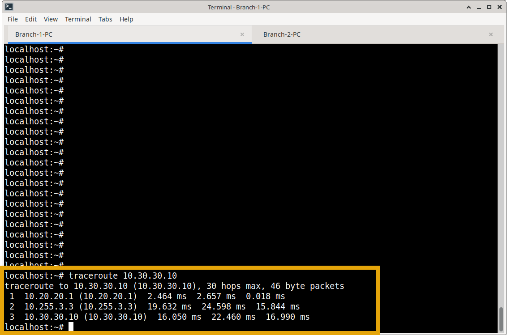

**10.255.3.3 = BRANCH-2 (H2-MPLS)**

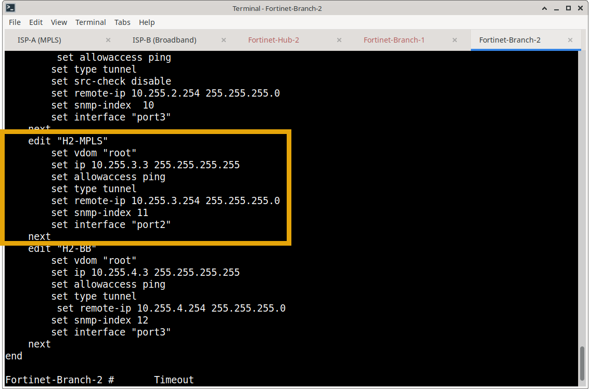

---

## Evidence Index (Curated Proof)

| Category / Phase | Key Artifact (`screenshots/`) | Purpose & Technical Verification |
| :--- | :--- | :--- |
| **Architecture** | `advpn-lucid-chart.png` | Comprehensive network diagram illustrating Dual-Hub layout, DCI interconnect, and 4-tunnel spoke mesh. |
| **Architecture** | `topology.png` | Complete PNETLab lab topology showing Hub 1, Hub 2, ISPs, and dual-homed branch sites. |
| **Control Plane (DCI)** | `dci-config-router-bgp-show-hq.png` | Inter-Hub DCI IPsec tunnel and iBGP peering configuration on HQ. |
| **DCI Data Plane** | `hq-pings-hub-2-lan.png` | Direct ICMP ping verification between HQ and Hub 2 LAN (10.40.40.1) across the private DCI tunnel. |
| **Spoke SD-WAN** | `config-sd-wan-members-show-branch-1.png` | Branch-1 SD-WAN zone configuration bundling all 4 overlay tunnels into VPN-ZONE. |
| **BGP Mesh (Hub 1)** | `get-router-info-bgp-summary-hq.png` | Hub 1 BGP summary verifying 5 established peers (Spokes plus Hub 2 DCI peer). |
| **BGP Mesh (Hub 2)** | `get-router-info-bgp-summary-hub-2.png` | Hub 2 BGP summary verifying 5 established peers (Spokes plus Hub 1 DCI peer). |
| **BGP Mesh (Spoke)** | `get-router-info-bgp-summary-branch-1.png` | Spoke 1 BGP summary confirming 4 active overlay sessions (2 to Hub 1, 2 to Hub 2). |
| **Traffic Engineering**| `get-router-info-bgp-network-10.10.10.0-24-local-preference-200.png` | Spoke BGP table showing Primary Hub 1 routes preferred at Local-Preference 200. |
| **Traffic Engineering**| `get-router-info-bgp-network-10.40.40.0-24-local-preference-100.png` | Spoke BGP table showing Standby Hub 2 routes maintained as backup at Local-Preference 100. |
| **Transit Path** | `underlay-overlay-traceroute-after-routing-over-tunnel.png` | Initial traceroute prior to shortcut, proving 4-hop transit through Primary Hub 1 (10.255.1.254). |
| **Shortcut Tunnel** | `diagnose-vpn-ike-gateway-shortcut-branch-1.png` | Spoke IKE gateway output verifying dynamic on-demand child shortcut tunnel establishment (H2-MPLS_0). |
| **Shortcut Path** | `hub-ha-test-shortcut-traceroute.png` | **Shortcut Proof:** Post-shortcut traceroute showing 3-hop direct delivery to Branch-2 (10.255.1.3), bypassing both hubs. |
| **Disaster Injection** | `hub-ha-test-shutting-down-hq-interfaces.png` | CLI output on HQ administratively shutting down physical WAN circuits (port2 and port3). |
| **Tunnel Teardown** | `hub-ha-test-vpn-interfaces-down-ike-gateway-branch.png` | Spoke IKE gateway telemetry showing Hub 1 tunnels transitioning to dead/connecting state. |
| **Control Failover** | `hub-ha-test-get-router-bgp-summary-during-failure-branch-1.png` | Spoke BGP summary confirming control plane failover, with Hub 2 maintaining established peering. |
| **Route Promotion** | `hub-ha-test-get-router-info-bgp-network-branch-1.png` | Spoke BGP table showing Hub 2 backup paths immediately promoted to active best paths. |
| **Disaster Recovery** | `hub-ha-test-ping-continues-after-packet-loss-47-branch-1-pc.png` |  Spoke-to-spoke ping traffic maintaining continuous communication throughout the Primary Hub blackout. |

---

## Business Value Delivered
* **Zero Datacenter Single Point of Failure:** Eliminates corporate WAN downtime during catastrophic datacenter failures by distributing route reflection and transit capacity across two geographically diverse hubs.
* **Autonomous Disaster Recovery:** Requires zero manual intervention or route updates during primary hub outages; spokes automatically failover BGP control planes and maintain active shortcut traffic.
* **Traffic Engineering Predictability:** Enforces deterministic path selection using standard BGP Local-Preference, keeping private MPLS traffic on primary infrastructure until an outage occurs.

---

---

### ➡️ What's Next?

With dual-hub disaster recovery and autonomous control-plane failover fully validated, the next step is to solve the classic WAN asymmetry challenge by dynamically influencing *inbound* return traffic based on real-time branch link health.

Continue to the next project to explore bidirectional path symmetry:
- **[Project 13: Dynamic Inbound Path Control via BGP Driven by SD-WAN SLA Status](../13-inbound-bgp-sla-control/)** – Utilizing `route-map-out-preferable` to dynamically manipulate BGP MED metrics based on SLA breaches, forcing upstream hubs to automatically reroute return traffic away from degraded branch circuits.

---

[⬅️ Back to Fortinet SD-WAN Masterclass Overview](../README.md)
