# Dynamic Inbound Path Control via BGP Driven by SD-WAN SLA Status

## Summary
In distributed enterprise architectures, controlling **outbound path selection** from the branch (Spoke ➔ Internet or Spoke ➔ Hub) is straightforward: the local FortiGate measures link performance and routes packets out of the healthiest circuit.

However, **inbound path engineering** (Hub ➔ Spoke or Datacenter ➔ Branch) presents a classic WAN challenge:
* If a primary MPLS circuit experiences brownouts, high jitter, or packet loss, the branch firewalls can detect the breach and shift outbound flows to Broadband.
* However, remote hubs and datacenters have no native visibility into downstream branch access circuit quality. Without control-plane signaling, the Hub continues forwarding return traffic into the degraded circuit, creating severe **asymmetric link degradation**.
* Standard BGP hold-down timers (180 seconds) are far too slow to react to brownouts, and static routing cannot dynamically alter upstream metric weights.

This project implements **Automated Bidirectional Path Symmetry**:
1. **Performance SLA Probing:** Fortinet-Branch-1 monitors overlay health to the Hub via `ADVPN_HEALTH`, enforcing a strict 5% packet loss ceiling.
2. **Dynamic BGP Multi-Exit Discriminator (MED) Signaling:** Branch-1 utilizes FortiOS `route-map-out-preferable` bound to `config system sdwan neighbor`. When healthy, Branch-1 advertises its local subnet (10.20.20.0/24) with **Metric 100 on MPLS** and **Metric 200 on Broadband**.
3. **Autonomous Inbound Failover:** When 15% packet loss was injected onto the MPLS circuit via an inline Linux Network Degradation Device (`tc netem`), Branch-1 detected the SLA breach (`sla_map=0x0`) and automatically withdrew the preferred route-map. It fell back to advertising **Metric 500 on MPLS**.
4. **Control and Data Plane Proof:** Without touching any configuration on Fortinet-HQ, HQ's BGP engine immediately demoted the MPLS path (Metric 500) and promoted Broadband (Metric 200) to the active best path. Inbound traceroutes and packet sniffers confirmed return traffic shifted from MPLS-VPN (10.255.1.2) to BB-VPN (10.255.2.2). Clearing the impairment automatically restored Metric 100, achieving hitless recovery.

---

## Lab Architecture & Dynamic Signaling Workflow

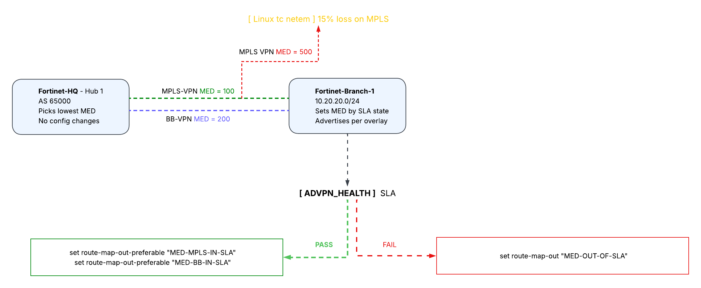

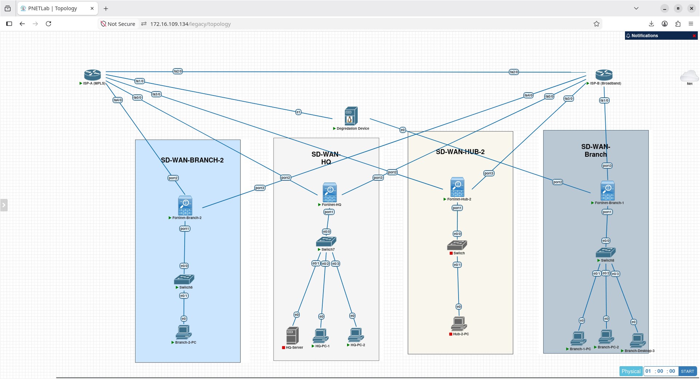

### BGP Metric (MED) Hierarchy Matrix
| Operational State | Overlay Tunnel | Egress BGP Route-Map | Advertised Metric (MED) | HQ BGP Selection Status | Inbound Forwarding Action |
| :--- | :--- | :--- | :--- | :--- | :--- |
| **Normal (In-SLA)** | MPLS-VPN (Member 3) | MED-MPLS-IN-SLA | **Metric 100** | **Best Path (`*>`)** | HQ forwards inbound over MPLS |
| **Normal (In-SLA)** | BB-VPN (Member 4) | MED-BB-IN-SLA | **Metric 200** | Backup Path | Standby |
| **Impaired (Out-of-SLA)**| MPLS-VPN (Member 3) | MED-OUT-OF-SLA | **Metric 500** | Demoted Path | Dropped from active forwarding |
| **Impaired (In-SLA)** | BB-VPN (Member 4) | MED-BB-IN-SLA | **Metric 200** | **Promoted Best Path (`*>`)** | HQ forwards inbound over Broadband |

---

## Configuration & Architecture Design

### 1. In-SLA and Out-of-SLA BGP Route-Maps (Fortinet-Branch-1)
Branch-1 defines three route-maps:
* **MED-MPLS-IN-SLA:** Assigns Metric 100 to make MPLS the primary inbound entry point when healthy.
* **MED-BB-IN-SLA:** Assigns Metric 200 to establish Broadband as the secondary backup path.
* **MED-OUT-OF-SLA:** Assigns Metric 500 to dynamically demote an impaired circuit when SLA thresholds are breached.

```fortios
config router route-map
    edit "MED-MPLS-IN-SLA"
        config rule
            edit 1
                set set-metric 100
            next
        end
    next
    edit "MED-BB-IN-SLA"
        config rule
            edit 1
                set set-metric 200
            next
        end
    next
    edit "MED-OUT-OF-SLA"
        config rule
            edit 1
                set set-metric 500
            next
        end
    next
end
```
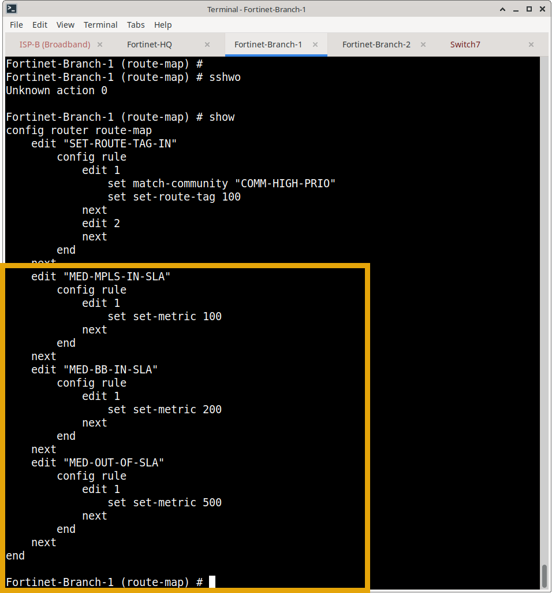

### 2. SD-WAN Performance Probe & BGP Neighbor Binding (Fortinet-Branch-1)
Under `config system sdwan`, the `ADVPN_HEALTH` probe targets HQ's gateway (10.10.10.1) with an aggressive 2% packet loss threshold. Under `config neighbor`, each BGP peering session is bound to its respective overlay member and SLA ID 1:

```fortios
config system sdwan
    config health-check
        edit "ADVPN_HEALTH"
            set server "10.10.10.1"
            set members 3 4
            set interval 1000
            set failtime 3
            set recoverytime 5
            config sla
                edit 1
                    set latency-threshold 150
                    set jitter-threshold 30
                    set packetloss-threshold 2
                next
            end
        next
    end
    config neighbor
        edit "10.255.1.254"
            set member 3
            set health-check "ADVPN_HEALTH"
            set sla-id 1
        next
        edit "10.255.2.254"
            set member 4
            set health-check "ADVPN_HEALTH"
            set sla-id 1
        next
    end
end
```
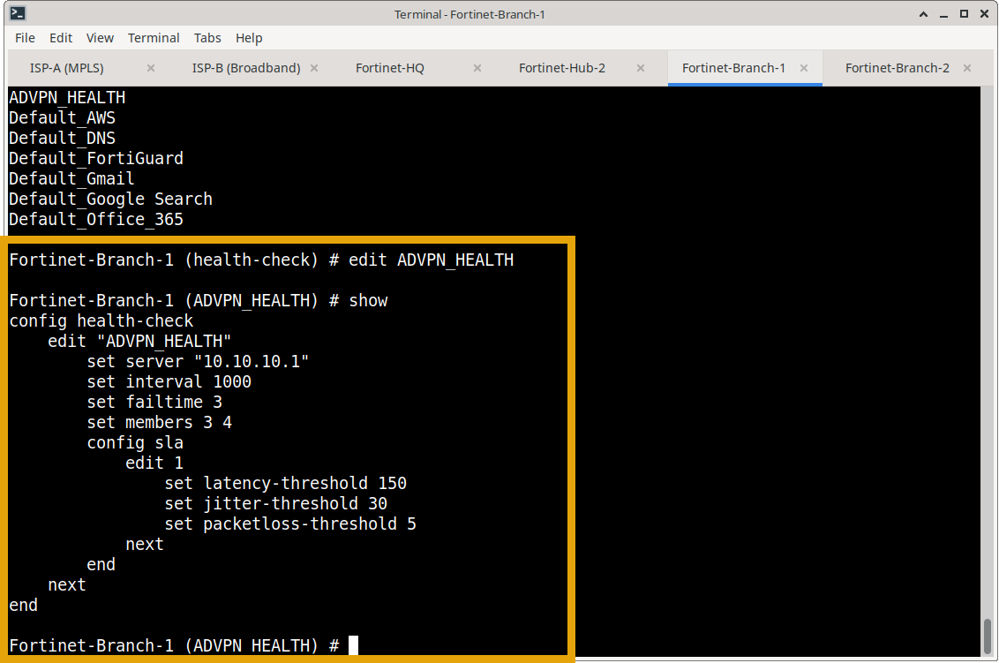

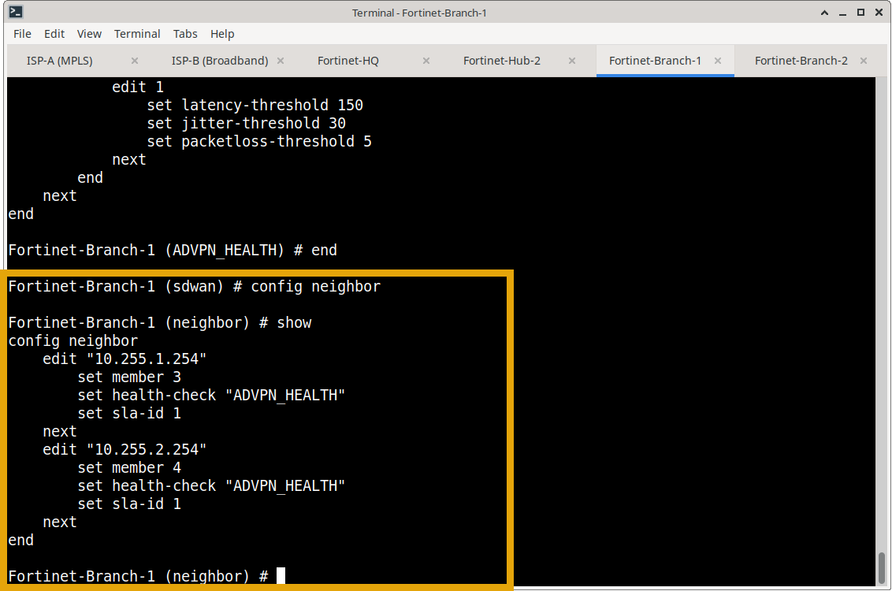

### 3. Dynamic BGP Neighbor Signaling (Fortinet-Branch-1)
Branch-1 couples the SD-WAN SLA state to BGP using `route-map-out-preferable`. When the member satisfies SLA ID 1, FortiOS advertises the preferred route-map. If SLA ID 1 fails, FortiOS automatically withdraws the preferred map and falls back to `route-map-out`:

```fortios
config router bgp
    config neighbor
        edit "10.255.1.254"
            set route-map-out-preferable "MED-MPLS-IN-SLA"
            set route-map-out "MED-OUT-OF-SLA"
        next
        edit "10.255.2.254"
            set route-map-out-preferable "MED-BB-IN-SLA"
            set route-map-out "MED-OUT-OF-SLA"
        next
    end
end
```
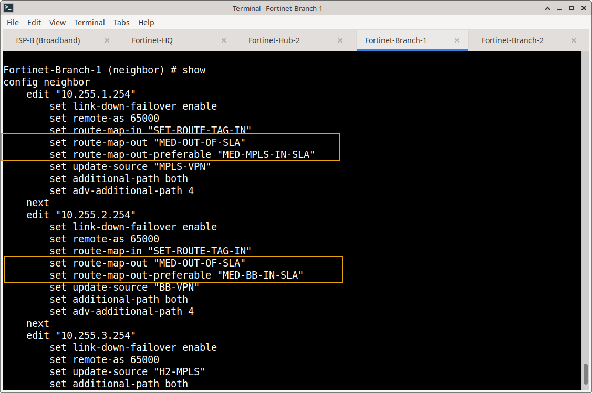

---

## Verification & Execution Lifecycle

### Phase 1: Baseline Verification (Primary MPLS Preferred at Metric 100)

1. **HQ BGP Table Telemetry:**
   Checking the BGP table on Fortinet-HQ confirms both candidate paths from Branch-1 (2.2.2.2). The MPLS path (10.255.1.2) is preferred due to lower metric:
   ```text
   Fortinet-HQ # get router info bgp network 10.20.20.0/24
   VRF 0 BGP routing table entry for 10.20.20.0/24
   Paths: (2 available, best #1, table Default-IP-Routing-Table)
     Original VRF 0
     Local, (Received from a RR-client)
       10.255.1.2 from 10.255.1.2 (2.2.2.2)
         Origin IGP metric 100, localpref 100, valid, internal, best
       10.255.2.2 from 10.255.2.2 (2.2.2.2)
         Origin IGP metric 200, localpref 100, valid, internal
   ```
   
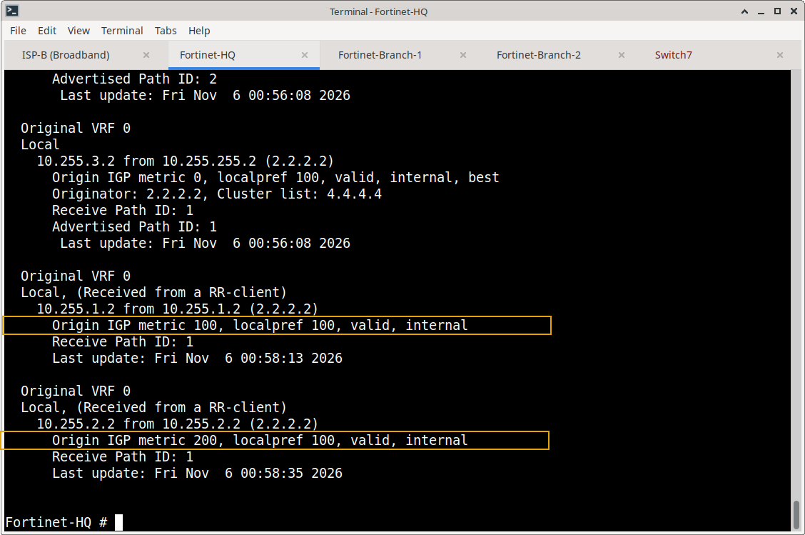

2. **HQ Kernel Routing Table Details:**
   Querying the kernel routing entry on HQ confirms that 10.20.20.0/24 is installed pointing out `MPLS-VPN` with `metric 100`:
   ```text
   Fortinet-HQ # get router info routing-table details 10.20.20.0
   Routing table for VRF=0
   Routing entry for 10.20.20.0/24
     Known via "bgp", distance 200, metric 100, best
     * vrf 0 10.255.1.2 priority 1 (recursive is directly connected, MPLS-VPN)
   ```
   
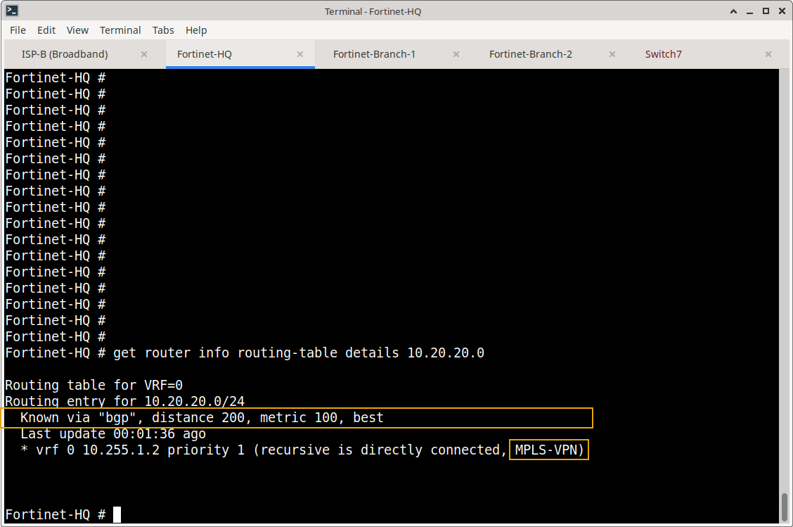

3. **Inbound Data Plane Traceroute (HQ-PC-1 ➔ Branch-1-PC):**
   ```bash
   localhost:~# traceroute 10.20.20.10
   traceroute to 10.20.20.10 (10.20.20.10), 30 hops max, 46 byte packets
    1  10.10.10.1 (10.10.10.1)    2.754 ms   2.395 ms   2.496 ms
    2  10.255.1.2 (10.255.1.2)   22.547 ms  24.261 ms  17.152 ms   <-- Inbound via MPLS-VPN Tunnel
    3  10.20.20.10 (10.20.20.10) 23.439 ms  16.472 ms  15.295 ms
   ```

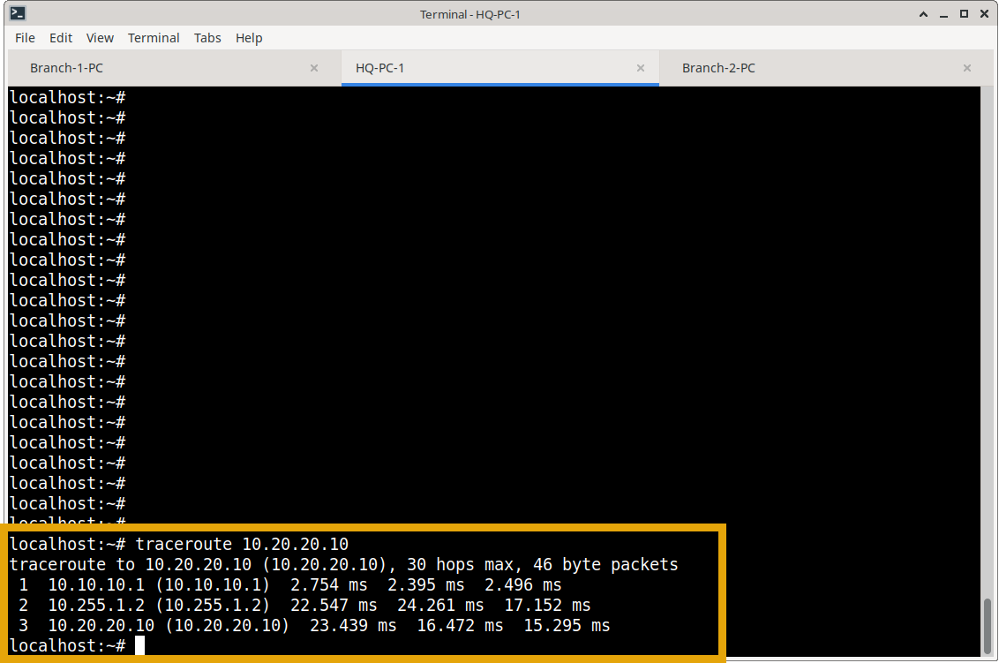

**10.255.1.2 = Branch-1 (MPLS-VPN)**

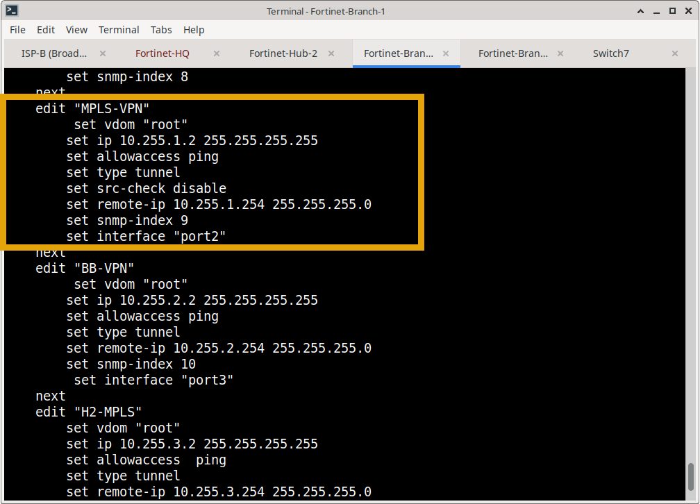

4. **Wire Sniffer Confirmation on Branch-1:**
   ```text
   Fortinet-Branch-1 # diagnose sniffer packet any "host 10.20.20.10" 4 0 l
   MPLS-VPN in 10.10.10.10 -> 10.20.20.10: icmp: echo request          <-- Inbound arriving on MPLS
   port1 out 10.10.10.10 -> 10.20.20.10: icmp: echo request
   port1 in 10.20.20.10 -> 10.10.10.10: icmp: echo reply
   MPLS-VPN out 10.20.20.10 -> 10.10.10.10: icmp: echo reply
   ```
   
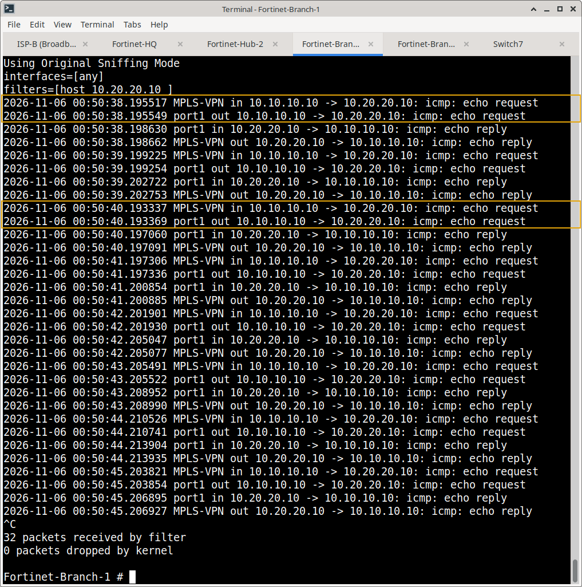

---

### Phase 2: Impairment Injection & Dynamic SLA Breach

1. **Linux Network Degradation Injection:**
   On the inline Network Degradation Appliance, 15% random packet loss was injected onto the MPLS circuit:
   ```bash
   localhost:~# sudo tc qdisc add dev eth0 root netem loss 15%
   ```
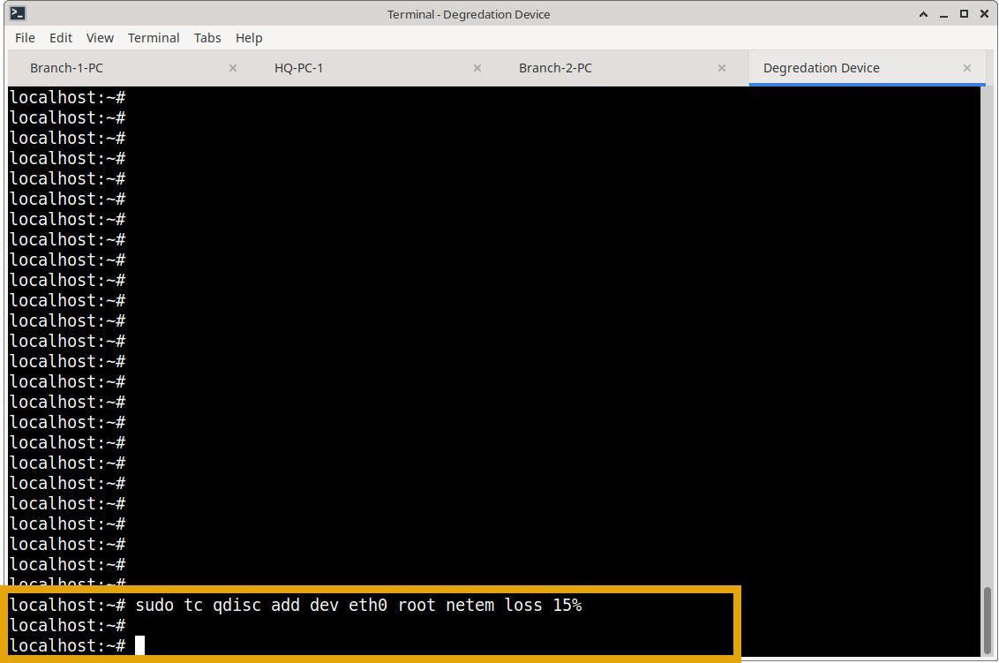

2. **Branch-1 SLA State Transition:**
   Within 3 seconds, Branch-1's `ADVPN_HEALTH` probe detected the loss and flagged Member 3 as failed:
   ```text
   Fortinet-Branch-1 # diagnose sys sdwan health-check
   Health Check(ADVPN_HEALTH):
   Seq(3 MPLS-VPN): state(alive), packet-loss(18.000%) latency(18.287), jitter(2.028) sla_map=0x0
   Seq(4 BB-VPN): state(alive), packet-loss(0.000%) latency(17.867), jitter(2.919) sla_map=0x1
   ```
   * Because packet loss (18%) exceeded the 5% threshold, Member 3 transitioned to `sla_map=0x0`.
   * FortiOS automatically withdrew `route-map-out-preferable` and applied `MED-OUT-OF-SLA` (Metric 500) to BGP neighbor 10.255.1.254.

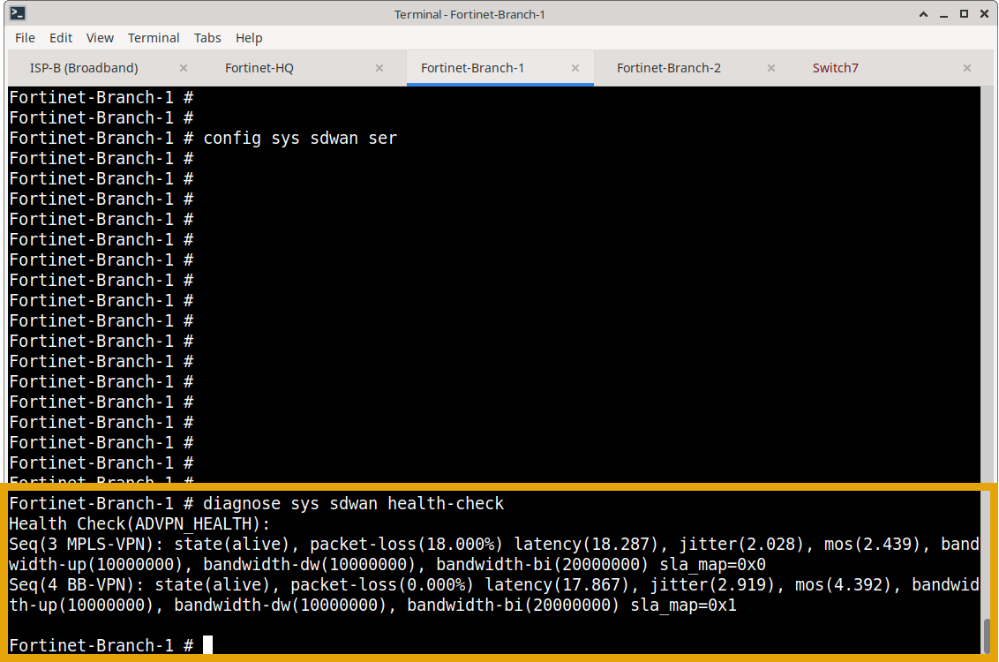

---

### Phase 3: Autonomous Inbound Path Failover on HQ

Without any manual intervention or local configuration changes on Fortinet-HQ:

1. **HQ BGP Table Telemetry (Control-Plane Proof):**
   ```text
   Fortinet-HQ # get router info bgp network 10.20.20.0/24
   VRF 0 BGP routing table entry for 10.20.20.0/24
   Paths: (2 available, best #2, table Default-IP-Routing-Table)
     Original VRF 0
     Local, (Received from a RR-client)
       10.255.1.2 from 10.255.1.2 (2.2.2.2)
         Origin IGP metric 500, localpref 100, valid, internal             <-- DEMOTED (Metric 500)
       10.255.2.2 from 10.255.2.2 (2.2.2.2)
         Origin IGP metric 200, localpref 100, valid, internal, best       <-- PROMOTED (Metric 200)
   ```
   * **Telemetry Analysis:** The MPLS path dynamically updated its metric from 100 to **500**. Because 200 < 500, HQ promoted Broadband (10.255.2.2) to the active best path (`*>`).

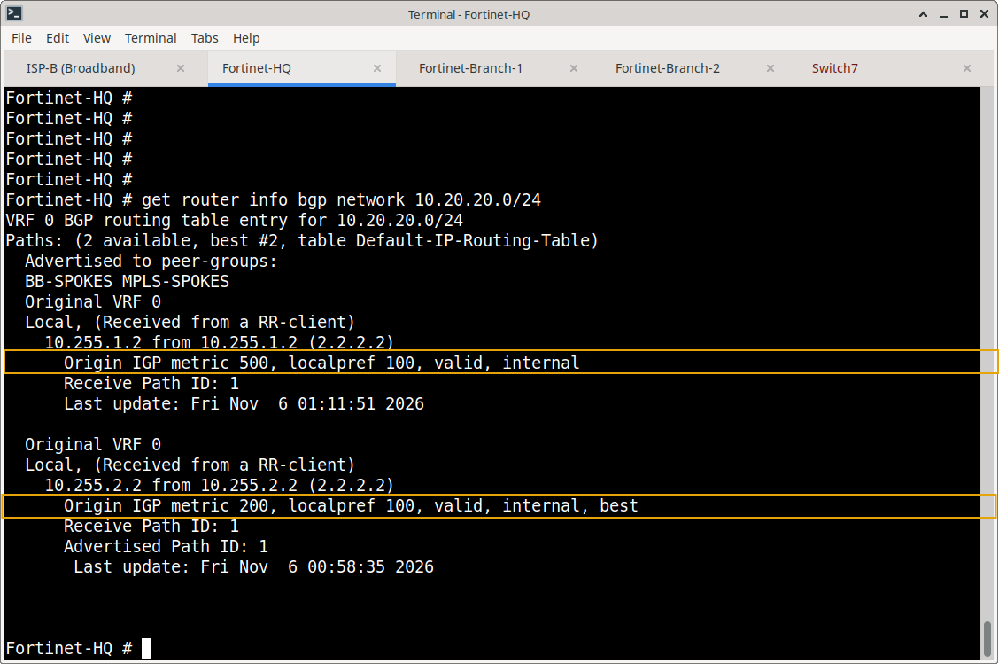


2. **HQ Kernel Routing Table Details Update:**
   ```text
   Fortinet-HQ # get router info routing-table details 10.20.20.0
   Routing table for VRF=0
   Routing entry for 10.20.20.0/24
     Known via "bgp", distance 200, metric 200, best
     * vrf 0 10.255.2.2 priority 1 (recursive is directly connected, BB-VPN)
   ```
   * The kernel routing table immediately shifted the forwarding pointer from `MPLS-VPN` to `BB-VPN`.

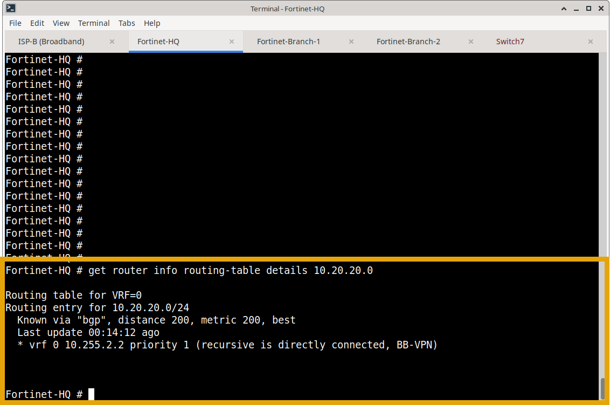


3. **Inbound Data Plane Shift (HQ-PC-1 ➔ Branch-1-PC):**
   Rerunning traceroute from HQ-PC-1 confirms the data plane shifted to the Broadband overlay tunnel:
   ```bash
   localhost:~# traceroute 10.20.20.10
   traceroute to 10.20.20.10 (10.20.20.10), 30 hops max, 46 byte packets
    1  10.10.10.1 (10.10.10.1)    3.537 ms   2.372 ms   2.259 ms
    2  10.255.2.2 (10.255.2.2)   15.736 ms  14.629 ms  17.457 ms   <-- Shifted to BB-VPN Inbound!
    3  10.20.20.10 (10.20.20.10) 23.880 ms  19.941 ms  16.843 ms
   ```

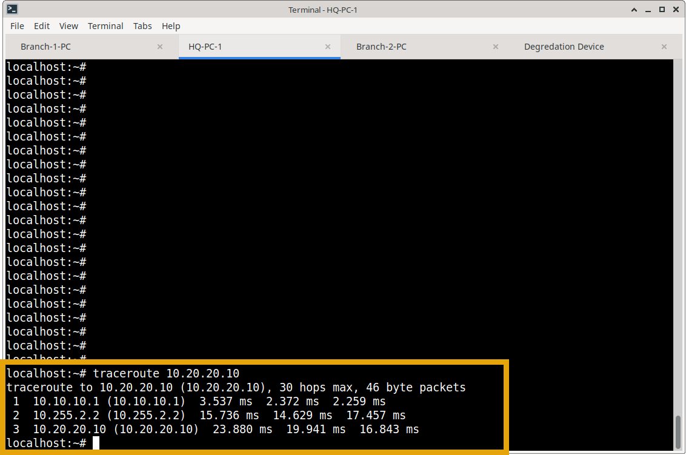

**10.255.2.2 = Branch-1 (BB-VPN)**

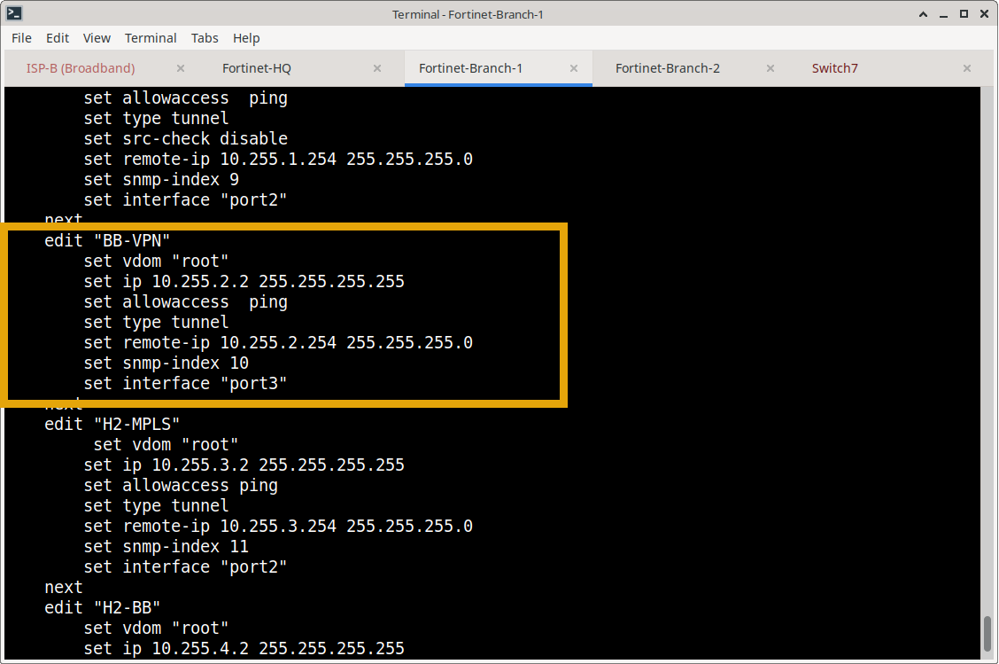

4. **Wire Sniffer Confirmation on Branch-1:**
   ```text
   Fortinet-Branch-1 # diagnose sniffer packet any "host 10.20.20.10" 4 0 l
   BB-VPN in 10.10.10.10 -> 10.20.20.10: icmp: echo request            <-- Arriving via BB-VPN
   port1 out 10.10.10.10 -> 10.20.20.10: icmp: echo request
   port1 in 10.20.20.10 -> 10.10.10.10: icmp: echo reply
   BB-VPN out 10.20.20.10 -> 10.10.10.10: icmp: echo reply
   ```
   * Packets from HQ now enter via `BB-VPN in`, confirming true bidirectional traffic symmetry over the healthy link.

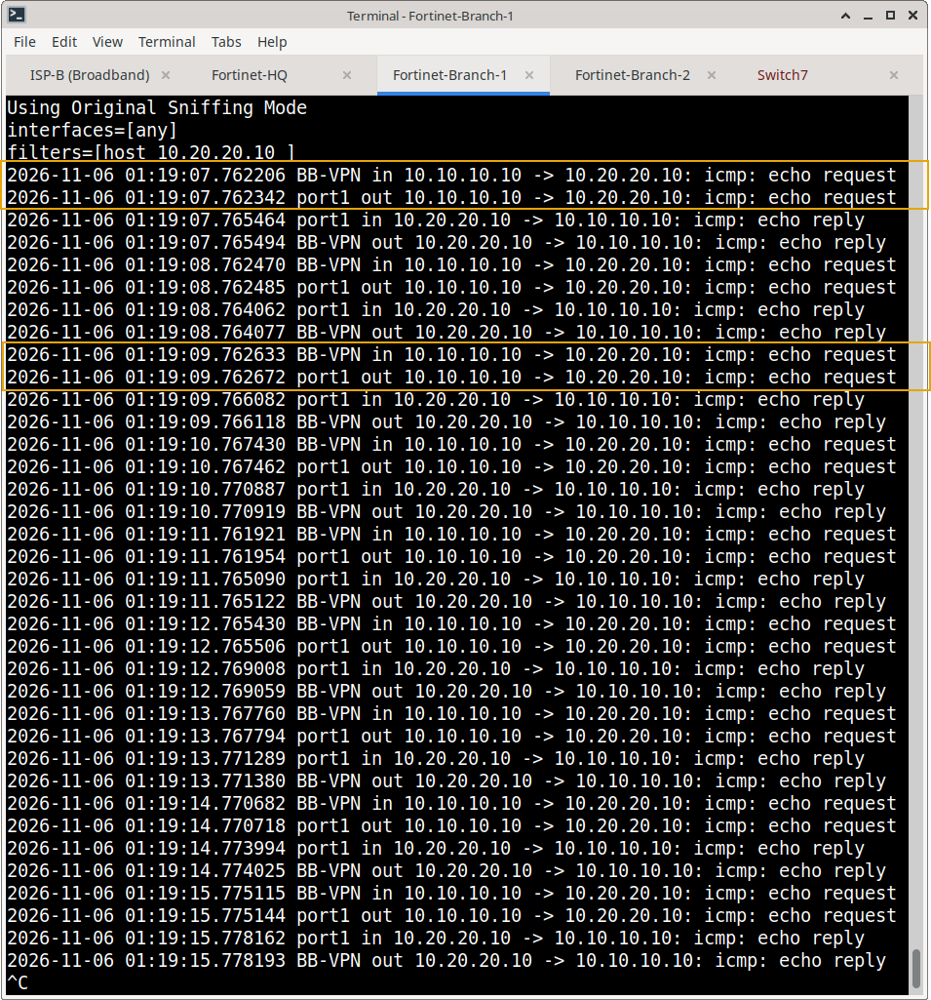

---

### Phase 4: Recovery & Preemption

1. **Clear Impairment:**
   ```bash
   localhost:~# sudo tc qdisc del dev eth0 root 2>/dev/null
   ```
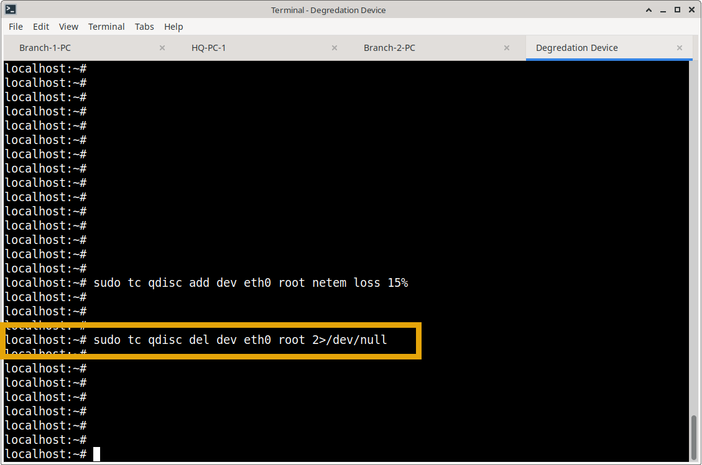

2. **Autonomous BGP Metric Reversion on HQ:**
   As soon as Branch-1's probe measured 0% loss, Member 3 returned to `sla_map=0x1`. Branch-1 automatically re-advertised `MED-MPLS-IN-SLA` (Metric 100), restoring primary routing on HQ:
   ```text
   Fortinet-HQ # get router info bgp network 10.20.20.0/24
   Original VRF 0
   Local, (Received from a RR-client)
     10.255.1.2 from 10.255.1.2 (2.2.2.2)
       Origin IGP metric 100, localpref 100, valid, internal, best         <-- RESTORED (Metric 100)
     10.255.2.2 from 10.255.2.2 (2.2.2.2)
       Origin IGP metric 200, localpref 100, valid, internal
   ```

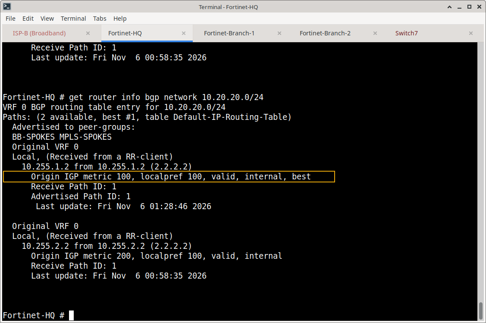
---

## Complete Evidence Index

| Category / Phase | Key Artifact | Purpose & Technical Verification |
| :--- | :--- | :--- |
| **BGP Config** | `config-router-route-map-branch.png` | Displays definition of `MED-MPLS-IN-SLA` (100), `MED-BB-IN-SLA` (200), and `MED-OUT-OF-SLA` (500). |
| **BGP Config** | `config-bgp-neighbor-branch.png` | Confirms BGP neighbors configured with `route-map-out-preferable` and default `route-map-out`. |
| **SLA Config** | `config-sdwan-health-check-branch.png` | Displays `ADVPN_HEALTH` configuration with 2% packet loss threshold under SLA ID 1. |
| **SLA Config** | `config-sdwan-neighbor-binding-branch.png` | Confirms BGP neighbors 10.255.1.254 and 10.255.2.254 bound to `ADVPN_HEALTH` SLA 1. |
| **Baseline BGP** | `hq-bgp-network-baseline-metric-100.png` | BGP table on HQ showing MPLS preferred with Metric 100 and Broadband with Metric 200. |
| **Baseline RIB** | `hq-routing-table-details-baseline-mpls.png` | Routing table details on HQ showing 10.20.20.0/24 installed via 10.255.1.2 (MPLS-VPN). |
| **Baseline Data Plane**| `hq-traceroute-baseline-mpls.png` | Inbound traceroute from HQ-PC-1 traversing Hop 2 at 10.255.1.2 (MPLS-VPN). |
| **Baseline Sniffer** | `branch-sniffer-baseline-mpls-in.png` | Packet sniffer on Branch-1 confirming inbound packets arriving on `MPLS-VPN in`. |
| **Impairment Injection**| `linux-degradation-15-percent-loss.png` | Terminal command applying `sudo tc qdisc add dev eth0 root netem loss 15%`. |
| **SLA Breach** | `branch-health-check-loss-18-percent.png` | Health-check telemetry showing MPLS-VPN logging 18% packet loss (`sla_map=0x0`). |
| **Control Failover** | `hq-bgp-network-metric-500-demoted.png` | **Core Control Proof:** HQ BGP table showing MPLS demoted to Metric 500 and Broadband promoted to best path. |
| **RIB Failover** | `hq-routing-table-details-failover-bb.png` | Routing table details on HQ confirming 10.20.20.0/24 repointed to 10.255.2.2 (BB-VPN). |
| **Data Failover** | `hq-traceroute-inbound-shifted-to-bb.png` | **Core Data Proof:** Inbound traceroute from HQ-PC-1 shifting Hop 2 to 10.255.2.2 (BB-VPN). |
| **Sniffer Failover** | `branch-sniffer-failover-bb-in.png` | Packet sniffer on Branch-1 proving return packets arriving on `BB-VPN in`. |
| **Recovery** | `linux-degradation-cleared.png` | Terminal command executing `sudo tc qdisc del dev eth0 root`. |
| **Preemption** | `hq-bgp-network-metric-100-restored.png` | BGP table on HQ showing Metric 100 automatically restored on MPLS. |

---

## Business Value Delivered
* **Elimination of Asymmetric Link Degradation:** Solves the root cause of one-way voice degradation by ensuring that when a branch shifts outbound traffic away from a degraded link, upstream hubs immediately steer inbound return traffic to match.
* **Autonomous Performance-Driven BGP:** BGP metrics adapt dynamically to real-time physical link quality (packet loss, latency, jitter) rather than relying strictly on binary interface up/down link states.
* **Zero Configuration Overhead on Hubs:** Upstream datacenters and hubs require zero local SD-WAN rules or manual intervention; standard BGP MED comparison handles the path election automatically.

---

### ➡️ What's Next?

With autonomous, bidirectional path symmetry fully validated, the next step is to eliminate the remaining 2-minute BGP hold-down delay during silent circuit brownouts by introducing sub-second failure detection.

Continue to the next project to explore rapid protocol convergence:
- **[Project 14: Sub-Second BGP Convergence via BFD over SD-WAN Overlays](../14-bfd-subsecond-convergence/)** – Implementing Bidirectional Forwarding Detection (BFD) with 250ms micro-timers to slash protocol failure detection from 137 seconds down to under 1 second, ensuring hitless failover.

---

[⬅️ Back to Fortinet SD-WAN Overview](../README.md)
