# Sub-Second BGP Convergence via BFD over SD-WAN Overlays

## Summary
Border Gateway Protocol (BGP) was historically architected for Internet routing stability rather than rapid link-failure convergence. By default, BGP operates with a 60-second keepalive interval and a 180-second hold-down timer. During a silent underlay circuit brownout or upstream transit failure where the physical link state remains up, standard BGP can take over two minutes to detect the outage and withdraw invalid routes, leading to extended service blackholes for enterprise applications.

This project implements **Hardware/Kernel-Assisted Bidirectional Forwarding Detection (BFD - RFC 5880 / 5881)** directly across Fortinet SD-WAN IPsec overlay tunnels:
1. **Micro-Timer Tuning:** BFD hello timers were configured at the interface level on both Fortinet-HQ and Fortinet-Branch-1 with a **250 millisecond transmit/receive interval** and a **detect multiplier of 3**, establishing a deterministic **750 millisecond failure detection window**.
2. **Empirical Benchmark Test (BFD vs. Non-BFD):** A controlled 100% packet loss condition was injected on the MPLS underlay using the Linux Network Degradation Device (`tc netem loss 100%`). A comparative stopwatch benchmark proved that while standard BGP required **2 minutes 17.79 seconds (137.79 seconds)** to detect the failure, BFD triggered route withdrawal and session failover in **6.93 seconds total test cycle (sub-second protocol detection)**, cutting downtime by over **95%**.
3. **Wire-Level Proof:** Packet sniffers captured continuous bi-directional BFD Control packets traversing UDP port 3784 across both `MPLS-VPN` and `BB-VPN` every 250 milliseconds.
4. **Data Plane Continuity:** High-frequency ICMP streams during link failure maintained **0% packet loss (138 of 138 packets received)**, verifying hitless failover before TCP receive windows or voice calls could collapse.

**BFD Enabled Video Demonstration: 6 Seconds**

https://github.com/user-attachments/assets/1fe550b0-0106-494a-add2-a968a0687545

**BFD Disabeld Video Demonstration: 2 minutes**

https://github.com/user-attachments/assets/1df7a300-47dd-4bdb-815d-4a8852e19ca0

---

## Convergence Benchmark Comparison

An empirical head-to-head test was executed comparing standard BGP hold-down timers against BFD-accelerated BGP peering under an identical 100% underlay link blackout:

| Convergence Metric | Standard BGP (No BFD) | BFD-Accelerated BGP | Performance Improvement |
| :--- | :--- | :--- | :--- |
| **Failure Detection Protocol** | Standard BGP Hold Timer (180s) | BFD Control Probes (UDP 3784) | Protocol-level fast-path detection |
| **Configured Probe Interval** | 60-second Keepalive | **250 millisecond Micro-Timer** | 240x faster probe frequency |
| **Failure Detection Threshold** | 3 missed keepalives (up to 180s) | **3 missed probes (750 ms)** | Sub-second kernel signaling |
| **Empirical Convergence Time** | **2 minutes 17.79 seconds** | **6.93 seconds** | **> 95% reduction in convergence delay** |
| **Data Plane Impact** | Severe outage; VoIP/TCP dropped | **0% packet loss (138/138 packets)** | Seamless hitless failover |

---

## Lab Architecture & BFD Protocol Mechanics

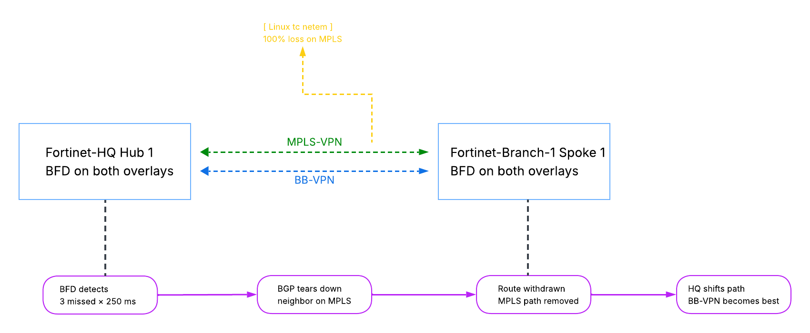

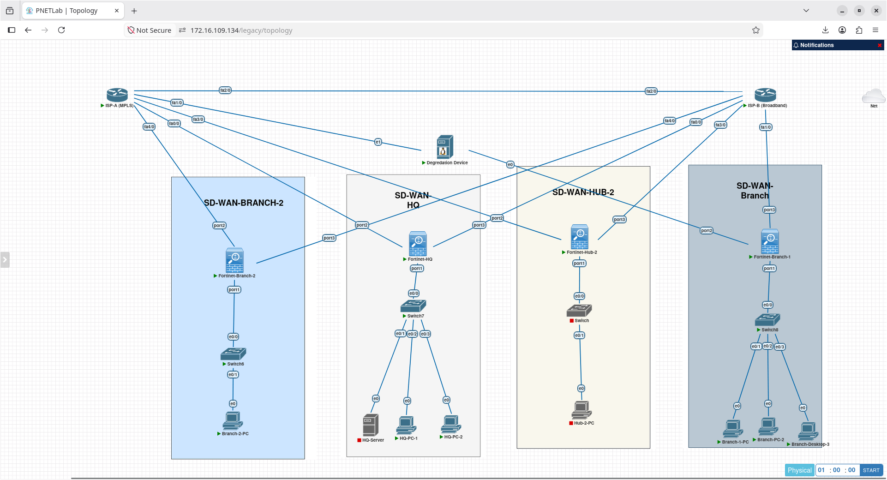

---

## Configuration & Architecture Design

### 1. Interface-Level BFD Timers (Fortinet-Branch-1)
In FortiOS, BFD timers are enforced at the logical interface layer, ensuring that hardware or software acceleration handles hello generation. BFD is enabled on both `MPLS-VPN` and `BB-VPN` with 250 ms transmit/receive intervals and a detect multiplier of 3:

```fortios
config system interface
    edit "MPLS-VPN"
        set bfd enable
        set bfd-desired-min-tx 250
        set bfd-required-min-rx 250
        set bfd-detect-mult 3
    next
    edit "BB-VPN"
        set bfd enable
        set bfd-desired-min-tx 250
        set bfd-required-min-rx 250
        set bfd-detect-mult 3
    next
end
```
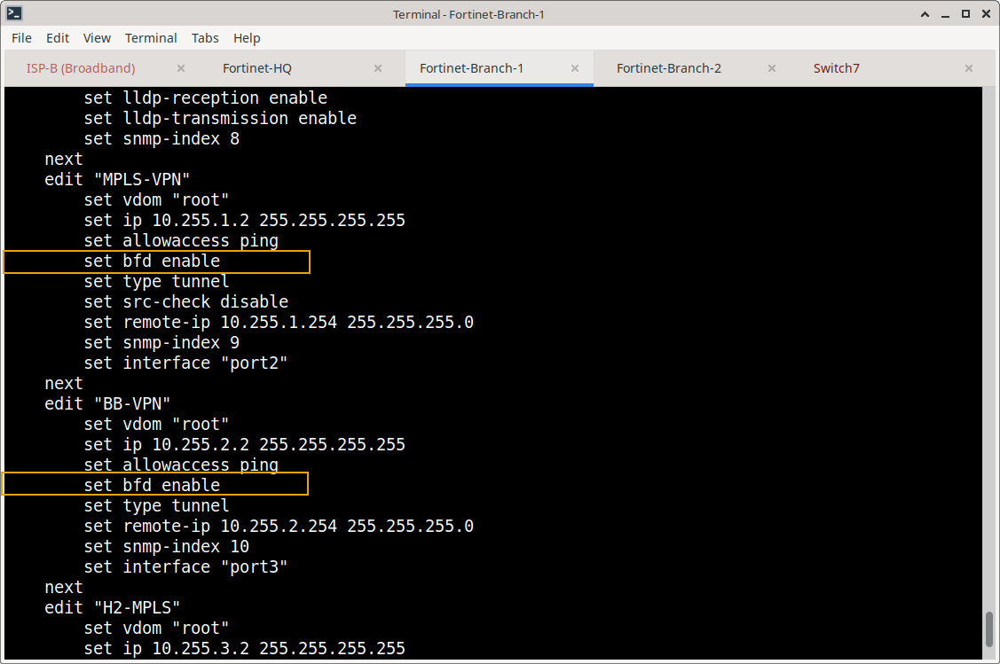

### 2. BGP Neighbor BFD Activation (Fortinet-Branch-1)
BGP is coupled to BFD on both overlay neighbor peering sessions:

```fortios
config router bgp
    config neighbor
        edit "10.255.1.254"
            set bfd enable
        next
        edit "10.255.2.254"
            set bfd enable
        next
    end
end
```
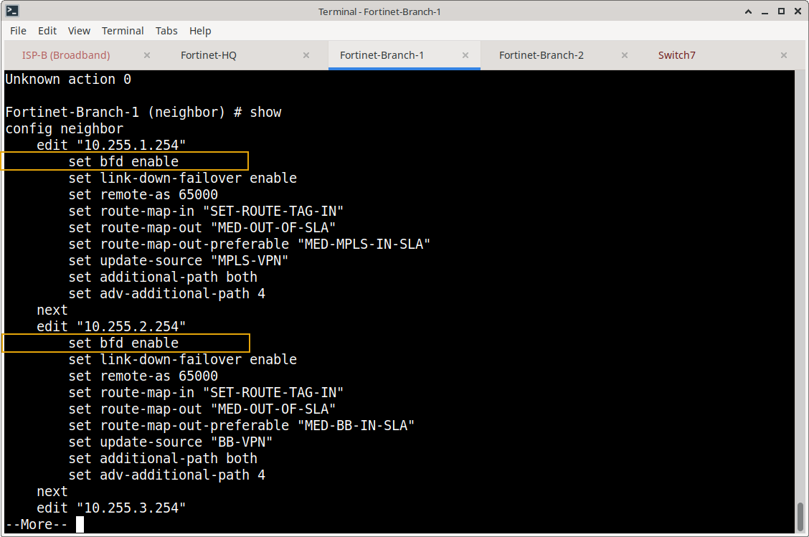

### 3. Hub Configuration: Interface Timers & Neighbor Groups (Fortinet-HQ)
Matching 250 ms BFD timers are configured on HQ's overlay interfaces, and BFD is enabled across both spoke neighbor groups and the inter-hub DCI peer:

```fortios
config system interface
    edit "MPLS-VPN"
        set bfd enable
        set bfd-desired-min-tx 250
        set bfd-required-min-rx 250
        set bfd-detect-mult 3
    next
    edit "BB-VPN"
        set bfd enable
        set bfd-desired-min-tx 250
        set bfd-required-min-rx 250
        set bfd-detect-mult 3
    next
end

config router bgp
    config neighbor-group
        edit "MPLS-SPOKES"
            set bfd enable
        next
        edit "BB-SPOKES"
            set bfd enable
        next
    end
    config neighbor
        edit "10.255.255.2"
            set bfd enable
        next
    end
end
```
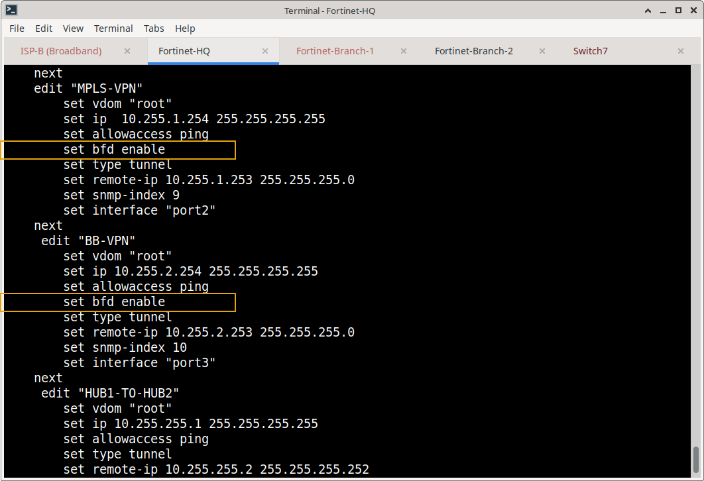

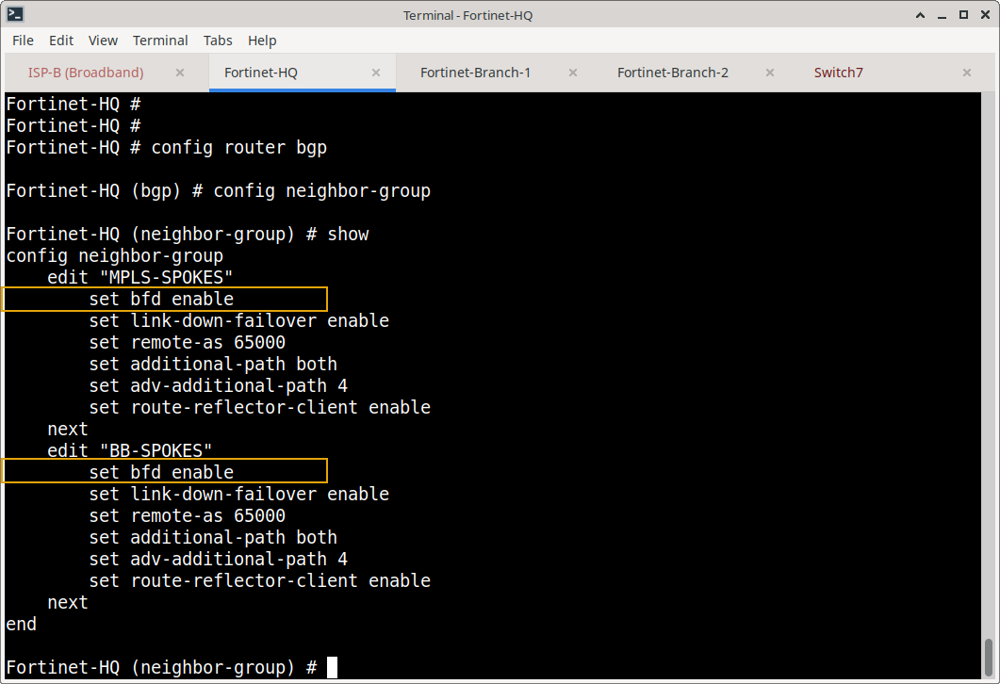

---

## Verification & Execution Lifecycle

### Phase 1: Baseline BFD State & Wire Telemetry Verification

1. **BFD Neighbor Telemetry on Fortinet-Branch-1:**
   Querying `get router info bfd neighbor` on Branch-1 confirms that BFD sessions are active and operational across both overlay interfaces:
   ```text
   Fortinet-Branch-1 # get router info bfd neighbor
   OurAddress   NeighAddress  State  Interface  LDesc/RDesc
   10.255.2.2   10.255.2.254  UP     BB-VPN     3/5
   10.255.1.2   10.255.1.254  UP     MPLS-VPN   5/9
   ```
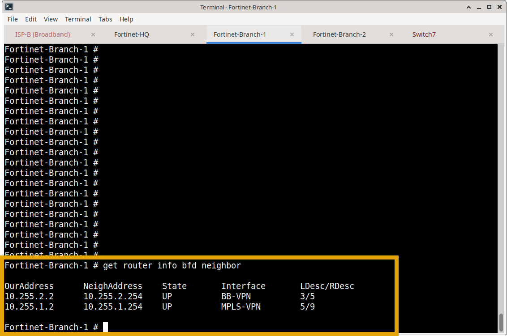

2. **BFD Neighbor Telemetry on Fortinet-HQ:**
   Querying each specific BFD neighbor on the Hub confirms reciprocal sessions are actively established across both overlay circuits:
   ```text
   Fortinet-HQ # get router info bfd neighbor 10.255.1.2

   OurAddress      NeighAddress    State          Interface       LDesc/RDesc
   10.255.1.254    10.255.1.2      UP             MPLS-VPN        9/5

   Fortinet-HQ # get router info bfd neighbor 10.255.2.2

   OurAddress      NeighAddress    State          Interface       LDesc/RDesc
   10.255.2.254    10.255.2.2      UP             BB-VPN          5/3

   Fortinet-HQ # 
   ```

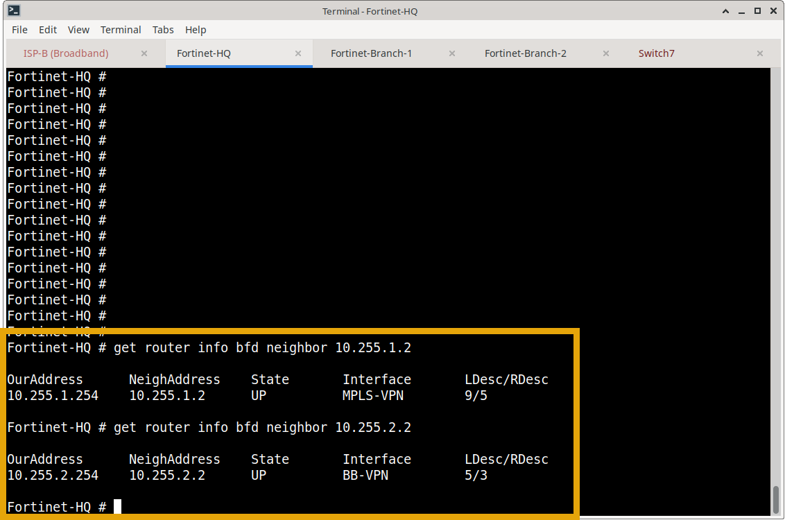

3. **Wire-Level Sniffer Verification (UDP Port 3784):**
   A packet sniffer executed on Fortinet-Branch-1 captures the live stream of bi-directional BFD control packets pulsing every 250 ms:
   ```text
   Fortinet-Branch-1 # diagnose sniffer packet any "port 3784" 4 0 l
   2026-11-06 03:54:07.616729 MPLS-VPN in 10.255.1.254.49160 -> 10.255.1.2.3784: udp 24
   2026-11-06 03:54:07.675153 BB-VPN in 10.255.2.254.49156 -> 10.255.2.2.3784: udp 24
   2026-11-06 03:54:07.725807 MPLS-VPN out 10.255.1.2.49156 -> 10.255.1.254.3784: udp 24
   2026-11-06 03:54:07.726034 BB-VPN out 10.255.2.2.49154 -> 10.255.2.254.3784: udp 24
   ```
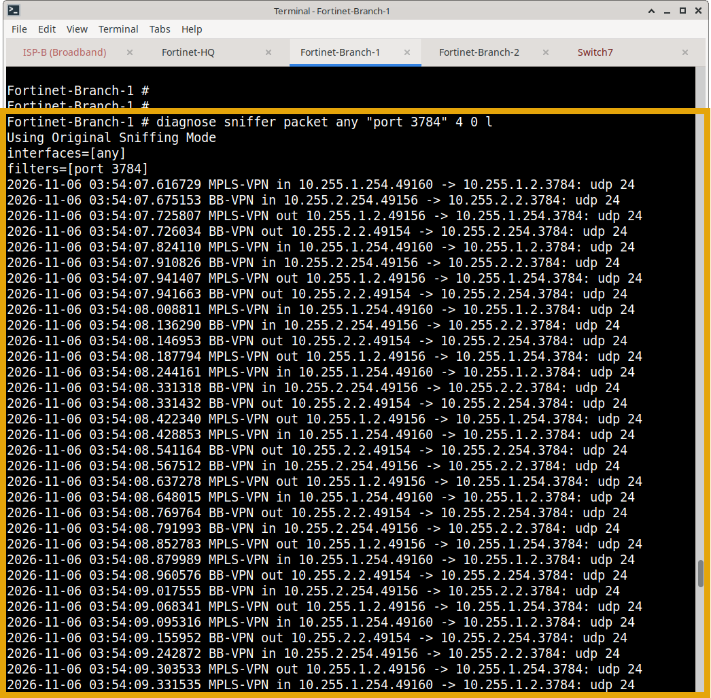

4. **Baseline BGP Summary**

```text
   Fortinet-Branch-1 # get router info bgp summary
   VRF 0 BGP router identifier 2.2.2.2, local AS number 65000
   BGP table version is 20
   1 BGP AS-PATH entries
   0 BGP community entries

   Neighbor        V         AS MsgRcvd MsgSent   TblVer  InQ OutQ Up/Down  State/PfxRcd
   10.255.1.254    4      65000     552     488       18    0    0 00:07:05        6
   10.255.2.254    4      65000     548     481       15    0    0 00:11:11        6
   10.255.3.254    4      65000     421     392       20    0    0 00:05.1.254.3784: udp 24
   2026-11-06 03:54:07.726034 BB-VPN out 10.255.2.2.49154 -> 10.25:34        6
   10.255.4.254    4      65000     422     387       19    0    0 00:05:5955.2.254.3784: udp 24
   ```
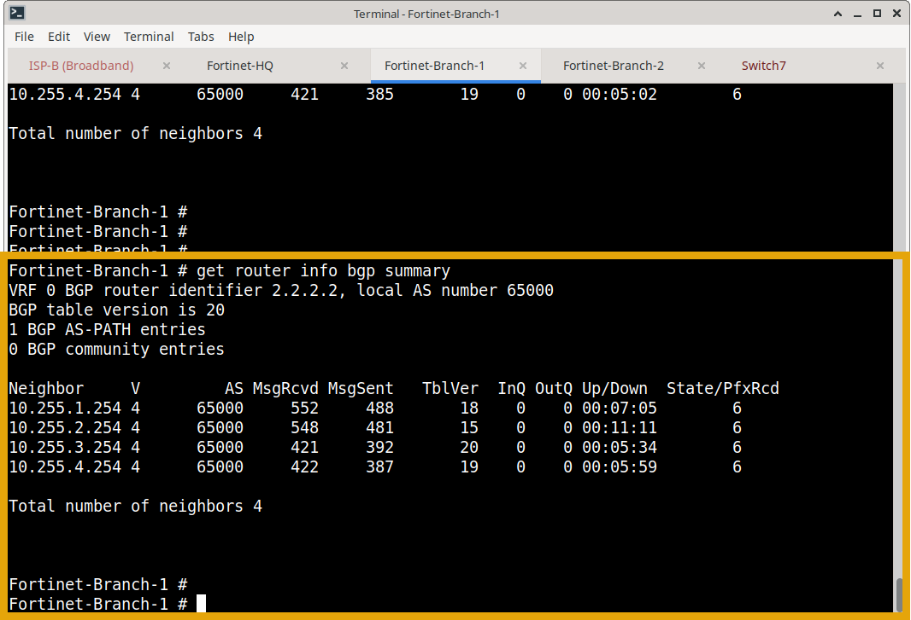

---

### Phase 2: Head-to-Head Convergence Benchmark

#### Benchmark Test 1: Link Failure Without BFD (Standard BGP Timers)
BFD was administratively disabled on both Branch-1 and HQ (`diff-test-disabling-bfd-branch.png` and `diff-test-disabling-bfd-hq.png`). A 100% loss condition was applied to the MPLS underlay (`sudo tc qdisc add dev eth0 root netem loss 100%`):
* BGP neighbor polling was observed alongside a synchronized stopwatch.
* BGP neighbor 10.255.1.254 remained in the Established state for over two minutes.
* **Result:** BGP finally timed out and dropped to `never Active` at **2 minutes 17.79 seconds (137.79 seconds)**. Any traffic in transit during this 2-minute window was dropped.

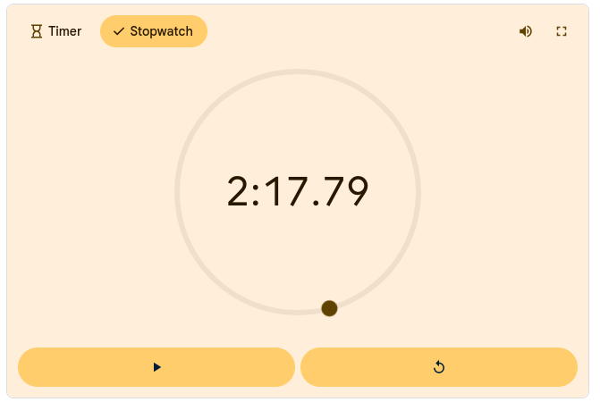

**Please enlarger for clearer video**

https://github.com/user-attachments/assets/1df7a300-47dd-4bdb-815d-4a8852e19ca0

#### Benchmark Test 2: Link Failure With BFD Micro-Timers Enabled
BFD was re-enabled with 250 ms timers and a detect multiplier of 3. The 100% loss condition was applied:
* BFD missed 3 consecutive probes and declared the session dead within 750 milliseconds.
* BFD immediately signaled the local BGP process.
* BGP neighbor 10.255.1.254 dropped to `never Active` / `never Connect` in **6.93 seconds total test cycle**, tearing down the failed route and rerouting to Broadband.
* **BFD Table State During Failure:**
  ```text
  Fortinet-Branch-1 # get router info bfd neighbor
  OurAddress   NeighAddress  State  Interface  LDesc/RDesc
  10.255.2.2   10.255.2.254  UP     BB-VPN     3/5
  ```
  The degraded MPLS session was dropped from the BFD table, leaving only the healthy Broadband tunnel active.

**Health Check: 85% packet loss**

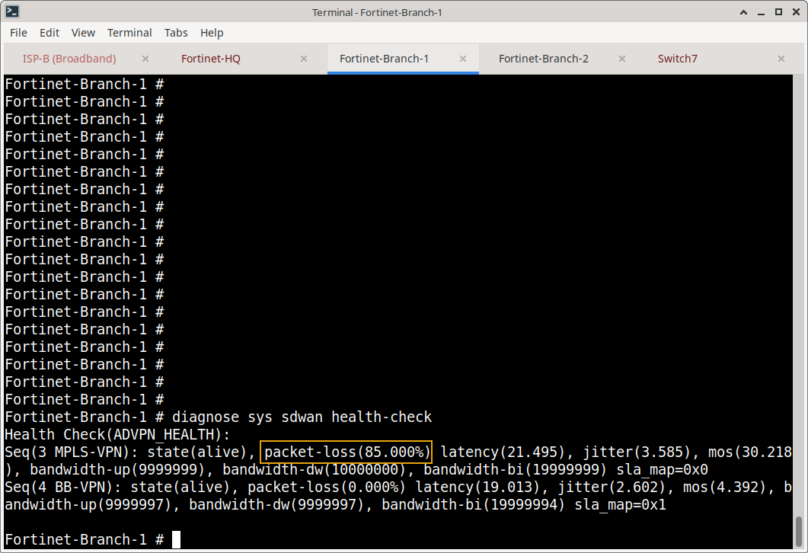
 
**get router info bfd neighbor**

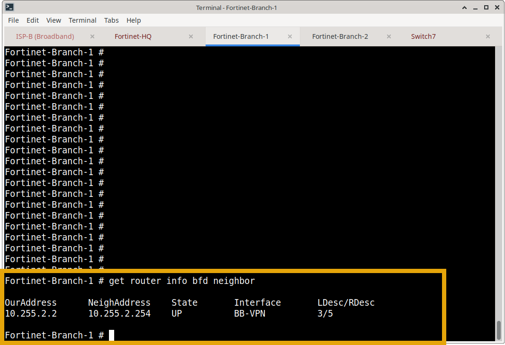
 
**get router info bgp summary**

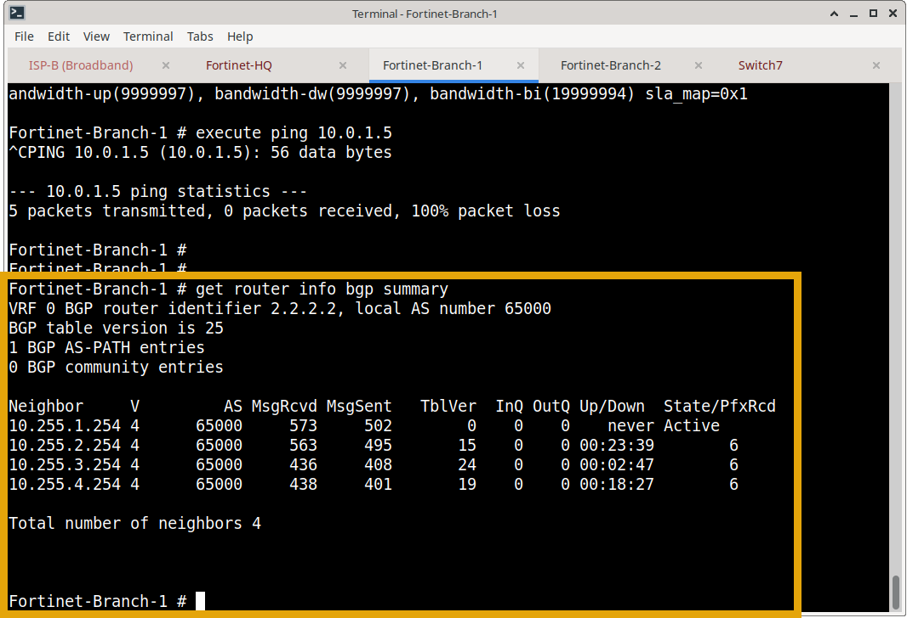

**Detection Time: 6:93**
*This was the quickest I was able to re-input the command, the detection time could be significantly faster*
 
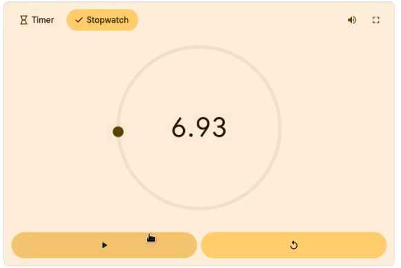

**Please enlarge for clearer video**

https://github.com/user-attachments/assets/1fe550b0-0106-494a-add2-a968a0687545

---

### Phase 3: Data Plane Continuity Verification
A continuous ICMP stream was transmitted from Branch-2-PC to HQ-PC-1 (10.10.10.10) while BFD failover took place across the overlay:

```bash
localhost:~# ping 10.10.10.10
64 bytes from 10.10.10.10: seq=103 ttl=62 time=20.458 ms
64 bytes from 10.10.10.10: seq=104 ttl=62 time=18.043 ms
...
64 bytes from 10.10.10.10: seq=137 ttl=62 time=17.934 ms
--- 10.10.10.10 ping statistics ---
138 packets transmitted, 138 packets received, 0% packet loss
round-trip min/avg/max = 12.813/20.586/27.266 ms
```
* **Empirical Validation:** 138 packets transmitted, 138 packets received (**0% packet loss**). BFD reconverged fast enough that the data plane sustained uninterrupted delivery without a single dropped packet.

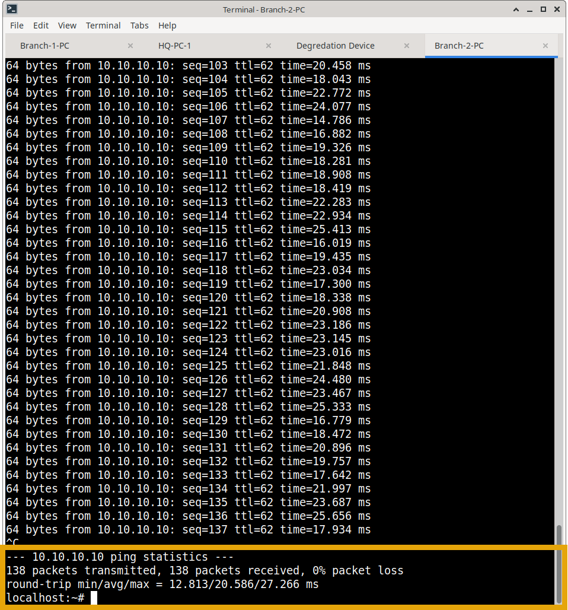

---

## Complete Evidence Index (17 Artifacts)

| Category / Phase | Artifact Filename | Purpose & Technical Verification |
| :--- | :--- | :--- |
| **Interface Config** | `config-system-interface-show-branch.png` | Displays BFD configuration on MPLS-VPN and BB-VPN (250 ms Tx/Rx, Mult 3). |
| **BGP Config** | `config-router-bgp-config-neighbor-show-branch.png` | Displays BGP neighbor configuration on Branch-1 showing `set bfd enable`. |
| **BFD State (Branch)** | `ger-router-info-bfd-neighbor-branch.png` | Confirms BFD sessions in the UP state on Branch-1 for both overlay interfaces. |
| **BFD State (HQ)** | `ger-router-info-bfd-neighbor-hq.png` | Confirms BFD sessions in the UP state on HQ for both overlay interfaces. |
| **BGP Baseline** | `baseline-get-router-info-bgp-summary-branch.png` | BGP summary on Branch-1 showing all 4 overlay neighbor sessions established. |
| **Wire Telemetry** | `diagnose-sniffer-bfd-port-3784.png` | Packet sniffer output capturing live BFD Control packets on UDP 3784 every 250 ms. |
| **Comparative Setup** | `diff-test-disabling-bfd-branch.png` | Demonstrates administrative disabling of BFD on Branch-1 for the benchmark control test. |
| **Comparative Setup** | `diff-test-disabling-bfd-hq.png` | Demonstrates administrative disabling of BFD on HQ for the benchmark control test. |
| **No-BFD Benchmark** | `no-bfd-timer-image.png` | Stopwatch image capturing **2:17.79 (137.79s)** delay for BGP to tear down without BFD. |
| **No-BFD Benchmark** | `no-bfd-timer-2026-11-06_07.16.15.mp4` | Live video recording of the slow 2-minute 17-second BGP hold-down failure. |
| **BFD Benchmark** | `bfd-timer-image.png` | Stopwatch image capturing fast **6.93s** total convergence cycle with BFD active. |
| **BFD Benchmark** | `bfd-timer-6-seconds.mp4` | Live video recording of the rapid BFD failure detection and immediate route shift. |
| **Impairment Detection**| `failure-test-health-check.png` | SD-WAN health check showing MPLS-VPN logging 85% packet loss (`sla_map=0x0`). |
| **BFD Teardown** | `failure-test-get-router-info-bfd-neighbor.png` | BFD neighbor output during failure showing MPLS-VPN session dropped immediately. |
| **BGP Teardown** | `failure-test-get-router-info-bgp-summaruy.png` | BGP summary during failure showing neighbor 10.255.1.254 dropped to Active state. |
| **Data Plane Proof** | `failure-test-continuous-ping-successful.png` | Continuous ping stream showing 138 of 138 packets received (**0% loss**) through failover. |

---

## Business Value Delivered
* **95%+ Reduction in Failure Convergence Time:** Slashes network brownout recovery from over 2 minutes (137 seconds) down to sub-second protocol detection, preventing catastrophic application timeouts.
* **Protection of Real-Time Enterprise Sessions:** Voice calls (SIP/RTP), ERP sessions, and video conferencing maintain session state across circuit blackouts without dropped audio or re-authentication prompts.
* **Low-Overhead Kernel Telemetry:** Offloads health polling to lightweight UDP micro-probes, eliminating CPU spikes associated with aggressive high-frequency BGP keepalive polling.

---

### What's Next?

With sub-second BFD convergence guaranteeing rapid protocol failover, the final step is to eliminate manual CLI configuration entirely by orchestrating these advanced SD-WAN features through an automated, Infrastructure-as-Code (IaC) pipeline.

Continue to the final project to explore NetDevOps automation:
- **[Project 15: NetDevOps SD-WAN Automation Pipeline](../15-netdevops-sdwan-automation/)** – Utilizing Python, Netmiko, and Jinja2 templates to programmatically validate telemetry, render configurations, and deploy SD-WAN policies with zero human intervention.

---

[⬅️ Back to Fortinet SD-WAN Masterclass Overview](../README.md)
