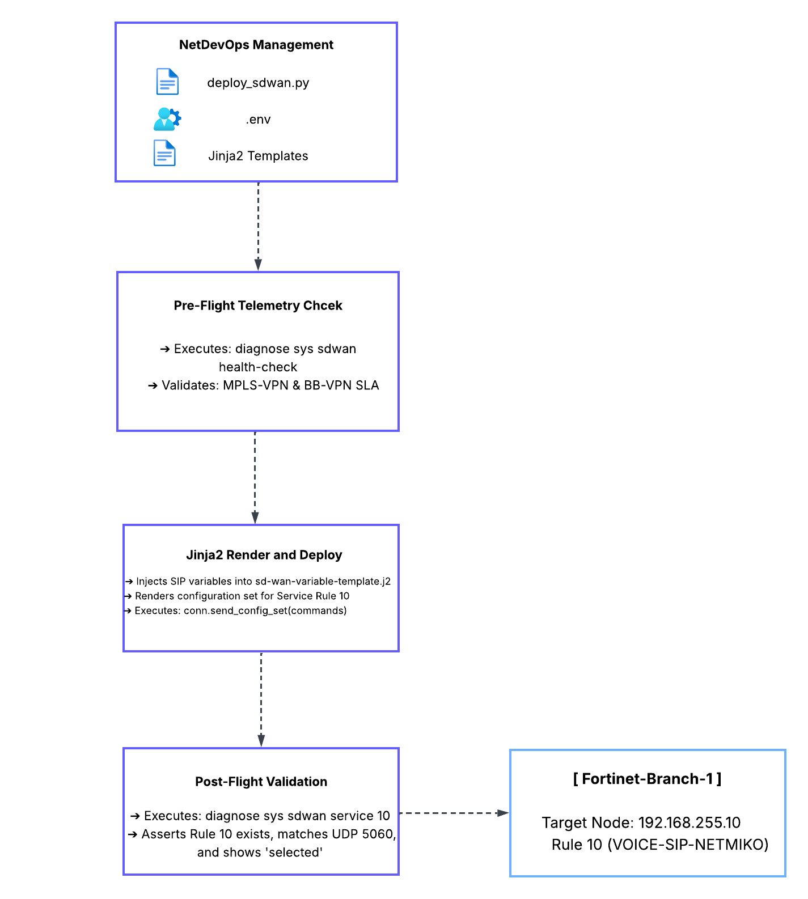
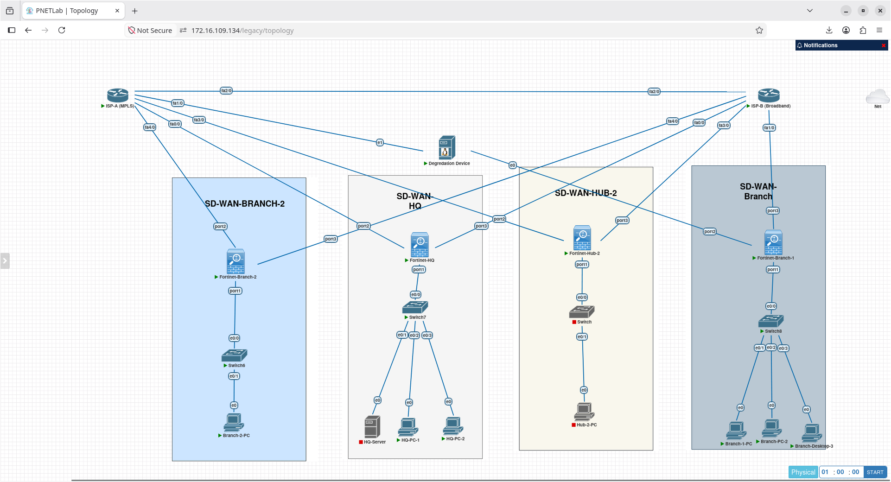
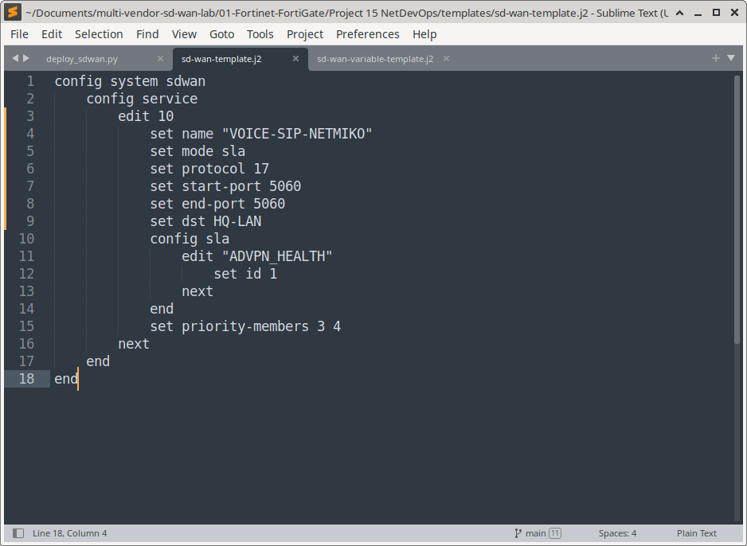
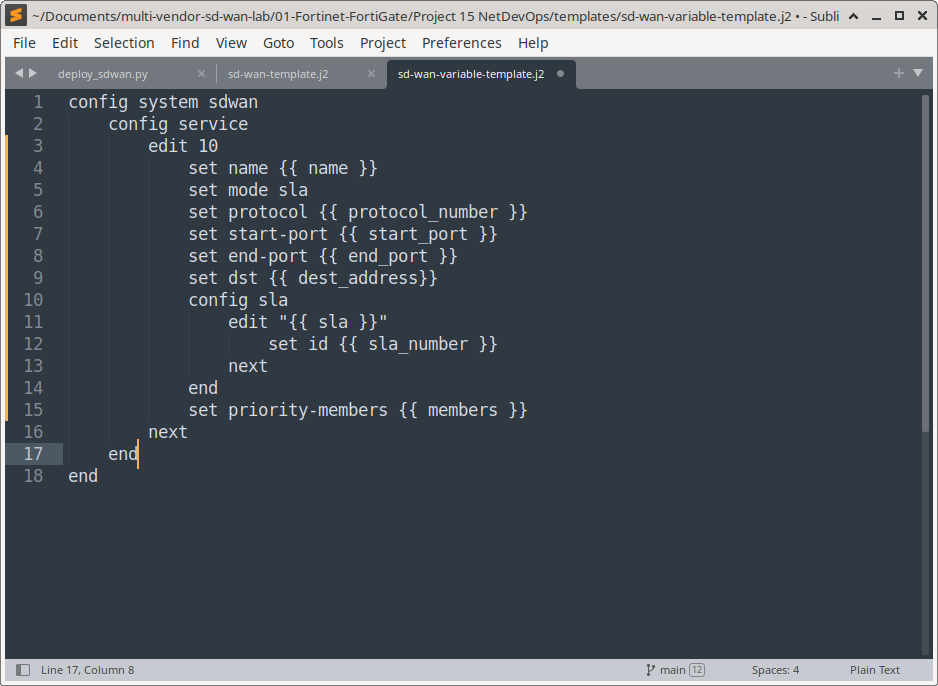
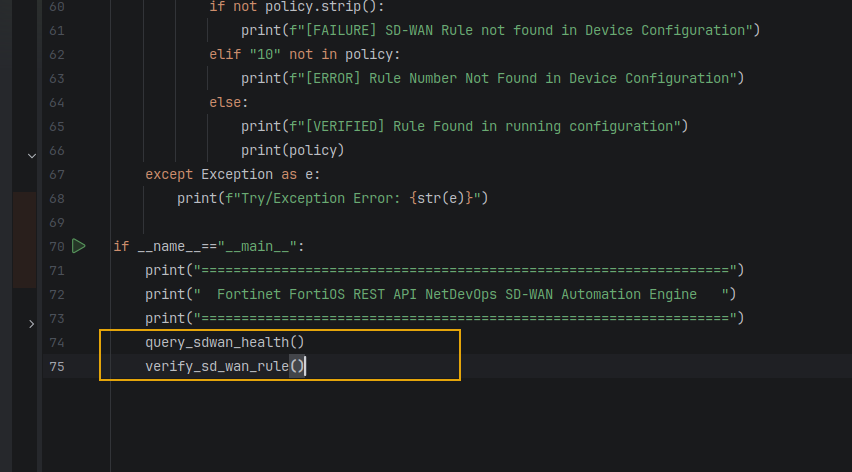
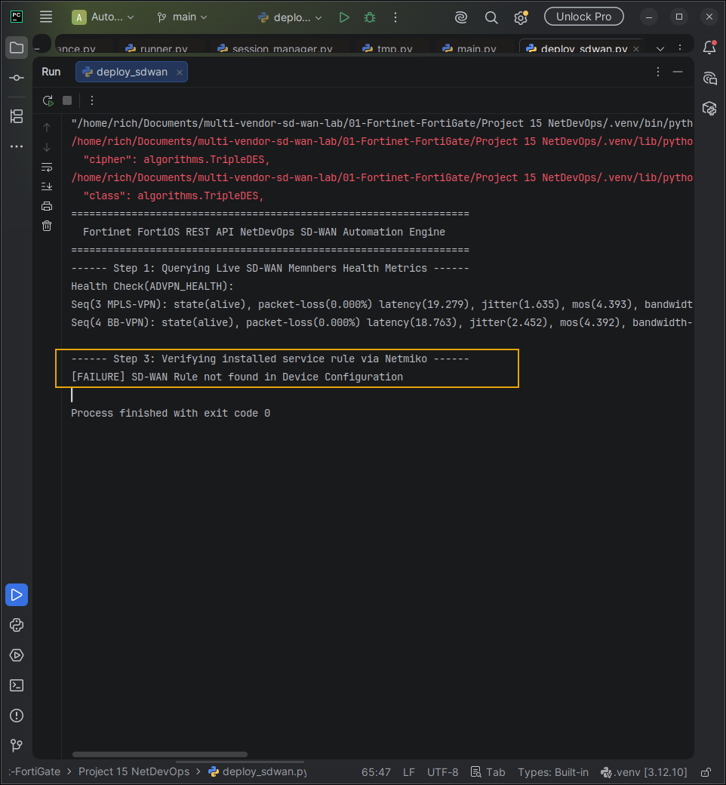
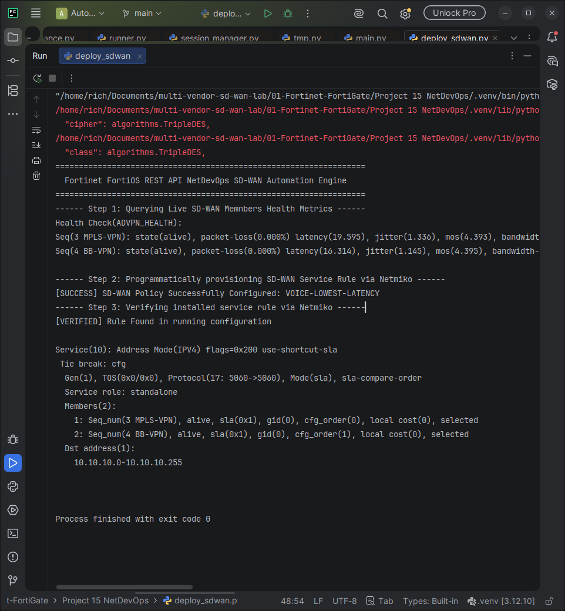
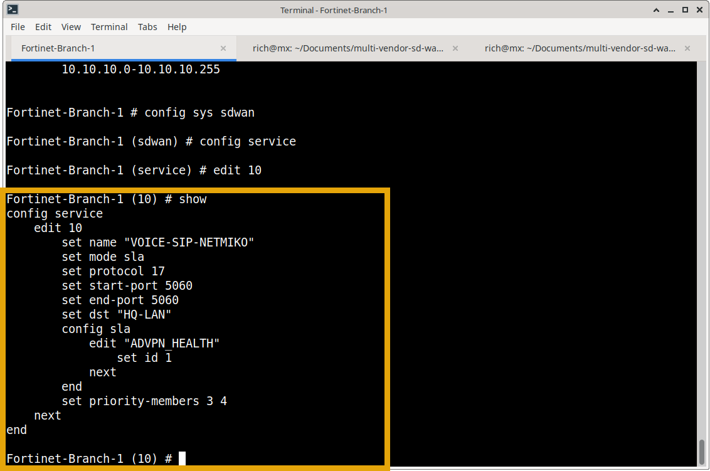

# NetDevOps — Automated SD-WAN Service Rule Provisioning (Python, Netmiko & Jinja2)

## Summary
Pushing SD-WAN policy by hand through the CLI or GUI does not scale. Across dozens of branches it produces configuration drift, typos and long change windows. This project replaces the manual workflow with a small **NetDevOps pipeline** that provisions an SD-WAN service rule on a FortiGate from a parameterized template, then checks the result on the device.

The pipeline is written in **Python 3.12 with Netmiko and Jinja2**, and runs in three stages against **Fortinet-Branch-1**:

1. **Pre-flight telemetry:** connects over SSH and prints live link quality (`diagnose sys sdwan health-check`) for both overlays, `MPLS-VPN` and `BB-VPN`: loss, latency, jitter and MOS.
2. **Render and deploy:** injects the policy variables (name, UDP/5060, destination object, SLA, members) into a Jinja2 template and pushes the rendered FortiOS CLI with Netmiko's `send_config_set()`.
3. **Post-flight verification:** reads `diagnose sys sdwan service 10` back from the device and confirms that Rule 10 exists and that its members are selected.

The rule it deploys steers **SIP signalling (UDP 5060) toward the HQ LAN (`HQ-LAN`, 10.10.10.0/24)** using the same `ADVPN_HEALTH` SLA built in the earlier projects. The automation therefore sits on top of the existing dual-hub ADVPN lab.

**Live Automation Video: Please enlarge for clearer video**

https://github.com/user-attachments/assets/e06a3760-c2a5-4182-88fd-5161d990216a

---

## Lab Context

| Item | Value |
| :--- | :--- |
| Platform | PNETLab, FortiGate VM64 |
| Target device | Fortinet-Branch-1, management IP `192.168.255.10` |
| Overlays | `MPLS-VPN` (SD-WAN member 3), `BB-VPN` (member 4) |
| SLA probe | `ADVPN_HEALTH`, SLA ID 1 |
| Destination object | `HQ-LAN` (10.10.10.0/24) |
| Automation host | Linux workstation, PyCharm, Python 3.12 virtual environment |

---

## Automation Pipeline & Data Flow





### Automation Stack
| Component | Tool | Purpose |
| :--- | :--- | :--- |
| Language | Python 3.12 (`.venv`) | Orchestrates the three stages |
| SSH transport | Netmiko `ConnectHandler`, `device_type: fortinet` | CLI session and config push |
| Templating | Jinja2 `Environment` + `FileSystemLoader` | Separates policy variables from FortiOS syntax |
| Secrets | `python-dotenv` (`.env`) | Keeps SSH credentials out of the source |
| Target | FortiOS VM64 (Fortinet-Branch-1) | SD-WAN enforcement point |

---

## Project Structure

```text
Project 15 NetDevOps/
├── .env                              # SSH_USERNAME / SSH_PASSWORD (never committed)
├── deploy_sdwan.py                   # Pipeline: pre-check, deploy, verify
├── templates/
│   ├── sd-wan-template.j2            # Static template (hard-coded values, first iteration)
│   └── sd-wan-variable-template.j2   # Parameterized template used by the final script
├── screenshots/
└── videos/
```

---

## Implementation

### 1. Static template (first iteration)
The first version hard-codes the rule and renders it with no variables. It proves the Netmiko push works end to end before any parameterization is added:

```jinja2
config system sdwan
    config service
        edit 10
            set name "VOICE-SIP-NETMIKO"
            set mode sla
            set protocol 17
            set start-port 5060
            set end-port 5060
            set dst HQ-LAN
            config sla
                edit "ADVPN_HEALTH"
                    set id 1
                next
            end
            set priority-members 3 4
        next
    end
end
```


### 2. Parameterized template (`sd-wan-variable-template.j2`)
Every policy value becomes a variable, so the same template can drive any rule or branch by changing the input dictionary:

```jinja2
config system sdwan
    config service
        edit 10
            set name {{ name }}
            set mode sla
            set protocol {{ protocol_number }}
            set start-port {{ start_port }}
            set end-port {{ end_port }}
            set dst {{ dest_address }}
            config sla
                edit "{{ sla }}"
                    set id {{ sla_number }}
                next
            end
            set priority-members {{ members }}
        next
    end
end
```


### 3. Automation engine (deploy_sdwan.py)

```python
import os
import sys
import urllib3
from pathlib import Path
from dotenv import load_dotenv
from netmiko import ConnectHandler
from jinja2 import Environment, FileSystemLoader
import time

BASE_DIR = Path(__file__).resolve().parent
load_dotenv(BASE_DIR / ".env")
TEMPLATE_DIR = BASE_DIR / "templates"

env = Environment(
    loader=FileSystemLoader(TEMPLATE_DIR),
    trim_blocks=True,
    lstrip_blocks=True
)
forti_parameters = {
    "device_type": "fortinet",
    "username": os.getenv("SSH_USERNAME"),
    "password": os.getenv("SSH_PASSWORD"),
    "host": "192.168.255.10"
}

def query_sdwan_health():
    print("------ Step 1: Querying Live SD-WAN Members Health Metrics ------")
    try:
        with ConnectHandler(**forti_parameters) as conn:
            health_check = conn.send_command("diagnose sys sdwan health-check")
            print(health_check)
    except Exception as e:
        print(f"Try/Exception Error: {str(e)}")

def provision_sd_wan_rule():
    print("------ Step 2: Programmatically provisioning SD-WAN Service Rule via Netmiko ------")
    try:
        with ConnectHandler(**forti_parameters) as conn:
            name = "VOICE-SIP-NETMIKO"
            protocol_number = "17"
            start_port = "5060"
            end_port = "5060"
            dest_address = "HQ-LAN"
            sla = "ADVPN_HEALTH"
            sla_number = "1"
            members = "3 4"

            template = env.get_template("sd-wan-variable-template.j2")
            commands = template.render(
                name=name,
                protocol_number=protocol_number,
                start_port=start_port,
                end_port=end_port,
                dest_address=dest_address,
                sla=sla,
                sla_number=sla_number,
                members=members
            ).splitlines()

            conn.send_config_set(commands, read_timeout=120)
            print("[SUCCESS] SD-WAN Policy Successfully Configured: VOICE-LOWEST-LATENCY")
    except Exception as e:
        print(f"Try/Exception Error: {str(e)}")

def verify_sd_wan_rule():
    print("------ Step 3: Verifying installed service rule via Netmiko ------")
    try:
        with ConnectHandler(**forti_parameters) as conn:
            policy = conn.send_command("diagnose sys sdwan service 10")
            if not policy.strip():
                print("[FAILURE] SD-WAN Rule not found in Device Configuration")
            elif "10" not in policy:
                print("[ERROR] Rule Number Not Found in Device Configuration")
            else:
                print("[VERIFIED] Rule Found in running configuration")
                print(policy)
    except Exception as e:
        print(f"Try/Exception Error: {str(e)}")

if __name__ == "__main__":
    print("==================================================================")
    print("  Fortinet FortiOS REST API NetDevOps SD-WAN Automation Engine   ")
    print("==================================================================")
    query_sdwan_health()
    provision_sd_wan_rule()
    time.sleep(20)
    verify_sd_wan_rule()
```

The 20-second `time.sleep()` gives the FortiGate time to compile the new service rule before the verification stage reads it back.

---

## Verification & Execution Lifecycle

### Phase 1: Baseline (rule absent)
With only Steps 1 and 3 enabled, the script confirms the device starts clean. Verification correctly reports a failure because Rule 10 does not exist yet:

```text
------ Step 1: Querying Live SD-WAN Members Health Metrics ------
Health Check(ADVPN_HEALTH):
Seq(3 MPLS-VPN): state(alive), packet-loss(0.000%) latency(19.279), jitter(1.635), mos(4.393) ...
Seq(4 BB-VPN):   state(alive), packet-loss(0.000%) latency(18.763), jitter(2.452), mos(4.392) ...

------ Step 3: Verifying installed service rule via Netmiko ------
[FAILURE] SD-WAN Rule not found in Device Configuration
```

This negative result matters. It shows the verification stage fails when the rule is missing, so a later pass is meaningful.





### Phase 2: Full pipeline run
All three stages enabled:

```text
------ Step 1: Querying Live SD-WAN Members Health Metrics ------
Seq(3 MPLS-VPN): state(alive), packet-loss(0.000%) latency(19.595), jitter(1.336), mos(4.393) ...
Seq(4 BB-VPN):   state(alive), packet-loss(0.000%) latency(16.314), jitter(1.145), mos(4.395) ...

------ Step 2: Programmatically provisioning SD-WAN Service Rule via Netmiko ------
[SUCCESS] SD-WAN Policy Successfully Configured: VOICE-LOWEST-LATENCY

------ Step 3: Verifying installed service rule via Netmiko ------
[VERIFIED] Rule Found in running configuration

Service(10): Address Mode(IPV4) flags=0x200 use-shortcut-sla
 Tie break: cfg
  Gen(1), TOS(0x0/0x0), Protocol(17: 5060->5060), Mode(sla), sla-compare-order
  Service role: standalone
  Members(2):
    1: Seq_num(3 MPLS-VPN), alive, sla(0x1), gid(0), cfg_order(0), local cost(0), selected
    2: Seq_num(4 BB-VPN), alive, sla(0x1), gid(0), cfg_order(1), local cost(0), selected
  Dst address(1):
        10.10.10.0-10.10.10.255

Process finished with exit code 0
```



### Phase 3: Configuration check on the FortiGate
Logging into Branch-1 directly confirms the rule is in the running configuration and matches the template:

```fortios
Fortinet-Branch-1 # config sys sdwan
Fortinet-Branch-1 (sdwan) # config service
Fortinet-Branch-1 (service) # edit 10
Fortinet-Branch-1 (10) # show
config service
    edit 10
        set name "VOICE-SIP-NETMIKO"
        set mode sla
        set protocol 17
        set start-port 5060
        set end-port 5060
        set dst "HQ-LAN"
        config sla
            edit "ADVPN_HEALTH"
                set id 1
            next
        end
        set priority-members 3 4
    next
end
```

What the kernel output (`diagnose sys sdwan service 10`) shows:
* **Match:** protocol 17 (UDP), port 5060 to 5060, destination 10.10.10.0 to 10.10.10.255 (`HQ-LAN`).
* **Mode:** `Mode(sla)`, so members are compared by the `ADVPN_HEALTH` probe results.
* **Members:** both overlays are `alive`, in SLA (`sla(0x1)`) and `selected`.



---

## Complete Evidence Index

Suggested filenames. Rename your captures to match, or adjust the table.

| Category / Phase | Artifact Filename | Purpose |
| :--- | :--- | :--- |
| **Topology** | `topology.png` | PNETLab lab: ISPs, Fortinet-HQ, Hub-2, Branch-1/2, degradation device. |
| **Architecture** | `pipeline-architecture.png` | Three-stage pipeline diagram. |
| **Template** | `sd-wan-template-static.png` | Static Jinja2 template (first iteration). |
| **Template** | `sd-wan-variable-template.png` | Parameterized template with `{{ variables }}`. |
| **Code** | `deploy-sdwan-first-iteration.png` | First `provision_sd_wan_rule()` using the static template. |
| **Code** | `deploy-sdwan-variables.png` | Final version with the variable dictionary and `render()` call. |
| **Baseline** | `pre-check-rule-not-found.png` | Run with Rule 10 absent: `[FAILURE] SD-WAN Rule not found`. |
| **Execution** | `python-pipeline-success.png` | All three stages passing, exit code 0. |
| **Firewall CLI** | `fortigate-cli-show-service-10.png` | `show` output of Rule 10 in the running config. |
| **Data plane** | `diagnose-sys-sdwan-service-10.png` | Kernel service table with both members `selected`. |
| **Demo** | `videos/sd-wan-automation-2026-11-07_00.13.13.mp4` | Screen recording of the run. |
| **Operational SOP** | `runbook-automation` | Setup, run and rollback steps above. |

---

## Business Value Delivered
* **Consistency:** every branch that runs the same template receives the same validated rule, which removes hand-typed syntax errors.
* **Separation of intent and syntax:** the policy (UDP/5060 to HQ over the best SLA member) lives in variables. FortiOS CLI lives in the template.
* **Built-in feedback:** each run reads link quality before the change and reads the rule back afterwards, so a deployment ends with evidence and not an assumption.
* **Foundation for scale:** the structure (template, variables, verify) extends to a branch inventory and to other vendors, which the next module (Cisco) will test.

---

[Back to Fortinet Module Overview](../README.md) · [Next Module: Cisco Catalyst SD-WAN (Viptela)](../../02-Cisco-Catalyst-SDWAN/)
