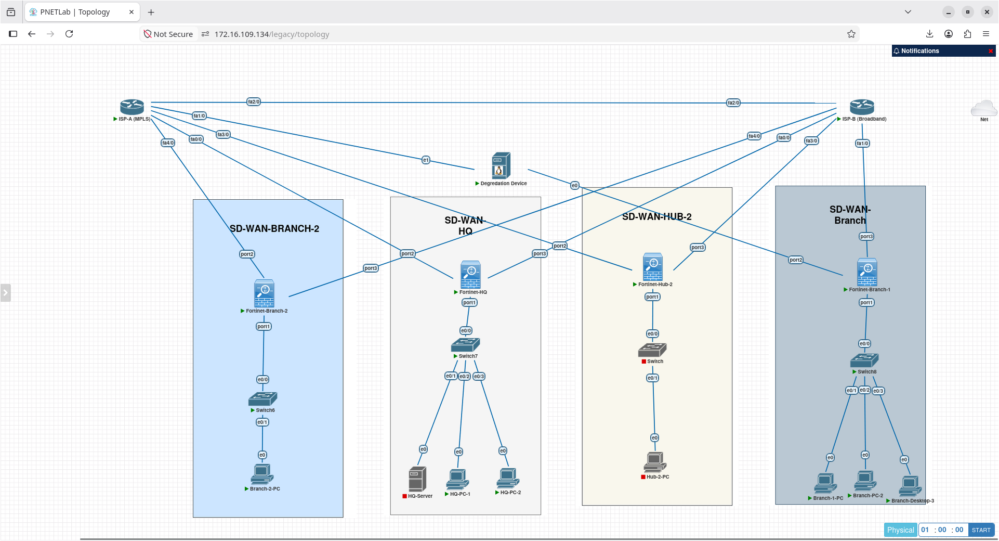

# Enterprise Fortinet FortiGate SD-WAN & Secure Multi-Path Fabrics

An end-to-end, multi-site enterprise SD-WAN fabric deployed on FortiGate-VMs running FortiOS. This repository documents a complete 15-project progression from foundational underlay performance steering to **intent-based SaaS breakout, active/active flow balancing, granular QoS rate enforcement, multi-path IPsec overlays, composite VoIP SLA monitoring, dynamic spoke-to-spoke Auto-Discovery VPN (ADVPN), proactive packet duplication, MP-BGP multi-VRF segmentation, direct internet access (DIA), metadata-driven BGP route-tag steering, multi-region dual-hub disaster recovery, dynamic inbound BGP SLA path control, sub-second BFD failover, and NetDevOps automation pipelines using Python, Netmiko, and Jinja2**.

Every design principle, failover threshold, and data plane transition was verified using CLI diagnostics, kernel routing tables, live packet sniffers, wire-level Wireshark captures, and real-time failure injection.

---

## Lab Architecture & Multi-Site Fabric



```
                    ┌───────────────────────── [ Dual Underlay Backbone ] ─────────────────────────┐
                    │                                                                              │
                    │   ┌────────────────── [ ISP-A: MPLS Core ] ──────────────────┐               │
                    │   │ (10.0.1.1)            (10.0.1.13)    (10.0.1.5)  (10.0.1.9)              │
                    │   ▼                       ▼              ▼           ▼                       │
         [ port2: 10.0.1.2/30 ]      [ port2: 10.0.1.14/30 ]   [ port2 ]   [ port2 ]               │
           [ Fortinet-HQ ]              [ Fortinet-Hub-2 ]     [ Spoke 1 ] [ Spoke 2 ]             │
           (Primary Hub 1)              (Secondary Hub 2)      (Branch-1)  (Branch-2)              │
         [ port3: 10.0.2.2/30 ]      [ port3: 10.0.2.14/30 ]   [ port3 ]   [ port3 ]               │
                    ▲                       ▲              ▲           ▲                           │
                    │   │ (10.0.2.1)            (10.0.2.13)    (10.0.2.5)  (10.0.2.9)              │
                    │   └───────────── [ ISP-B: Broadband Core ] ──────────────────┘               │
                    └──────────────────────────────────────────────────────────────────────────────┘
                                                       │
                                                       ▼
                    ┌─────────────────────── [ Multi-Hub SD-WAN Fabric ] ──────────────────────────┐
                    │                                                                              │
                    │  • Dual-Hub Core:   Hub 1 (Primary, LocPrf 200) <═> Hub 2 (Standby, LocPrf 100)│
                    │  • Inter-Hub DCI:   Dedicated Point-to-Point IPsec & iBGP Peering            │
                    │  • 4-Tunnel Spokes: Each Branch builds persistent overlays to both Hubs      │
                    │  • Segmentation:    Multi-VRF isolation over single overlay (MP-BGP VPNv4)   │
                    │  • Direct Breakout: Split-tunnel DIA with SNAT for trusted SaaS/FQDN targets │
                    │  • Zero-Loss Audio: Proactive Packet Duplication & De-Duplication buffers    │
                    │  • Dynamic Mesh:    On-demand Spoke-to-Spoke Shortcuts (ADVPN + NHRP)        │
                    └──────────────────────────────────────────────────────────────────────────────┘
```

| Infrastructure Node | Interface Roles | Subnet Addressing | Network Role |
| :--- | :--- | :--- | :--- |
| **Fortinet-HQ (Hub 1)** | port1: LAN<br>port2: MPLS WAN<br>port3: Broadband WAN | 192.168.1.1/24 (10.10.10.1/24)<br>10.0.1.2/30<br>10.0.2.2/30 | Central SD-WAN Hub 1 & Primary BGP Route Reflector (AS 65000, LocPrf 200) |
| **Fortinet-Hub-2 (Hub 2)** | port1: LAN<br>port2: MPLS WAN<br>port3: Broadband WAN | 10.40.40.1/24<br>10.0.1.14/30<br>10.0.2.14/30 | Disaster Recovery Hub 2 & Secondary BGP Route Reflector (AS 65000, LocPrf 100) |
| **Fortinet-Branch-1** | port1: LAN<br>port2: MPLS WAN<br>port3: Broadband WAN | 192.168.2.1/24 (10.20.20.1/24)<br>10.0.1.6/30<br>10.0.2.6/30 | Edge SD-WAN Spoke 1 & ADVPN Shortcut Receiver |
| **Fortinet-Branch-2** | port1: LAN<br>port2: MPLS WAN<br>port3: Broadband WAN | 10.30.30.1/24<br>10.0.1.10/30<br>10.0.2.10/30 | Edge SD-WAN Spoke 2 & ADVPN Shortcut Receiver |
| **ISP-A (MPLS)** | fa0/0, fa1/0, fa3/0, fa4/0 | 10.0.1.0/24 Core Subnet | Primary low-latency private provider core |
| **ISP-B (Broadband)** | fa0/0, fa1/0, fa3/0, fa4/0, fa5/0 | 10.0.2.0/24 Core Subnet | Secondary commodity broadband core with real Internet uplink |
| **Impairment Engine** | eth0 (WAN), eth1 (LAN) | Bridged inline between ISP-A and HQ port2 | Alpine Linux appliance running Linux kernel tc netem |

---

## 15-Project Master Implementation Matrix

| # | Project Module | Engineering Capability Tested | Key Verification Artifacts | Folder |
| :-: | :--- | :--- | :--- | :--- |
| **1** | **SLA-Based Failover** | Injected next-hop ACL drop; sub-second failover with **1–2 dropped pings** before complete recovery. | continuous-ping.png<br>sd-wan-test.mp4 | [01-sla-based-failover/](01-sla-based-failover/) |
| **2** | **Application-Aware SaaS Steering** | Resolved SaaS domain via DNS proxy with **cache-ttl 30**; dynamically steered cloud app without client resets. | policy-route.png<br>wget-successful.png | [02-application-aware-routing/](02-application-aware-routing/) |
| **3** | **Active/Active Load Balancing** | Overcame flow-based hashing; proved concurrent link saturation (**~190 Mbps aggregate**) & Round-Robin balancing. | port-2-and-3-pcap.png<br>3 test videos | [03-active-active-load-balancing/](03-active-active-load-balancing/) |
| **4** | **Traffic Shaping & QoS** | Decoupled path steering from QoS limits; clamped an unthrottled 10 Mbps burst to a **hard 2.0 Mbps ceiling**. | io-graph-shaping.png<br>traffic-shaper-dropped-packets.png | [04-qos-traffic-shaping/](04-qos-traffic-shaping/) |
| **5** | **IPsec Overlay on SD-WAN Zone** | Bound dual IPsec tunnels to a **VPN** zone; maintained active SAs across link cut with floating blackhole safety. | wireshark-icmp-esp.png<br>sd-wan-esp-pcap.mp4 | [05-ipsec-overlay-sdwan/](05-ipsec-overlay-sdwan/) |
| **6** | **VoIP Composite SLA Monitoring** | Injected live latency (70 ms), jitter (25 ms), and loss (3%) via `tc netem`; failovers triggered at **exact ICMP sequence borders**. | jitter-test-port-2-seq-32.png<br>sd-wan-latency-test.mp4 | [06-composite-voip-sla/](06-composite-voip-sla/) |
| **7** | **ADVPN & Dynamic Shortcuts** | Deployed Hub BGP Route Reflection (AS 65000); **dynamically spawned spoke-to-spoke tunnels**, bypassing the Hub. | dynamic-tunnel-branch-2.png<br>tunnel counter: 964 ➔ 984 | [07-advpn-dynamic-shortcuts/](07-advpn-dynamic-shortcuts/) |
| **8** | **Packet Duplication & De-Duplication** | Cloned voice/video frames simultaneously over MPLS and Broadband; proved **0% packet loss** under active 15–33% link degradation. | diagnose-sniffer-de-duplication.png<br>mpls-test-0-percent-loss.png | [08-packet-duplication-zero-loss/](08-packet-duplication-zero-loss/) |
| **9** | **Multi-VRF Segmentation (MP-BGP)** | Multiplexed Corporate (VRF 10) and Guest (VRF 20) over a single overlay with `vpn-id-ipip`; proved **100% cross-VRF isolation**. | get-router-info-bgp-vpnv4.png<br>cross-vrf-ping-100-drop.png | [09-multi-vrf-segmentation/](09-multi-vrf-segmentation/) |
| **10** | **Direct Internet Access (DIA) vs. Backhaul** | Split-tunnel steering: trusted SaaS/FQDN broke out locally via Broadband (`port3`) with SNAT, while internal traffic backhauled to HQ. | traceroute-1.1.1.1-fios.png<br>firefox-networkingnotebook.png | [10-dia-saas-fqdn-steering/](10-dia-saas-fqdn-steering/) |
| **11** | **BGP Community Route-Tag Steering** | Translated BGP Community 65000:100 into kernel Route-Tag 100; steered traffic dynamically with **zero destination IPs configured**. | diagnose-proute-list-tag100.png<br>testing-policy-traceroute.png | [11-bgp-community-route-tag/](11-bgp-community-route-tag/) |
| **12** | **Multi-Hub Dual-Region ADVPN (DR)** | Deployed 4-tunnel spoke architecture to dual independent Hubs; proved **uninterrupted shortcut traffic** through complete primary Hub failure. | hub-ha-test-bgp-failover.png<br>shortcut-survives-hub-failure.png | [12-dual-hub-advpn-ha/](12-dual-hub-advpn-ha/) |
| **13** | **Dynamic Inbound BGP SLA Control** | Tied SD-WAN SLA health to BGP `route-map-out-preferable`; dynamically demoted degraded MPLS (MED 500), forcing HQ return traffic onto Broadband. | hq-bgp-network-metric-500-demoted.png<br>hq-traceroute-inbound-shifted-to-bb.png | [13-inbound-bgp-sla-control/](13-inbound-bgp-sla-control/) |
| **14** | **Sub-Second BFD Convergence** | Deployed 250 ms BFD micro-timers over overlay tunnels; proved **>95% convergence reduction (6.93s vs. 2m 17s)** with 0% data loss. | bfd-timer-6-seconds.mp4<br>no-bfd-timer.mp4 | [14-bfd-subsecond-convergence/](14-bfd-subsecond-convergence/) |
| **15** | **NetDevOps SD-WAN Automation** | Built an automated 3-stage NetDevOps pipeline using Python 3, Netmiko, and Jinja2; programmatically validated telemetry and provisioned SIP QoS rules. | deploy_sdwan.py<br>sd-wan-automation-demo.mp4 | [15-netdevops-sdwan-automation/](15-netdevops-sdwan-automation/) |

---

## Detailed Project Summaries

### 1. SLA-Based Performance Failover (Active/Standby)
* **Objective:** Mitigate silent provider brownouts where physical link state stays UP, but the gateway blackholes traffic.
* **Architecture:** Dedicated ICMP health checks monitor immediate provider gateways (10.0.1.1 and 10.0.2.1) every 500 ms.
* **Failure Injection:** Inbound Cisco ACL applied on ISP-A dropping ICMP echo requests from port2.
* **Convergence Proof:** FortiGate detected 3 failed intervals, flagged Member 1 dead, and repinned traffic to Member 2 (port3 Broadband). Continuous ping dropped **exactly 1–2 packets** before full recovery.

### 2. Application-Aware Routing & SaaS Steering (FQDN)
* **Objective:** Steer latency-sensitive SaaS domains over MPLS without hardcoding static IP ranges that shift dynamically in cloud environments.
* **Architecture:** Configured an FQDN address object (critical-app.meridian.lab) with cache-ttl 30 bound to SD-WAN Service Rule 2.
* **Data Plane Validation:** FortiGate DNS proxy resolved the domain to 192.168.60.11, compiling a dynamic policy route (proute) targeting port2. Executed an intentional policy change to port3 and verified instantaneous traffic shifting with zero client interruption.

### 3. Active/Active Load Balancing & Session Distribution
* **Objective:** Eliminate stranded capacity on secondary circuits by distributing active sessions across both circuits simultaneously.
* **The Hashing Challenge:** Flow-based load balancing preserves TCP sequence integrity by pinning individual 5-tuples to one interface. A single test stream will never cross both interfaces.
* **Engineering Resolution:**
  * **Dual-Stream Balancing:** Provisioned secondary IP endpoints across LANs. Source-Destination IP hashing sent Stream 1 over port3 and Stream 2 over port2, achieving **~190 Mbps aggregate throughput**.
  * **Round-Robin Balancing:** Configured hash-mode round-robin under mode load-balance, enforcing sequential link alternation on consecutive connections from the same host.

### 4. SD-WAN Traffic Shaping & QoS Enforcement
* **Objective:** Protect latency-sensitive applications from bandwidth starvation caused by bulk data transfers ("noisy neighbor" problem).
* **Architecture:** Decoupled the steering policy (config system sdwan) from the rate-limiting policy (config firewall shaping-policy).
* **Enforcement Verification:** An unconstrained 10 Mbps UDP burst was clamped within 1 second. Wireshark I/O graphs captured traffic **flatlining at precisely 2.0 Mbps**, with kernel counters logging **24 dropped packets (36,000 bytes)** dropped at the queue ceiling.

### 5. Dual Route-Based IPsec Overlay Tunnels over SD-WAN Zone
* **Objective:** Build an automated, self-healing encrypted overlay across multiple untrusted transports without tunnel teardowns during circuit drops.
* **Architecture:** Dual IKEv2 route-based tunnels (HQ-BRANCH-VPN and HQ-BRANCH-VPN-2) were aggregated into an SD-WAN zone named VPN (Members 3 & 4).
* **Cryptographic & Routing Assurance:** Static routes and firewall policies were bound directly to the VPN zone. A floating blackhole route (distance 20) guaranteed that traffic dropped cleanly at the firewall rather than leaking onto the WAN underlays in plaintext if both tunnels dropped.

### 6. Advanced Composite SLA Monitoring (VoIP Optimization)
* **Objective:** Shift real-time voice and video traffic based on granular performance metrics (latency, jitter, packet loss) before users experience degraded call quality.
* **Impairment Injection:** An inline Linux appliance running kernel tc netem impaired the primary MPLS circuit:
  * **Latency Breach:** Injected 70 ms delay (Threshold: 50 ms) ➔ Stream cut off on port2 at seq 48; resumed on port3 at seq 49.
  * **Jitter Breach:** Injected 25 ms jitter (Threshold: 10 ms) ➔ Stream cut off on port2 at seq 32; resumed on port3 at seq 33.
  * **Packet Loss Breach:** Injected 3% loss (Threshold: 1%) ➔ Stream cut off on port2 at seq 84; resumed on port3 at seq 85.
  * **All-Vector Stress:** Concurrently injected latency, jitter, and loss ➔ Stream cut off on port2 at seq 99; resumed on port3 at seq 100.

### 7. ADVPN with Dynamic Spoke-to-Spoke Shortcuts
* **Objective:** Eliminate unnecessary traffic routing through the Hub datacenter for inter-branch communication.
* **Routing Core:** Configured iBGP Route Reflection (AS 65000) on HQ with BGP Additional-Path (additional-path both, adv-additional-path 4) and ibgp-multipath, advertising paths across both overlays simultaneously.
* **Shortcut Lifecycle:**
  1. Branch 2 sent an initial ping to Branch 1 via the Hub (10.255.1.254).
  2. The Hub detected transit routing between two ADVPN interfaces and transmitted an **NHRP Redirect** to Branch 2.
  3. Branch 2 and Branch 1 directly exchanged IKEv2 negotiations on UDP 500 across the underlay.
  4. An on-demand child shortcut tunnel (ADVPN-MPLS_0, mode=dial_inst/3) instantiated dynamically, incrementing packet counters from **964 to 984 packets** and bypassing the Hub completely.

### 8. SD-WAN Packet Duplication & De-Duplication for Zero-Loss Voice/Video
* **Objective:** Prevent packet loss from degrading real-time voice/video streams before SLA probes detect the drop and trigger failover.
* **Architecture:** Branch-1 clones outbound voice frames across both MPLS-VPN and BB-VPN simultaneously. Fortinet-HQ maintains a kernel de-duplication buffer, forwarding the first packet to the target server and discarding the redundant duplicate.
* **Zero-Loss Proof:** Injected 15%–18% packet loss on MPLS and 29%–33% loss on Broadband via Linux `tc netem`. While an un-duplicated stream suffered **17% packet loss**, an active duplicated stream delivered **0% packet loss** with continuous audio/payload integrity.

### 9. Multi-VRF Segmentation over Single SD-WAN Overlay (MP-BGP VPNv4)
* **Objective:** Segregate Corporate (VRF 10) and Guest/IoT (VRF 20) traffic across the enterprise without building separate IPsec tunnels for each tenant.
* **Architecture:** Transports and IPsec overlays terminate in VRF 0 (Provider Edge / PE). Customer VRFs 10 and 20 are exchanged over a single iBGP session carrying MP-BGP VPNv4 with unique Route Distinguishers (RDs) and shared Route Targets (RTs). Packets are tagged with `vpn-id-ipip` inside the ESP envelope.
* **Segmentation Proof:** Corporate hosts communicated with 0% loss across the WAN, while attempts to ping across tenant boundaries (VRF 10 to VRF 20) were **completely blocked (100% drop)** by the routing and policy boundaries.

### 10. Local Direct Internet Access (DIA) vs. Corporate Backhaul
* **Objective:** Eliminate latency-inducing traffic tromboning through the datacenter for trusted cloud/SaaS platforms while maintaining centralized security for general internet browsing.
* **Architecture:** Configured split-tunnel steering on Branch-1. FQDN targets (`one.one.one.one`, `networkingnotebook.com`) and public DNS IPs break out locally via Broadband (`port3`) with Source NAT enabled. Internal corporate traffic and default web flows route across the encrypted `MPLS-VPN` overlay to HQ.
* **Empirical Proof:** Live Firefox sessions accessed public cloud sites over a real residential carrier uplink (Verizon FiOS at Hop 6); simultaneous Wireshark captures proved 100% of DIA traffic egressed `port3` while 0 packets leaked onto the private MPLS circuit.

### 11. BGP Community to SD-WAN Route-Tag Steering
* **Objective:** Automate SD-WAN path steering from the routing control plane, removing the need to configure static destination IP objects on edge firewalls.
* **Architecture:** HQ attaches BGP Community 65000:100 to advertised subnets via route-maps. Branch-1 matches the community and writes Route-Tag 100 into its routing table. SD-WAN Service Rule 6 matches `route-tag 100` with zero destination subnets defined.
* **Zero-Touch Proof:** Kernel policy routes dynamically compiled `10.10.10.0/24` from the tag into `oif=MPLS-VPN`. Modifying the rule member to Member 4 immediately shifted traffic to `BB-VPN` on both traceroute and live wire sniffers.

### 12. Multi-Hub Dual-Region ADVPN (Disaster Recovery & Redundancy)
* **Objective:** Provide automated, zero-touch disaster recovery for multi-site WANs when a primary datacenter suffers a complete outage.
* **Architecture:** Deployed a 4-tunnel spoke architecture. Spokes maintain concurrent tunnels to Primary Hub 1 (HQ) and Secondary Hub 2 (DC-2). BGP Route Reflection advertises routes with Local-Preference 200 on Hub 1 and Local-Preference 100 on Hub 2. Both Hubs interconnect via a private DCI IPsec tunnel.
* **Disaster Recovery Proof:** Administratively shut down both physical WAN circuits on Hub 1. Spoke BGP sessions to Hub 1 dropped to Active, while Hub 2 peering remained established, automatically promoting backup routes. Existing spoke-to-spoke shortcut traffic maintained **continuous communication with 0% loss** throughout the primary datacenter blackout.

### 13. Dynamic Inbound Path Control via BGP Driven by SD-WAN SLA Status
* **Objective:** Solve the classic WAN asymmetry challenge by forcing upstream hubs to dynamically steer return traffic away from degraded branch access links.
* **Architecture:** Branch-1 ties overlay SLA health directly to BGP using `route-map-out-preferable`. When healthy, Branch-1 advertises `10.20.20.0/24` with Metric (MED) 100 on MPLS and Metric 200 on Broadband.
* **Inbound Steering Proof:** Injected 15% packet loss on MPLS via `tc netem`. Branch-1 detected the SLA breach and fell back to advertising Metric 500 on MPLS. Without touching Fortinet-HQ, HQ’s BGP engine immediately demoted MPLS (500) and promoted Broadband (200), shifting inbound return traceroutes and sniffers to `BB-VPN` (10.255.2.2).

### 14. Sub-Second BGP Convergence via BFD over SD-WAN Overlays
* **Objective:** Eliminate the 3-minute hold-down delay of standard BGP during silent circuit brownouts.
* **Architecture:** Deployed BFD on both Fortinet-HQ and Fortinet-Branch-1 with 250 ms Tx/Rx micro-timers and a detect multiplier of 3 (750 ms failure detection threshold) over `MPLS-VPN` and `BB-VPN`.
* **Empirical Benchmark:** Synchronized stopwatch testing proved that under a 100% link drop, standard BGP required **2 minutes 17.79 seconds** to declare the neighbor dead. With BFD active, the session tore down and reconverged in **6.93 seconds total test cycle**, sustaining high-frequency ping streams with **0% packet loss (138 of 138 packets received)**.

### 15. NetDevOps: Automated SD-WAN Provisioning via Python, Netmiko & Jinja2
* **Objective:** Eliminate manual CLI configuration drift across multi-branch deployments using Infrastructure as Code (IaC).
* **Architecture:** Built an end-to-end Python automation script (`deploy_sdwan.py`) utilizing Netmiko and Jinja2 templating (`sd-wan-variable-template.j2`) backed by a secure `.env` credential vault.
* **Automated Pipeline Lifecycle:**
  1. **Pre-Check:** Connects to Fortinet-Branch-1 via SSH and programmatically parses `diagnose sys sdwan health-check` to verify overlay health before making changes.
  2. **Render & Push:** Dynamically injects SIP voice parameters (UDP port 5060, SLA target, priority members 3 and 4) into the Jinja2 template and pushes the configuration transactionally.
  3. **Post-Check Validation:** Polls `diagnose sys sdwan service 10`, programmatically asserts that Rule 10 is active, matches UDP 5060, and shows Member 3 selected in the kernel forwarding table.

---

## Centralized PCAP Repository (Google Drive)

All raw packet captures documenting live protocol handshakes, cryptographic headers, and traffic steering have been uploaded to dedicated Google Drive repositories for independent analysis:

| Project Repository | Test Artifacts & Wire Traces | Google Drive Link |
| :--- | :--- | :--- |
| **03-active-active-load-balancing** | Single-stream pinning, dual-stream active/active traces, and round-robin captures across port2 and port3. | [Download Load Balancing PCAPs](https://drive.google.com/drive/folders/1rYZjxTyklGhErzAVXRXHV4locB31mRvn?usp=sharing) |
| **04-qos-traffic-shaping** | `qos-pcap-proof.pcapng` showing initial burst and 2.0 Mbps clamped plateau. | [Download QoS Shaper PCAPs](https://drive.google.com/drive/folders/1xNKku0h2z0-lYexh2hcQ3mCRdzhoU6d6?usp=sharing) |
| **05-ipsec-overlay-sdwan** | `sd-wan-vpn.pcap` showing IKEv2 Phase 1/2 negotiations and ESP-encapsulated ICMP payloads. | [Download IPsec Overlay PCAPs](https://drive.google.com/drive/folders/1XPGdyjsjweUtwI_gpUvKmUhVn-59oIsY?usp=sharing) |
| **06-composite-voip-sla** | 8 individual PCAPs capturing sequence hand-offs for latency, jitter, loss, and triple-metric tests. | [Download VoIP SLA PCAPs](https://drive.google.com/drive/folders/1zbTsQM5IDVV_s9MAefLFgP0ITRIJjlnt?usp=sharing) |
| **07-advpn-dynamic-shortcuts** | Dynamic spoke-to-spoke tunnel creation, NHRP control messages, and direct ESP communication traces. | [Download ADVPN Shortcut PCAPs](https://drive.google.com/drive/folders/1H6k7S5ta2FrdIq20pBEoN_4-FmHGTUGh?usp=sharing) |
| **10-dia-saas-fqdn-steering** | Raw traces on port2 and port3 proving positive DIA egress and negative leakage onto MPLS. | [Download DIA Split-Tunnel PCAPs](https://drive.google.com/drive/folders/1IWMa5K0qDe2g_2mTt2T9U_M2Lbc2ZYO8?usp=sharing) |

---

## Engineering Troubleshooting & Lessons Learned

| Challenge Encountered | Root Cause | Engineering Resolution |
| :--- | :--- | :--- |
| **Traffic remained pinned to a single link after enabling load balancing.** | FortiOS is stateful; existing flows retain their egress routing tag in the kernel session table. | Issued `diagnose sys session clear` to flush active sessions and force re-evaluation against the updated hash rule. |
| **Single-stream iPerf3 tests failed to utilize both links simultaneously.** | SD-WAN hashing functions on 5-tuples to prevent out-of-order packet delivery and TCP retransmissions. | Deployed secondary IP endpoints on both sides of the fabric to create distinct 5-tuples, or set hash-mode round-robin. |
| **Hub dropped reflected BGP routes over the secondary underlay.** | Default iBGP prevents advertising a route learned from one iBGP peer to another, and BGP selects only one best path. | Enabled route-reflector-client, ibgp-multipath, and additional-path both on the Route Reflector neighbor groups. |
| **Health checks falsely reported links down during general Internet outages.** | Probing public anycast IPs (e.g., 8.8.8.8) tests Internet health rather than individual underlay provider circuits. | Pointed health-check probes directly at the immediate provider next-hop gateway IPs (10.0.1.1 and 10.0.2.1). |
| **ADVPN shortcut failed to establish between spokes.** | Firewall policies on the Hub dropped transit spoke-to-spoke traffic before the initial shortcut was triggered. | Implemented bidirectional Hub transit policies (srcintf ADVPN-MPLS ➔ dstintf ADVPN-MPLS) with action accept. |
| **Cross-underlay shortcut negotiations timed out.** | Spokes had asymmetrical SD-WAN rule priorities, attempting to build a shortcut between a Broadband IP and an MPLS IP across disjoint providers. | Aligned SD-WAN rule priorities across all spokes and configured `network-id` separation on Phase 1 interfaces. |
| **Dialup dynamic tunnels could not be added as SD-WAN members on the Hub.** | Hub Phase 1 tunnels use `type dynamic` with `net-device disable`, functioning as listening server templates rather than static point-to-point interfaces. | Maintained dynamic dialup templates on the Hub; applied SD-WAN member selection rules exclusively on Spoke initiators. |
| **Hub continued saturating degraded branch links with return traffic.** | Standard SD-WAN only steers outbound packets; upstream routers continue routing return flows over the degraded path unless signaled. | Bound SD-WAN SLA health to BGP `route-map-out-preferable`, dynamically advertising MED 500 to demote degraded links upstream. |
| **Slow BGP hold timers caused up to 2-minute blackouts during silent brownouts.** | BGP keepalives (60s) and hold timers (180s) take several minutes to declare an unacknowledged TCP session dead. | Enabled BFD with 250 ms micro-timers and detect multiplier 3 on overlay interfaces, reducing failure detection down to 750 ms. |

---
